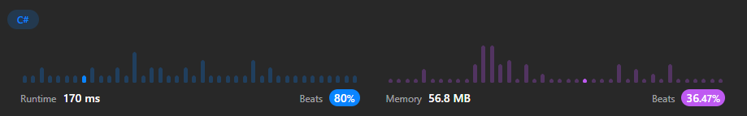

# C# and TypeScript Easy solution with Approach. ❇️✅

**Author:** ArafatSabbir
**Votes:** 1
**Link:** [https://leetcode.com/problems/add-to-array-form-of-integer/solutions/3189770/](https://leetcode.com/problems/add-to-array-form-of-integer/solutions/3189770/)

---

# Approach
1. We will use two pointers, one for num and other for k.
2. We will start from the end of the array and add the digits of num and k.
3. We will keep track of carry and add it to the sum.
4. We will add the sum to the result list.
5. We will reverse the result list and return it.


# Runtime & Memory



# Complexity
- Time complexity:
O(max(n, log k)), where n is the length of num, and k is the value of k.

- Space complexity:
O(max(n, log k)), the space used by the answer.

# C# Code
```
public class Solution 
{
    public IList<int> AddToArrayForm(int[] num, int k) 
    {
        var result = new List<int>();
        var carry = 0;
        var i = num.Length - 1;
        while (i >= 0 || k > 0)
        {
            var sum = carry;
            if (i >= 0)
            {
                sum += num[i];
                i--;
            }

            if (k > 0)
            {
                sum += k % 10;
                k /= 10;
            }

            result.Add(sum % 10);
            carry = sum / 10;
        }

        if (carry > 0)
        {
            result.Add(carry);
        }

        result.Reverse();
        return result;
    }
}
```

# TypeScript Code
```
function addToArrayForm(num: number[], k: number): number[] {
    let result = [];
    let carry = 0;
    let i = num.length - 1;
    while(i >= 0 || k > 0) {
        let sum = carry;
        if(i >= 0) {
            sum += num[i];
            i--;
        }
        if(k > 0) {
            sum += k % 10;
            k = Math.floor(k / 10);
        }
        result.push(sum % 10);
        carry = Math.floor(sum / 10);
    }
    if(carry > 0) {
        result.push(carry);
    }
    
    return result.reverse();
};
```
# Like\u2B06\uFE0F | Share\uD83C\uDFAF | Favourite\u2B50