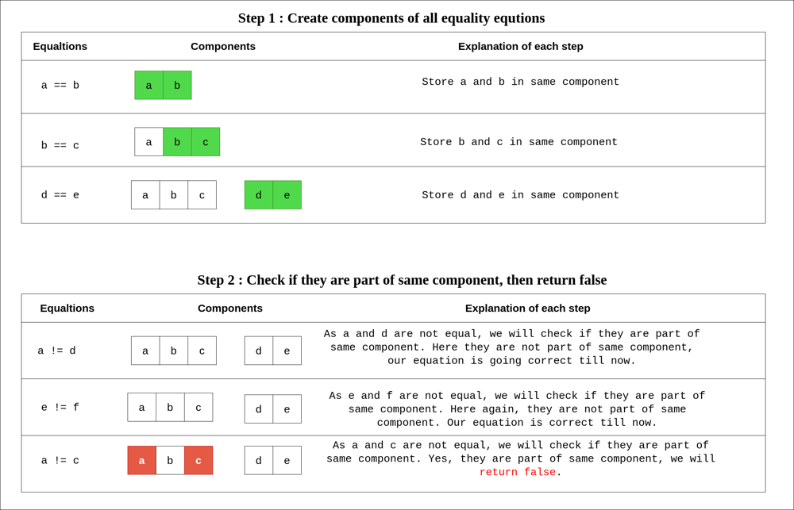
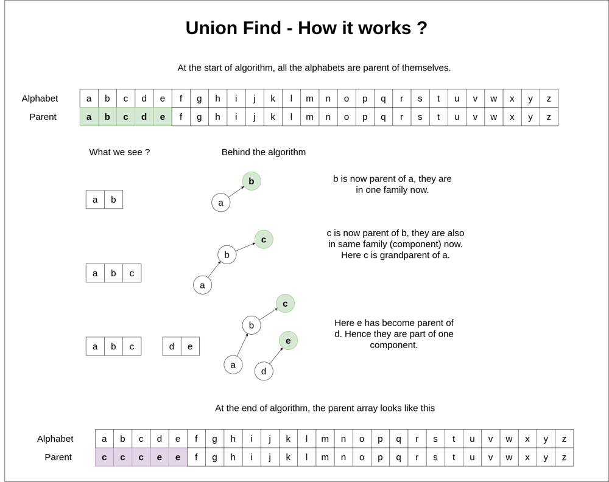

# C++ | Union Find | Related Problems

**Author:** kiranpalsingh1806
**Votes:** 238
**Link:** [https://leetcode.com/problems/satisfiability-of-equality-equations/solutions/2624959/](https://leetcode.com/problems/satisfiability-of-equality-equations/solutions/2624959/)

---

**Approach**
- We will store variables in same component if they are equal.
- Then we will check non-equality equtions, if both variables in any of those equation are in same component, we return false.

Let's take one example - `a==b`, `b==c`, `a!=d`, `d==e`, `e!=f`, `a!=c`.



**How Union Find works ?**




```cpp
class Solution {
    int uf[26];
    int find(int x) {
        return uf[x] == x ? x : (uf[x] = find(uf[x]));
    }
public:
    bool equationsPossible(vector<string>& equations) {
        for (int i = 0; i < 26; ++i) uf[i] = i;
        for (auto e : equations) {
            if (e[1] == '=') uf[find(e[0] - 'a')] = find(e[3] - 'a'); 
        }
        for (auto e : equations) {
            if (e[1] == '!' && find(e[0] - 'a') == find(e[3] - 'a')) return false;
        }
        return true;
    }
};
```

**Union Find (DSU) Related Problems**
[1. Smallest String With Swaps ](https://leetcode.com/problems/smallest-string-with-swaps/)
[2. Number of Good Paths ](https://leetcode.com/problems/number-of-good-paths/)
[3. Number of Islands ](https://leetcode.com/problems/number-of-islands/)
[4. Longest Consecutive Sequence ](https://leetcode.com/problems/longest-consecutive-sequence/)
[5. Number of Provinces ](https://leetcode.com/problems/number-of-provinces/)
[6. Redundant Connection ](https://leetcode.com/problems/redundant-connection/)
[7. Max Area of Island ](https://leetcode.com/problems/max-area-of-island/)
[8. Is Graph Bipartite? ](https://leetcode.com/problems/is-graph-bipartite/)
[9. Satisfiability of Equality Equations ](https://leetcode.com/problems/satisfiability-of-equality-equations/)