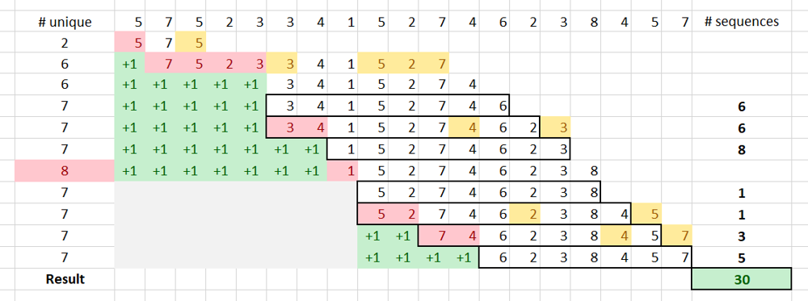

# Longest - Shortest

**Author:** votrubac
**Votes:** 533
**Link:** [https://leetcode.com/problems/subarrays-with-k-different-integers/solutions/235235/](https://leetcode.com/problems/subarrays-with-k-different-integers/solutions/235235/)

---

If the problem talks about continuous subarrays or substrings, the sliding window technique may help solve it in a linear time. Such problems are tricky, though the solution is simple once you get it. No wonder I am seeing such problems in almost every interview!

Here, we will take a look at [Subarrays with K Different Integers](https://leetcode.com/problems/subarrays-with-k-different-integers/) (LeetCode Hard), which appeared on LeetCode [weekly contest #123](https://leetcode.com/contest/weekly-contest-123). You can also master the sliding windows technique with these additional problems:
- [Longest Substring Without Repeating Characters](https://leetcode.com/problems/longest-substring-without-repeating-characters/)
- [Longest Substring with At Most Two Distinct Characters](https://leetcode.com/problems/longest-substring-with-at-most-two-distinct-characters/)
- [Longest Substring with At Most K Distinct Characters](https://leetcode.com/problems/longest-substring-with-at-most-k-distinct-characters/)
<!--# Problem Description
Given an array ```A``` of positive integers, call a (contiguous, not necessarily distinct) subarray of ```A``` good if the number of different integers in that subarray is exactly ```K```. For example, ```[1,2,3,1,2]``` has 3 different integers: 1, 2, and 3.

Return the number of good subarrays of ```A```.
### Example
**Input:** A = [1,2,1,2,3], K = 2
**Output:** 7
**Explanation:** Subarrays formed with exactly 2 different integers: [1,2], [2,1], [1,2], [2,3], [1,2,1], [2,1,2], [1,2,1,2].
# Coding Practice
Try solving this problem before moving on to the solutions. It is available on LeetCode Online Judge ([Subarrays with K Different Integers](https://leetcode.com/problems/subarrays-with-k-different-integers/)). Also, as you read through a solution, try implementing it yourself.

LeetCode is my favorite destinations for algorithmic problems. It has 987 problems and counting, with test cases to validate the correctness, as well as computational and memory complexity. There is also a large community discussing different approaches, tips and tricks.
# Brute-Force Solution
We can just iterate through each sub-array using two loops and count the good ones. For the inner loop, we use hash set to count unique numbers; if we the set size becomes larger than ```K```, we break from the inner loop.
```
int subarraysWithKDistinct(vector<int>& A, int K, int res = 0) {
  for (auto i = 0; i < A.size(); ++i) {
    unordered_set<int> s;
    for (auto j = i; j < A.size() && s.size() <= K; ++j) {
      s.insert(A[j]);
      if (s.size() == K) ++res;
    }
  }
  return res;
}
```
### Complexity Analysis
The time complexity of this solution is *O(n * n)*, where *n* is the length of ```A```. This solution is not accepted by the online judge.
-->
# Intuition
For numbers `l`, `m`, and `r` (`l <= m <= r`), such as:
- `[l, r]` is the longest subarray with `k` unique numbers, and
- `[m, r]` is the shortest subarray with `k` unique numbers,

there are `m - l + 1` good subarrays that end at `r`.

For example, for `k == 3` and array `[1, 2, 1, 2, 3]`, the longest subarray is `[0, 4]` and shortest - `[2, 4]`.  So, we have `2 - 0 + 1 == 3` good subarrays: `[1, 2, 1, 2, 3]`, `[2, 1, 2, 3]` and `[1, 2, 3]`.
# Linear Solution
We can iterate through the array and use three pointers for our sliding window (`[l, m, r]`). The back of the window is always the current position in the array (`r`). The middle of the window (`m`) is moved so that `nums[m]` appear only once in `[m, r]`.

This ensures that `[m, r]` is the shortest subarray with a given number of unique elements.

To do that, we keep tabs on how many times each number appears in our window (`cnt`). After we add next number to the back of our window, we try to move `m` as far as possible while maintaining the same number of unique elements.

If we collected `k` unique numbers, then we found `m - l + 1` good subarrays.

If our window reached `k + 1` unique numbers, we reduce set `cnt[nums[m]]` to zero (again, that number appears only at `nums[m]`), increment `m` and set `l = m + 1` (because we are starting a new sequence). This process is demonstrated step-by-step for the test case below; `m - l + 1` window is shown as `+1` in the green background.
```
[5,7,5,2,3,3,4,1,5,2,7,4,6,2,3,8,4,5,7]
7
```


**C++**
```cpp
int subarraysWithKDistinct(vector<int>& nums, int k) {
    int cnt[20001] = {}, res = 0, sz = nums.size();
    for (int l = 0, m = 0, r = 0; r < sz; ++r) {
        if (++cnt[nums[r]] == 1)
            if (--k < 0) {
                cnt[nums[m++]] = 0;
                l = m;
            }
        if (k <= 0) {
            while (cnt[nums[m]] > 1)
                --cnt[nums[m++]];
            res += m - l + 1;   
        }
    }
    return res;
} 
```
**Java**
```java
public int subarraysWithKDistinct(int[] nums, int k) {
    int res = 0, sz = nums.length;
    int[] cnt = new int[sz + 1];
    for (int l = 0, m = 0, r = 0; r < sz; ++r) {
        if (++cnt[nums[r]] == 1)
            if (--k < 0) {
                cnt[nums[m++]] = 0;
                l = m;
            }
        if (k <= 0) {
            while (cnt[nums[m]] > 1)
                --cnt[nums[m++]];
            res += m - l + 1;   
        }
    }    
    return res;
}
```
**Python 3**
```python
class Solution:
    def subarraysWithKDistinct(self, nums: List[int], k: int) -> int:
        cnt, res, l, m = [0] * (len(nums) + 1), 0, 0, 0
        for n in nums:
            cnt[n] += 1
            if cnt[n] == 1:
                k -= 1
                if (k < 0):
                    cnt[nums[m]] = 0
                    m += 1
                    l = m
            if k <= 0:
                while(cnt[nums[m]] > 1):
                    cnt[nums[m]] -= 1
                    m += 1
                res += m - l + 1
        return res
```
### Complexity Analysis
- Time Complexity: *O(n)*, where *n* is the length of ```A```.
- Space Complexity: *O(n)*.