# Simplified algorithm explained with visual example🔥 | C++ ✔| Java ✔|

**Author:** Recode_-1
**Votes:** 256
**Link:** [https://leetcode.com/problems/subarrays-with-k-different-integers/solutions/4944691/](https://leetcode.com/problems/subarrays-with-k-different-integers/solutions/4944691/)

---

Please Upvote if u like it \uD83D\uDE0A\uD83D\uDE3F


---

# Example
Let's take the following example
```
Input: nums = [1,2,1,2,3], k = 2
Output: 7

```
## let's try to solve it 

```
step 1
```
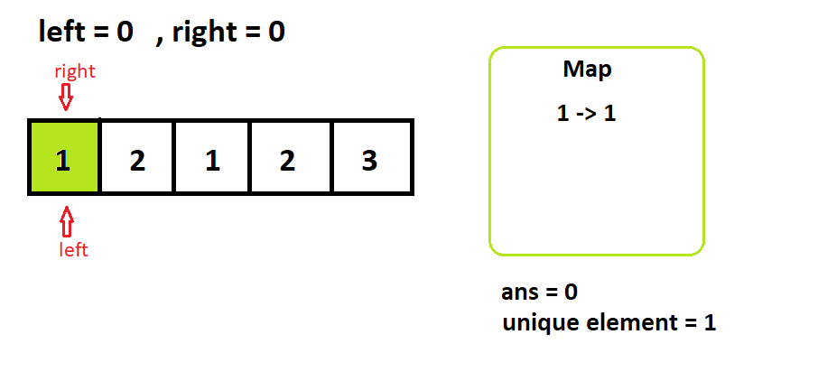
```
step 2
```
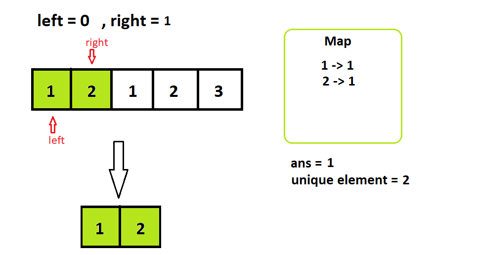
```
step 3
```
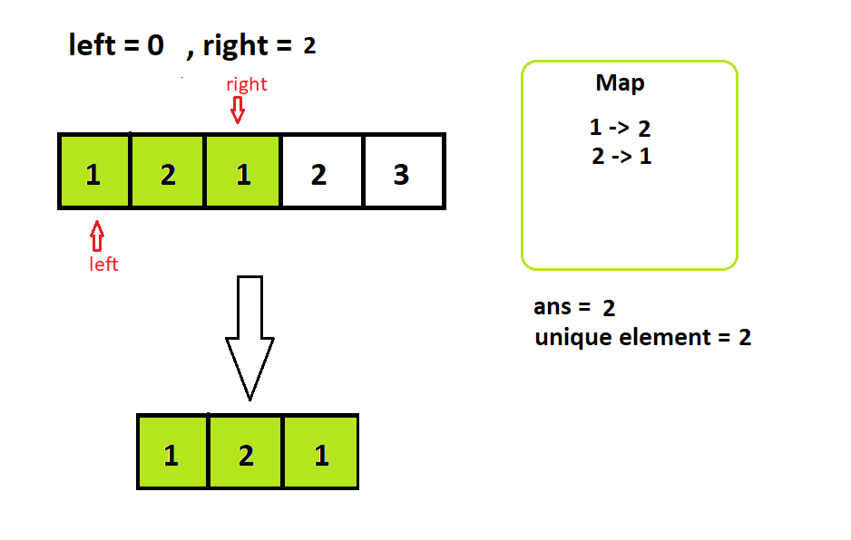
```
step4
```
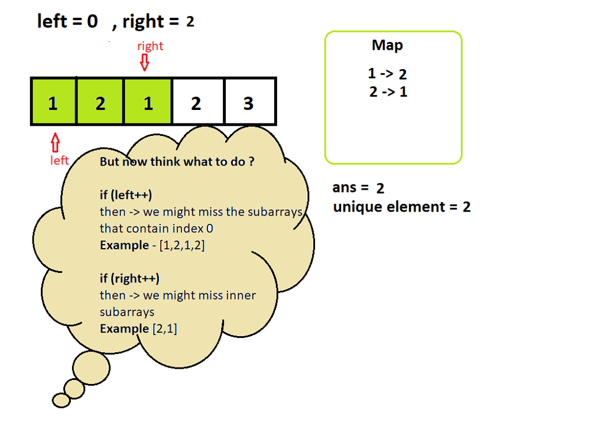

# Now Idea ?\uD83E\uDD14 (Actual Idea)
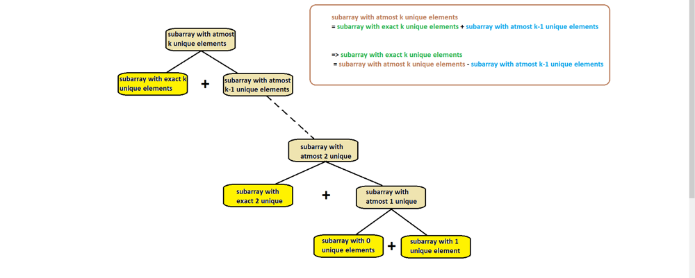

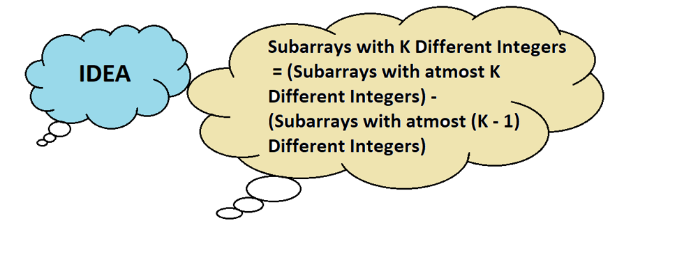


# Finding number of subarrays with atmost k unique elements (here  k=2) 

```
Step 1
```
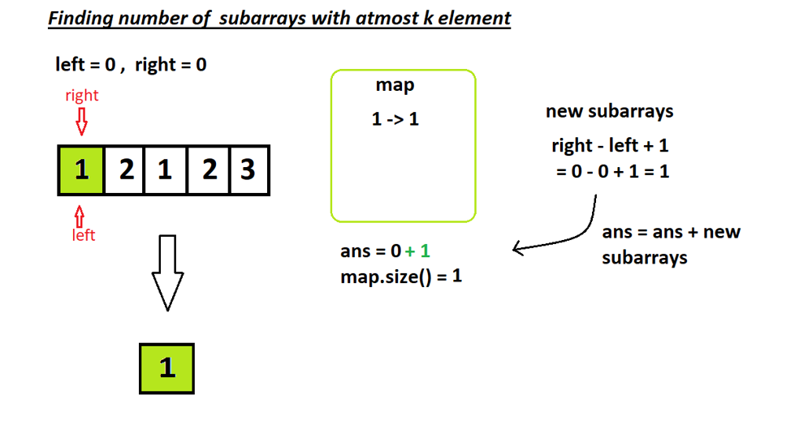
```
Step 2
```
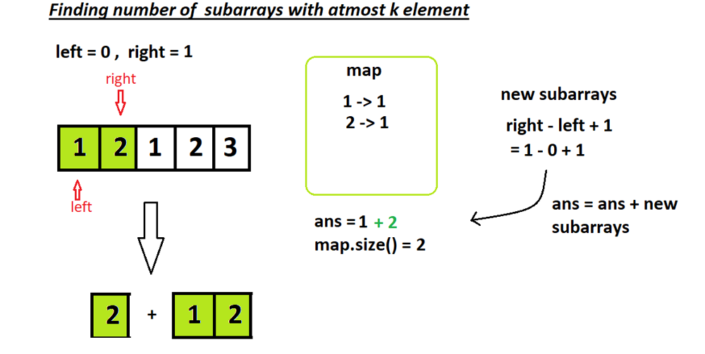
```
Step 3
```
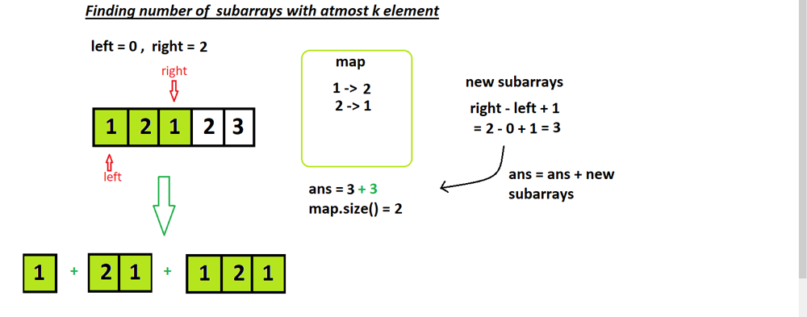
```
Step 4
```
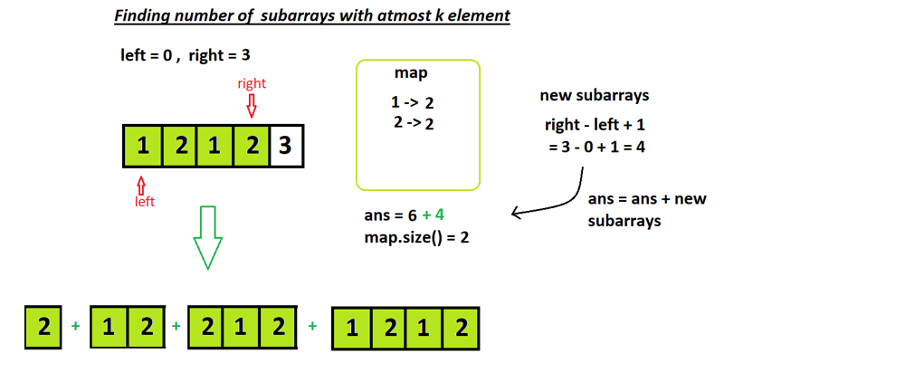

```
Step 5 (correction - left index = 1 , not 0)
```
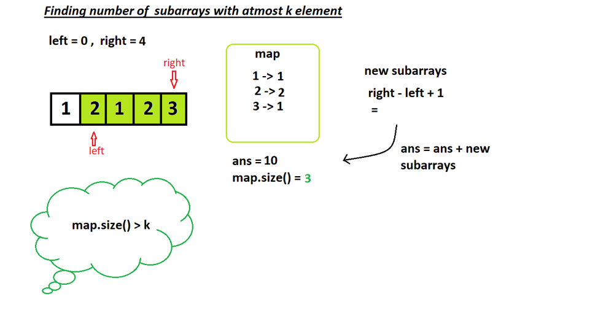
```
Step 6
```
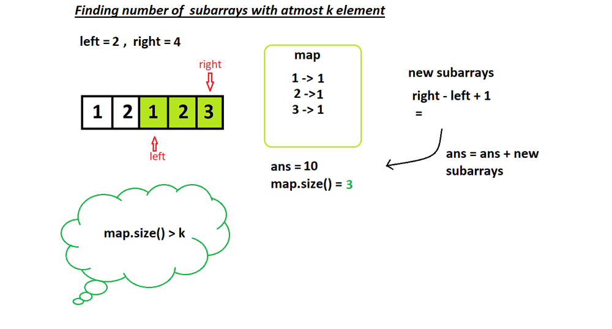
```
Step 7
```
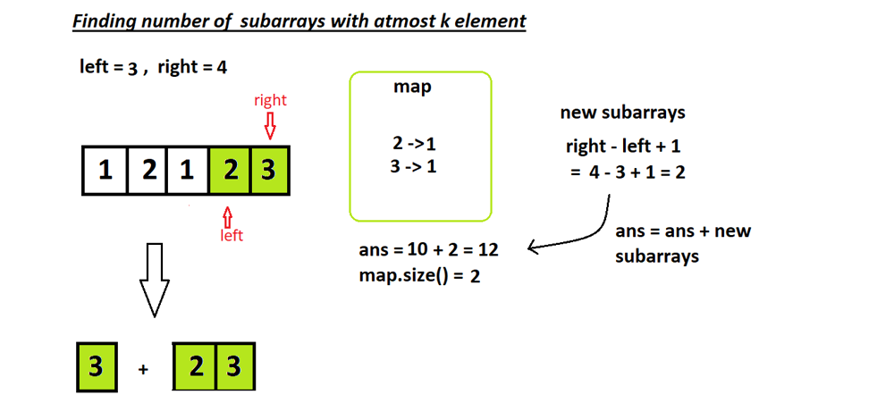

 

### Now in similar way we have to calculate  Finding number of subarrays with atmost (k-1) unique elements (which is 5 in this case )
### so 12 - 5 = 7 (that is the answer)

---


# Algorithm
1. **Overall Approach**:
   - The solution utilizes a sliding window technique to count the number of subarrays with exactly `k` distinct integers.

2. **Counting Subarrays with `k` Distinct Integers**:
   - The `subarraysWithKDistinct` function computes the difference between the count of subarrays with at most `k` distinct integers and the count of subarrays with at most `k-1` distinct integers.

3. **Counting Subarrays with At Most `k` Distinct Integers**:
   - The `subarray_with_atmost_k` helper function calculates the count of subarrays with at most `k` distinct integers.
   - It initializes a sliding window with `left` and `right` pointers.
   - It maintains a hashmap `map` to track the frequency of integers within the window.
   - The `right` pointer moves to the right, updating the frequency of the current element in `map`.
   - If the count of distinct integers exceeds `k`, the `left` pointer is adjusted to shrink the window until the count becomes at most `k`.
   - The size of each valid subarray ending at the current position (`right`) is added to the answer.

4. **Returning the Result**:
   - After computing the count of subarrays with exactly `k` distinct integers, the result is returned.


---


# Code in C++
```
class Solution {
public:
    int subarraysWithKDistinct(vector<int>& nums, int k) {
        int sub_with_max_element_k = subarray_with_atmost_k(nums,k);
        int reduced_sub_with_max_k = subarray_with_atmost_k(nums,k-1);
        return (sub_with_max_element_k - reduced_sub_with_max_k);
    }
    int subarray_with_atmost_k(vector<int>& nums,int k){
        unordered_map<int,int> map;
        int left = 0 , right = 0,ans = 0;
        while(right<nums.size()){
            map[nums[right]]++;
            while(map.size()>k){
                map[nums[left]]--;
                if(map[nums[left]]==0)map.erase(nums[left]);
                left++;
            }
            ans += right-left+1; // basically the size of subarray;
            right++;
        }
        return ans;
    }
};
```

---


# code in java
```
class Solution {
    public int subarraysWithKDistinct(int[] nums, int k) {
        int subWithMaxK = subarrayWithAtMostK(nums, k);
        int reducedSubWithMaxK = subarrayWithAtMostK(nums, k - 1);
        return subWithMaxK - reducedSubWithMaxK;
    }
    
    public int subarrayWithAtMostK(int[] nums, int k) {
        HashMap<Integer, Integer> map = new HashMap<>();
        int left = 0, right = 0, ans = 0;
        
        while (right < nums.length) {
            map.put(nums[right], map.getOrDefault(nums[right], 0) + 1);
            
            while (map.size() > k) {
                map.put(nums[left], map.get(nums[left]) - 1);
                if (map.get(nums[left]) == 0) {
                    map.remove(nums[left]);
                }
                left++;
            }
            
            ans += right - left + 1; // Size of subarray
            right++;
        }
        
        return ans;
    }
}
```