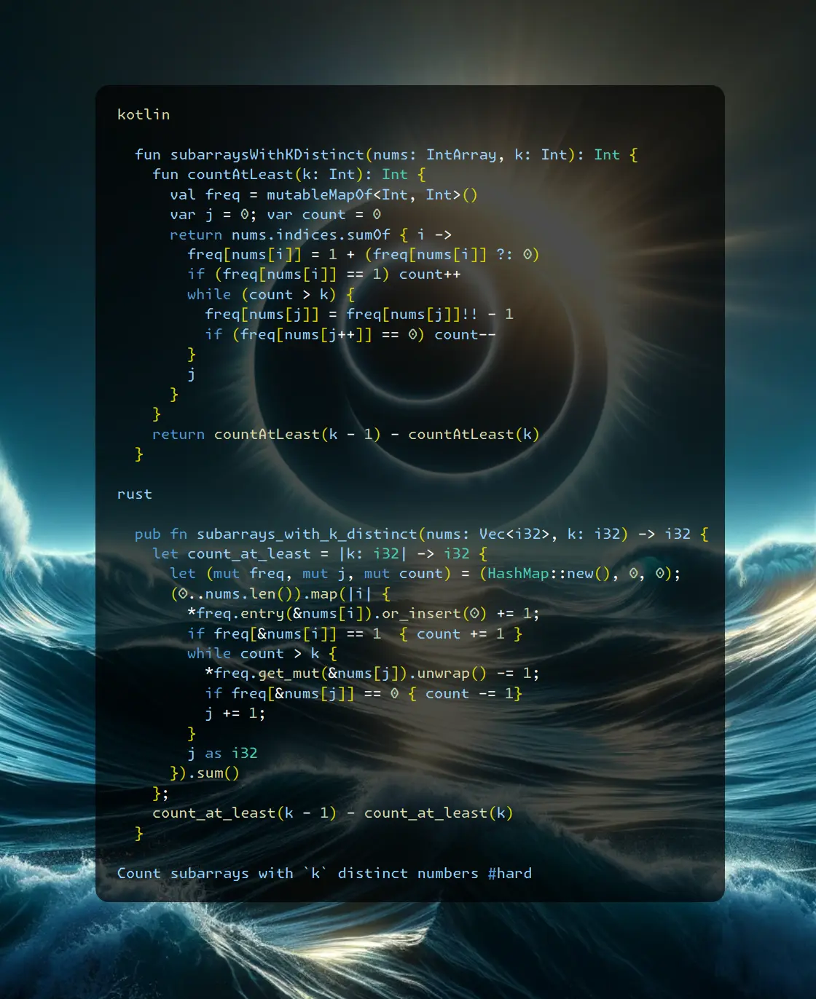

# Kotlin | Rust

**Author:** SamoylenkoDmitry
**Votes:** 1
**Link:** [https://leetcode.com/problems/subarrays-with-k-different-integers/solutions/4945526/](https://leetcode.com/problems/subarrays-with-k-different-integers/solutions/4945526/)

---



https://youtu.be/H1AQoy2hg38
#### Join me on Telegram

https://t.me/leetcode_daily_unstoppable/554

#### Problem TLDR

Count subarrays with `k` distinct numbers #hard

#### Intuition

We surely can count `at most k` numbers using sliding window technique: move the right pointer one step at a time, adjust the left pointer until condition met. All subarrays `start..k` where `start in 0..j` will have more or equal than `k` number of distincts if `j..k` have exatly `k` of them, so take `j` at each step.

To count exactly `k` we can remove subset of `at least k` from `at least k - 1`. (The trick here is that the number of `at least k - 1` is the bigger one)

#### Approach

Let's use a HashMap and some languages sugar:
* Kotlin: `sumOf`
* Rust: lambda to capture the parameters, `entry.or_insert`

#### Complexity

- Time complexity:
$$O(n)$$

- Space complexity:
$$O(k)$$, we have a frequencies stored in a map, can be up to `k`

#### Code

```kotlin []

  fun subarraysWithKDistinct(nums: IntArray, k: Int): Int {
    fun countAtLeast(k: Int): Int {
      val freq = mutableMapOf<Int, Int>()
      var j = 0; var count = 0
      return nums.indices.sumOf { i -> 
        freq[nums[i]] = 1 + (freq[nums[i]] ?: 0)
        if (freq[nums[i]] == 1) count++
        while (count > k) {
          freq[nums[j]] = freq[nums[j]]!! - 1
          if (freq[nums[j++]] == 0) count--
        }
        j
      }
    }
    return countAtLeast(k - 1) - countAtLeast(k)
  }

```
```rust []

  pub fn subarrays_with_k_distinct(nums: Vec<i32>, k: i32) -> i32 {
    let count_at_least = |k: i32| -> i32 {
      let (mut freq, mut j, mut count) = (HashMap::new(), 0, 0);
      (0..nums.len()).map(|i| {
        *freq.entry(&nums[i]).or_insert(0) += 1;
        if freq[&nums[i]] == 1  { count += 1 }
        while count > k {
          *freq.get_mut(&nums[j]).unwrap() -= 1;
          if freq[&nums[j]] == 0 { count -= 1}
          j += 1;
        }
        j as i32
      }).sum()
    };
    count_at_least(k - 1) - count_at_least(k)
  }

```