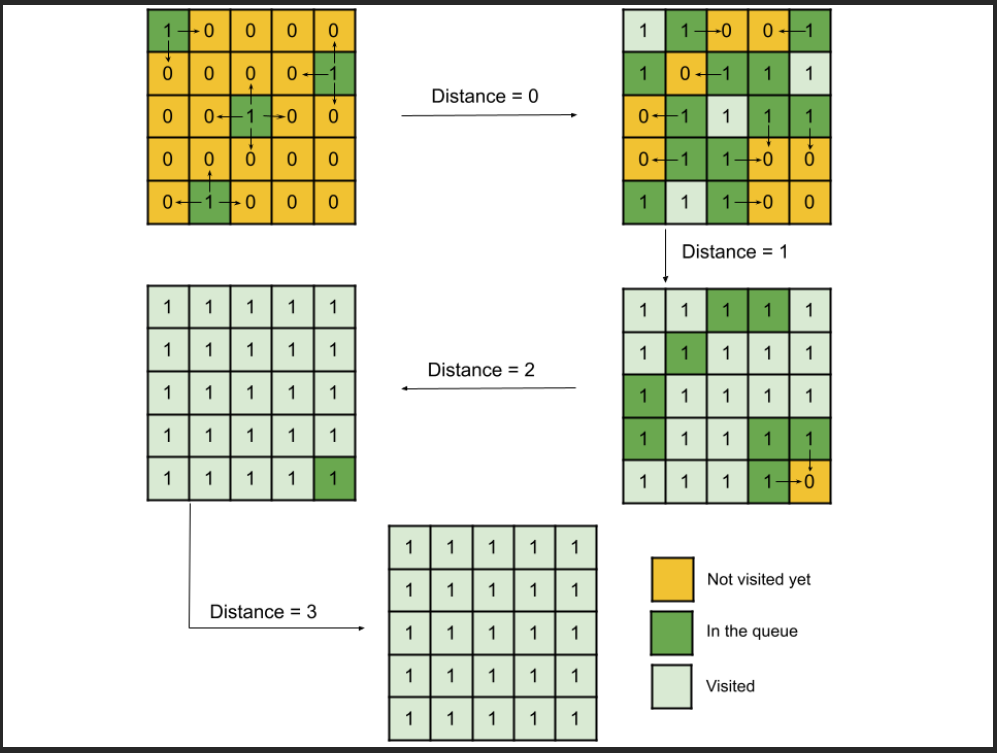

# C++ || BFS || Easiest Beginner Friendly Sol || O(n^2) time and O(n^2) space

**Author:** singhabhinash
**Votes:** 399
**Link:** [https://leetcode.com/problems/rotting-oranges/solutions/3166554/](https://leetcode.com/problems/rotting-oranges/solutions/3166554/)

---

# Intuition of this Problem:
Same type of bfs approach will work as shown in below picture.


<!-- Describe your first thoughts on how to solve this problem. -->
**NOTE - PLEASE READ APPROACH FIRST THEN SEE THE CODE. YOU WILL DEFINITELY UNDERSTAND THE CODE LINE BY LINE AFTER SEEING THE APPROACH.**

# Approach for this Problem:
1. Create a visited grid to store the state of the cell (fresh, rotten, or empty).
2. Initialize a queue to store the rotten oranges and count the number of fresh oranges.
3. Check if there are no fresh oranges, return 0, or if there are no rotten oranges, return -1.
4. Loop while the queue is not empty.
    - a. Store the size of the queue.
    - b. Loop through the size of the queue.
        - i. Get the front cell of the queue.
        - ii. Check all four directions of the cell to see if there are any fresh oranges.
        - iii. If there is a fresh orange, change its state to rotten and decrement the count of fresh oranges, and push the cell into the queue.
    - c. Increment the minutes.
1. If there are no fresh oranges, return the minutes.
2. If there are still fresh oranges, return -1.
<!-- Describe your approach to solving the problem. -->

# Humble Request:
- If my solution is helpful to you then please **UPVOTE** my solution, your **UPVOTE** motivates me to post such kind of solution.
- Please let me know in comments if there is need to do any improvement in my approach, code....anything.
- **Let's connect on** https://www.linkedin.com/in/abhinash-singh-1b851b188


# Code:
```C++ []
class Solution {
public:
    int orangesRotting(vector<vector<int>>& grid) {
        int m = grid.size();
        int n = grid[0].size();
        vector<vector<int>> visited = grid;
        //making queue in which we will fill rotten oranges
        queue<pair<int, int>> q;
        int countFreshOrange = 0;
        for (int i = 0; i < m; i++) {
            for (int j = 0; j < n; j++) {
                if (visited[i][j] == 2) {
                    q.push({i, j});
                }
                if (visited[i][j] == 1) {
                    countFreshOrange++;
                }
            }
        }
        //q.empty() means there is no rotten orange in the grid and countFreshOrange = 0 means we will rotten the freshoranges in 0 mins
        if (countFreshOrange == 0)
            return 0;
        if (q.empty())
            return -1;
        
        int minutes = -1;
        // we will cover four directions i.e. up, down, left, right
        vector<pair<int, int>> dirs = {{1, 0},{-1, 0},{0, -1},{0, 1}};
        while (!q.empty()) {
            int size = q.size();
            while (size--) {
                auto [x, y] = q.front();
                q.pop();
                for (auto [dx, dy] : dirs) {
                    int i = x + dx;
                    int j = y + dy;
                    if (i >= 0 && i < m && j >= 0 && j < n && visited[i][j] == 1) {
                        visited[i][j] = 2;
                        countFreshOrange--;
                        q.push({i, j});
                    }
                }
            }
            minutes++;
        }
        
        if (countFreshOrange == 0)
            return minutes;
        return -1;
    }
};
```
```Java []
class Solution {
    public int orangesRotting(int[][] grid) {
        int m = grid.length;
        int n = grid[0].length;
        int[][] visited = grid;
        Queue<int[]> q = new LinkedList<>();
        int countFreshOrange = 0;
        for (int i = 0; i < m; i++) {
            for (int j = 0; j < n; j++) {
                if (visited[i][j] == 2) {
                    q.offer(new int[] {i, j});
                }
                if (visited[i][j] == 1) {
                    countFreshOrange++;
                }
            }
        }
        if (countFreshOrange == 0)
            return 0;
        if (q.isEmpty())
            return -1;
        
        int minutes = -1;
        int[][] dirs = {{1, 0},{-1, 0},{0, -1},{0, 1}};
        while (!q.isEmpty()) {
            int size = q.size();
            while (size-- > 0) {
                int[] cell = q.poll();
                int x = cell[0];
                int y = cell[1];
                for (int[] dir : dirs) {
                    int i = x + dir[0];
                    int j = y + dir[1];
                    if (i >= 0 && i < m && j >= 0 && j < n && visited[i][j] == 1) {
                        visited[i][j] = 2;
                        countFreshOrange--;
                        q.offer(new int[] {i, j});
                    }
                }
            }
            minutes++;
        }
        
        if (countFreshOrange == 0)
            return minutes;
        return -1;
    }
}

```
```Python []
class Solution:
    def orangesRotting(self, grid: List[List[int]]) -> int:
        m, n = len(grid), len(grid[0])
        visited = grid
        q = collections.deque()
        countFreshOrange = 0
        for i in range(m):
            for j in range(n):
                if visited[i][j] == 2:
                    q.append((i, j))
                if visited[i][j] == 1:
                    countFreshOrange += 1
        if countFreshOrange == 0:
            return 0
        if not q:
            return -1
        
        minutes = -1
        dirs = [(1, 0), (-1, 0), (0, -1), (0, 1)]
        while q:
            size = len(q)
            while size > 0:
                x, y = q.popleft()
                size -= 1
                for dx, dy in dirs:
                    i, j = x + dx, y + dy
                    if 0 <= i < m and 0 <= j < n and visited[i][j] == 1:
                        visited[i][j] = 2
                        countFreshOrange -= 1
                        q.append((i, j))
            minutes += 1
        
        if countFreshOrange == 0:
            return minutes
        return -1

```

# Time Complexity and Space Complexity:
- Time complexity: **O(m*n)**
<!-- Add your time complexity here, e.g. $$O(n)$$ -->

- Space complexity: **O(m*n)**
<!-- Add your space complexity here, e.g. $$O(n)$$ -->

# Similar Pattern Problems:
1162. As Far from Land as Possible - https://leetcode.com/problems/as-far-from-land-as-possible/description/
317. Shortest Distance from All Buildings - https://leetcode.com/problems/shortest-distance-from-all-buildings/description/