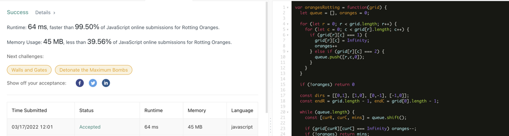

# JavaScript | Clean BFS w/ Explanation | 99.5%

**Author:** casmith1987
**Votes:** 42
**Link:** [https://leetcode.com/problems/rotting-oranges/solutions/1858396/](https://leetcode.com/problems/rotting-oranges/solutions/1858396/)

---



Version w/o Explanation: (Commented version below)
```
var orangesRotting = function(grid) {
  let queue = [], oranges = 0, time = 0;
  
  for (let r = 0; r < grid.length; r++) {
    for (let c = 0; c < grid[r].length; c++) {
      if (grid[r][c] === 1) oranges++
      else if (grid[r][c] === 2) queue.push([r,c,0]);
    }
  }
    
  const dirs = [[0,1], [1,0], [0,-1], [-1,0]];
  const endR = grid.length - 1, endC = grid[0].length - 1;
  
  while (queue.length && oranges) {
    const [curR, curC, mins] = queue.shift();
    
    if (grid[curR][curC] === 1) {
      grid[curR][curC] = 2;
      oranges--;
      time = mins;
    }

    for (let [addR, addC] of dirs) {
      const [newR, newC] = [curR + addR, curC + addC];
      if (newR < 0 || newR > endR || newC < 0 || newC > endC) continue;
      if (grid[newR][newC] === 1) {
        queue.push([newR, newC, mins + 1])
      }
    }
  }
  
  return oranges ? -1 : time;
};
```

Version w/ Explanation:
```
var orangesRotting = function(grid) {
  //Initialize queue for our BFS, Number of fresh oranges, and time to be returned.
  let queue = [], oranges = 0, time = 0;
  
  //Traverse matrix.  If we find a fresh orange, increment orange count.
  //If we find a rotten one, add it to the queue.
  for (let r = 0; r < grid.length; r++) {
    for (let c = 0; c < grid[r].length; c++) {
      if (grid[r][c] === 1) oranges++
      else if (grid[r][c] === 2) queue.push([r,c,0]);
    }
  }
    
  //Dirs will help us check neighbors during our BFS.  Adding these coordinates
  //to a point just gets right, left, up and down.  endR and endC are used later
  //to make sure neighbor coords are within grid.
  const dirs = [[0,1], [1,0], [0,-1], [-1,0]];
  const endR = grid.length - 1, endC = grid[0].length - 1;
  
  //Loop while queue is not empty and there are still fresh oranges.
  while (queue.length && oranges) {
  
	//Entry within queue can be destructured to make it easier to work with.
	//Each queue entry has a row, column and number of minutes taken for
	//infection to reach.
    const [curR, curC, mins] = queue.shift();
    
	//If orange is still fresh, we mark it as rotten, decrement our fresh oranges
	//count and set time to = mins.  Since we BFSing, the time it takes to infect
	//the last orange will be the time to infect all.  Once all oranges have
	//been infected, our orange count will = 0 and our condition in while loop
	//will stop the loop.  Time can then be returned.
    if (grid[curR][curC] === 1) {
      grid[curR][curC] = 2;
      oranges--;
      time = mins;
    }

    //Here's where our dir array above comes in handy.  We destructure
	//each entry and add it to our current to get neighbor coords below.
    for (let [addR, addC] of dirs) {
	
	  //Here we obtain our new or neighbor coordinates by adding currentRow
	  //and addRow of dir.  Same for col.
      const [newR, newC] = [curR + addR, curC + addC];
	  
	  //Here we check to make sure new coordinates lie within the grid.
      if (newR < 0 || newR > endR || newC < 0 || newC > endC) continue;
	  
	  //If neighbor coord is valid, and there is a fresh orange at those coordinates
	  //we push coordinates to our BFS to be infected next.  We also increment the
	  //mins count to track time taken to spread to that orange.
      if (grid[newR][newC] === 1) {
        queue.push([newR, newC, mins + 1])
      }
    }
  }
  
  //If we still have uninfected oranges, we return -1 because it won't spread
  //to all.  Otherwise, we simply return the time from initial infected to last
  //infected orange.
  return oranges ? -1 : time;
};
```
