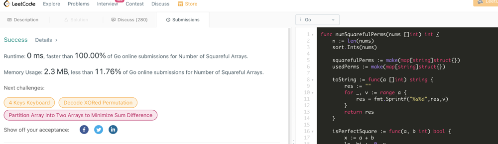

# Go. Backtracking. 0ms. Algorithm description

**Author:** sobik
**Votes:** 2
**Link:** [https://leetcode.com/problems/number-of-squareful-arrays/solutions/2433930/](https://leetcode.com/problems/number-of-squareful-arrays/solutions/2433930/)

---


## Algorithm
1. Define function isPerfectSquare that checks if sum of two ints is a perfect square. I used binary search for that since its faster than using standart Sqrt function
2. The idea of my approach is to build all possible permutations and count the number of perfect square permutation. 
3. We start from  an empty candidate for perfect square permutation. Iterativly add all not used numbers from nums. Keep tracking of used numbers. Example: We have nums = [1,2,3]. 
First iteration: []
Second: [1], [2], [3]
Third: [1, 2],  [1, 3], [2, 3], [2, 1],  [3, 1], [3, 2]
Fourth: [1, 2, 3], [1, 3, 2],  [2, 1, 3],  [2, 3, 1],  [3, 1, 2],  [3, 2, 1]
4. On last iteration we check if result permutation is perfect square permutation.
    But if we do this as I described using brute force we  get TLE. Few optimization should be introduced:
**Optimization #1**
Each time we add new element to permutation check if sum of this element and last element from permutation is perfect square. 
If no, stop proceeding with this permutation. This allows guarantee that if we get permutation with lenght = lenght of nums, then it is definitly perfectly squared permutation.
**Optimization #2**
Since there could be duplicates in nums, keep track of already handled permutation. I put each valid permutation to collection and each time I form new permutation, I check if it is already in collection. If yes, then I stop proceeding this permutation. This allows to avoid TLE on inputs like [2, 2, 2, 2, 2, 2, 2, 2, 2, 2, 2, 2], i.e, long array of similar numbers

Upvote if find it useful, please

## Implementation

```

func numSquarefulPerms(nums []int) int {
	n := len(nums)
	sort.Ints(nums)

	squarefulPermsCount := 0
	usedPerms := make(map[string]struct{})

	toString := func(a []int) string {
		res := ""
		for _, v := range a {
			res = fmt.Sprintf("%s%d",res,v)
		}
		return res
	}

	isUsed := func(a []int) bool {
		p := toString(a)
		_, ok := usedPerms[p]
		return ok	
	}

	markAsUsed := func(a []int) {
		p := toString(a)
		usedPerms[p] = struct{}{}	
	}

	isPerfectSquare := func(a, b int) bool {
		x := a + b
		lo, hi := 0, x
     	for lo <= hi {
        	mid := (lo + hi) / 2;
			if (mid * mid == x) {
				return true;
			} else if (mid * mid < x) {
				lo = mid + 1;
			} else {
				hi = mid - 1;
			}
    	}
    	return false;
	}

	var backtrack func ([]int, []byte)

	backtrack = func(a []int, u []byte) {
		if isUsed(a) { return }
		markAsUsed(a)
		l := len(a)
		if len(a) == n { 
			squarefulPermsCount += 1
			return
		} 
		for i, v := range(nums) {
			if u[i] == 1 { continue }
			if l > 0 && !isPerfectSquare(a[l-1], v) { continue }
			u[i] = 1
			a = append(a, v)
			backtrack(a, u)
			u[i] = 0
			a = a[:l]
		}		
	}

	backtrack([] int {}, make([]byte, n))
	return squarefulPermsCount
}

```