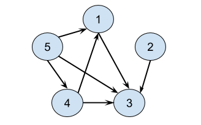

# Day 23 || Easiest Beginner Friendly Solution || O(n) time and O(n) space

**Author:** singhabhinash
**Votes:** 251
**Link:** [https://leetcode.com/problems/find-the-town-judge/solutions/3088104/](https://leetcode.com/problems/find-the-town-judge/solutions/3088104/)

---

# Intuition

**For example, with N = 5 and trust = [[1,3],[2,3],[4,3],[4,1],[5,3],[5,1],[5,4]], town judge will be 3.**

**In graph theory, we say the outdegree of a vertex (person) is the number of directed edges going out of it. For this graph, the outdegree of the vertex represents the number of other people that person trusts.**

**Likewise, we say that the indegree of a vertex (person) is the number of directed edges going into it. So here, it represents the number of people trusted by that person.**
SAME CONCEPT WE WILL USE BELOW
1. decrements the trust count of the first person in the pair. This is done because if the first person trusts the second person, it means that the first person does not trust themselves.
2. increments the trust count of the second person in the pair. This is done because if the first person trusts the second person, it means that the second person is trusted by the first person.
3. check if there is a person who is trusted by everyone except themselves (n-1 people) and if such person exists it returns the index of that person.
<!-- Describe your first thoughts on how to solve this problem. -->

# Approach
1. Initialize an empty array count of size n+1 to keep track of the number of people that trust or are trusted by a particular person.
2. Iterate through the trust array, for each pair of people, decrement the trust count of the first person and increment the trust count of the second person.
3. Iterate through the count array, for each person, check if their trust count is equal to n-1, if yes return that person's index, as that person is the judge.
4. If no such person is found, return -1 as no judge exists.
<!-- Describe your approach to solving the problem. -->

# Code
```C++ []
class Solution {
public:
    int findJudge(int n, vector<vector<int>> trust) {
        if (trust.size() == 0 && n == 1) 
            return 1;
        vector<int> count(n + 1);
        for (auto person : trust) {
            //count[person[0]]--; decrements the trust count of the first person in the pair. This is done because if the first person trusts the second person, it means that the first person does not trust themselves.
            count[person[0]]--;
            //count[person[1]]++; increments the trust count of the second person in the pair. This is done because if the first person trusts the second person, it means that the second person is trusted by the first person.
            count[person[1]]++;
        }

        for (int person = 0; person < count.size(); person++) {
            // check if there is a person who is trusted by everyone except themselves (n-1 people) and if such person exists it returns the index of that person.
            if (count[person] == n - 1) return person;
        }
        return -1;
    }
};
```
```Java []
class Solution {
    public int findJudge(int n, int[][] trust) {
        if (trust.length == 0 && n == 1) 
            return 1;
        int[] count = new int[n + 1];
        for (int[] person : trust) {
            count[person[0]]--;
            count[person[1]]++;
        }

        for (int person = 0; person < count.length; person++) {
            if (count[person] == n - 1) return person;
        }
        return -1;
    }
}

```
```Python []
class Solution:
    def findJudge(self, n: int, trust: List[List[int]]) -> int:
        if len(trust) == 0 and n == 1: 
            return 1
        count = [0] * (n + 1)
        for person in trust:
            count[person[0]] -= 1
            count[person[1]] += 1

        for person in range(len(count)):
            if count[person] == n - 1: return person
        return -1

```

# Complexity
- Time complexity: **O(n)** 

<!-- Add your time complexity here, e.g. $$O(n)$$ -->

- Space complexity: **O(n)**
<!-- Add your space complexity here, e.g. $$O(n)$$ -->