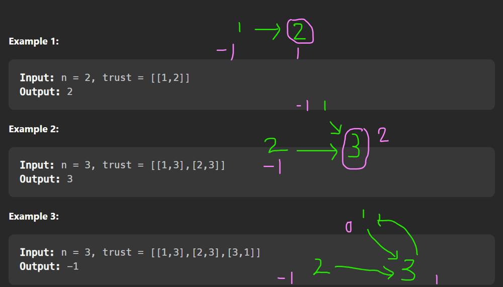

# Python/JS/Java/C++/Go O(n+t) by trust score.[w/ Visualization] 有中文解題影片

**Author:** brianchiang_tw
**Votes:** 37
**Link:** [https://leetcode.com/problems/find-the-town-judge/solutions/624254/](https://leetcode.com/problems/find-the-town-judge/solutions/624254/)

---

Python O(n+t) by trust score.

[Tutorial video in Chinese [ \u4E2D\u6587\u89E3\u984C\u5F71\u7247 ]](https://youtu.be/JVcmwA1TVTk)

[\u4E2D\u6587\u89E3\u984C\u6587\u7AE0](https://vocus.cc/article/65db069bfd89780001ed5e63)

Define trust score as the net counting of trusting by others.

If person_a trusts person_b, then

```
trust_score[ person_a ] -= 1
trust_score[ person_b ] += 1
```

Finally, **town judge** is the person who has **trust score == (n-1)**

---

**Visualziation**:
Green node: person id

Purple circle: town judge

Purple number: trust score



---
**Complexity analysis**

Time complexity:
O( n + T )
We have O(n) person scan loop, and O(T) edge scan loop.

Space complexity:
O(n)
We have a table, trust_score, for each person at most.


---

```
class Solution:
    def findJudge(self, N: int, trust: List[List[int]]) -> int:
        
        if N == 1:
            # Quick response for small case
            return 1
        
        # first cell is dummy, just for the convenience of indexing start from 1 to N
        trust_score = [ 0 for _ in range(N+1) ]
        
        for p1, p2 in trust:
            
            # decrease one point from p1 when p1 trusts other people
            trust_score[p1] -= 1
            
            # increase one point to p2 when p2 is trusted by others
            trust_score[p2] += 1
            
            
        
        for person in range(1, N+1):
            
            # town judge will be trusted by other N-1 people, and town judge trust nobody.
            if trust_score[person] == N-1:
                return person
        
        return -1
```

---

in **Java**:

<details>
	<summary> Expand to see source code</summary>

```
class Solution {
    public int findJudge(int n, int[][] trust) {
     
        if( 1 == n ){
            // Quick response on simple case
            return 1;
        }
        
        // first cell is dummy, just for the convenience of indexing start from 1 to N
        int[] score = new int[ (n+1) ];
        
        for( int[] pair : trust ){
            
            int a = pair[0], b = pair[1];
            
            // decrease one point from p1 when p1 trusts other people
            score[ a ] -= 1;
            
            // increase one point to p2 when p2 is trusted by others
            score[ b ] += 1;    
        }
        
        for( int i = 1 ; i <= n ; i++ ){
            
            // town judge will be trusted by other N-1 people, and town judge trust nobody.
            if( score[i] == n-1 ){
                return i;
            }
        }
        
        return -1;

    }
}
```

</details>


---

in **Javascript**:

<details>
	<summary> Expand to see source code</summary>

```
var findJudge = function(n, trust) {
    
    // Quick response for simple case
    if( 1 == n ){
        return 1;
    }
    
	// first cell is dummy, just for the convenience of indexing start from 1 to N
    trustScore = Array( n + 1 ).fill( 0 );
    
    for( const [p1, p2] of trust){
        
        // decrease one point from p1 when p1 trusts other people
        trustScore[p1] -= 1 ;
        
        // increase one point to p2 when p2 is trusted by others
        trustScore[p2] += 1;
    }
    
    
    for( let personID = 1 ; personID <= n ; personID++){
        
        // town judge will be trusted by other N-1 people, and town judge trust nobody.
        if( (n - 1) == trustScore[ personID] ){
            return personID;
        }
    }
    
    return -1;
    
};
```

</details>

---


in **C++**:

<details>
	<summary> Expand to see source code</summary>

```
class Solution {
public:
    int findJudge(int n, vector<vector<int>>& trust) {
        
        // Quick response for simple case
        if( 1 == n ){
            return 1;
        }
        
        // first cell is dummy, just for the convenience of indexing start from 1 to N
        vector< int > trustScore(n+1);
        
        // General cases:
        for( auto trustVector : trust){
            
            int p1 = trustVector[0], p2 = trustVector[1];
            
			// decrease one point from p1 when p1 trusts other people
            trustScore[ p1 ] -= 1;
			
			// increase one point to p2 when p2 is trusted by others
            trustScore[ p2 ] += 1;
        }
        
        for( int personID = 1 ; personID <= n ; personID++ ){
            
			// town judge will be trusted by other N-1 people, and town judge trust nobody.
            if( (n - 1) == trustScore[personID]  ){
                return personID;
            }
        }
        
        return -1;
    }
};
```

</details>

---


in **Go**:

<details>
	<summary> Expand to see source code</summary>

```
func findJudge(n int, trust [][]int) int {
    
    // Quick response on simple case
    if 1 == n {
        return 1
    }
    
    // first cell is dummy, just for the convenience of indexing start from 1 to N
    trustScore := make( []int, n+1)
    
    // General cases:
    for _, trustVector := range trust{
        
        p1 := trustVector[0]
        p2 := trustVector[1]
        
        // decrease one point from p1 when p1 trusts other people
        trustScore[ p1 ] -= 1
        
        // increase one point to p2 when p2 is trusted by others
        trustScore[ p2 ] += 1
    }
    
    for personID := 1 ; personID <= n ; personID++{
        
        // town judge will be trusted by other N-1 people, and town judge trust nobody.
        if ( n - 1 ) == trustScore[ personID ]{
            return personID
        }
    }
    
    return -1
}
```

</details>
