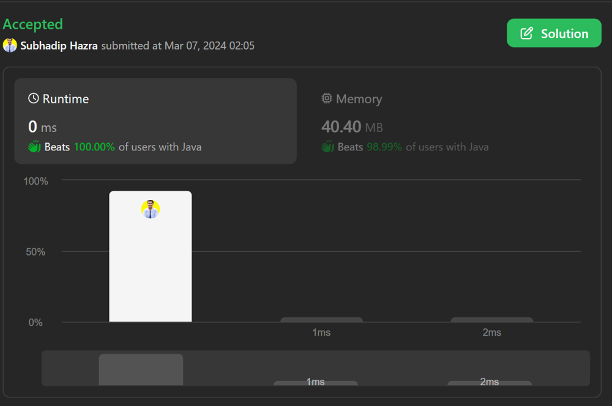

# BEST SOLUTION 😘|| ⚡100% RUNTIME && ✅ 99 % MEMORY || 😁SIMPLE || 🤤WITH EXPLANATION ||😎 JAVA && JS

**Author:** IamHazra
**Votes:** 9
**Link:** [https://leetcode.com/problems/available-captures-for-rook/solutions/4834326/](https://leetcode.com/problems/available-captures-for-rook/solutions/4834326/)

---




# Intuition
The problem involves finding the number of pawns that a rook can capture on a chessboard. To solve this, we need to check the row and column of the rook's position in all four directions: up, down, left, and right.

# Approach
1. Iterate through the chessboard to find the position of the rook ('R').
2. For each direction (up, down, left, right), check if there is a pawn ('p') that the rook can capture. If there is, increment the count.
3. If there is a bishop ('B') blocking the path in any direction, stop checking in that direction.

# Complexity
- Time complexity: O(n), where n is the number of cells in the chessboard (assuming a constant board size of 8x8).
- Space complexity: O(1), as we are using a constant amount of extra space regardless of the input size.

# Code
```javascript []
/**
 * @param {character[][]} board
 * @return {number}
 */
var numRookCaptures = function(board) {
    let count = 0;
    for(let i=0;i<board.length;i++){
        for(let j=0;j<board[0].length;j++){
            if(board[i][j] == 'R'){
                    count += upCheck(i,j,board) ? 1 : 0;
                    count += downCheck(i,j,board) ? 1 : 0;
                    count += rightCheck(i,j,board) ? 1 : 0;
                    count += leftCheck(i,j,board) ? 1: 0;
                }
            }
        }
        return count;
    };
    var upCheck = function(m,n,board){
        for(let i=m;i>=0;i--){
            if(board[i][n] == 'p') {
                return true;
            }
            else if(board[i][n] == 'B'){
                return false;
            }
        }
        return false;
    };
    var downCheck = function(m,n,board){
        for(let i=m;i<8;i++){
            if(board[i][n] == 'p') {
                return true;
            }
            else if(board[i][n] == 'B'){
                return false;
            }
        }
        return false;
    };var leftCheck = function(m,n,board){
        for(let i=n;i>=0;i--){
            if(board[m][i] == 'p') {
                return true;
            }
            else if(board[m][i] == 'B'){
                return false;
            }
        }
        return false;
    };var rightCheck = function(m,n,board){
        for(let i=n;i<8;i++){
            if(board[m][i] == 'p') {
                return true;
            }
            else if(board[m][i] == 'B'){
                return false;
            }
        }
        return false;
    };
```
```Java []
class Solution {
    public int numRookCaptures(char[][] board) {
        int count = 0;
        for(int i = 0; i < board.length; i++) {
            for(int j = 0; j < board[0].length; j++) {
                if(board[i][j] == 'R') {
                    count += upCheck(i, j, board) ? 1 : 0;
                    count += downCheck(i, j, board) ? 1 : 0;
                    count += rightCheck(i, j, board) ? 1 : 0;
                    count += leftCheck(i, j, board) ? 1 : 0;
                }
            }
        }
        return count;
    }
    
    public static boolean upCheck(int m, int n, char[][] board) {
        for(int i = m; i >= 0; i--) {
            if(board[i][n] == 'p') {
                return true;
            } else if(board[i][n] == 'B') {
                return false;
            }
        }
        return false;
    }
    
    public static boolean downCheck(int m, int n, char[][] board) {
        for(int i = m; i < 8; i++) {
            if(board[i][n] == 'p') {
                return true;
            } else if(board[i][n] == 'B') {
                return false;
            }
        }
        return false;
    }
    
    public static boolean leftCheck(int m, int n, char[][] board) {
        for(int i = n; i >= 0; i--) {
            if(board[m][i] == 'p') {
                return true;
            } else if(board[m][i] == 'B') {
                return false;
            }
        }
        return false;
    }
    
    public static boolean rightCheck(int m, int n, char[][] board) {
        for(int i = n; i < 8; i++) {
            if(board[m][i] == 'p') {
                return true;
            } else if(board[m][i] == 'B') {
                return false;
            }
        }
        return false;
    }
}
```
PLEASE UPVOTE ME IF IT'S USEFUL \u2B06\u2B06\u2B06
HAPPY CODING \uD83D\uDE0E\uD83D\uDE0E\uD83D\uDE0E !!

