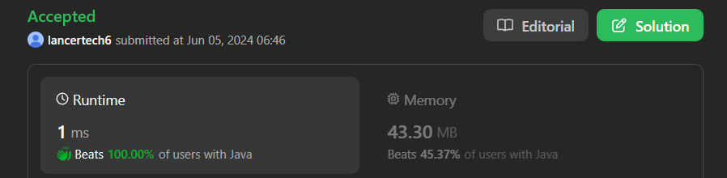

# ✅Beats 100% - Explained with [ Video ] - C++/Java/Python/JS - Frequency - Strings

**Author:** lancertech6
**Votes:** 224
**Link:** [https://leetcode.com/problems/find-common-characters/solutions/5260842/](https://leetcode.com/problems/find-common-characters/solutions/5260842/)

---



# YouTube Video Explanation:

<!-- **If you want a video for this question please write in the comments** -->

<!-- https://www.youtube.com/watch?v=ujU-jeO1v-k -->

https://youtu.be/gEE5YPQ7pkw

**\uD83D\uDD25 Please like, share, and subscribe to support our channel's mission of making complex concepts easy to understand.**

Subscribe Link: https://www.youtube.com/@leetlogics/?sub_confirmation=1

*Subscribe Goal: 1800 Subscribers*
*Current Subscribers: 1791*

---

# Intuition
<!-- Describe your first thoughts on how to solve this problem. -->
The problem requires finding common characters that appear in all strings within the array, including duplicates. The approach leverages frequency counting for each character in the alphabet (from 'a' to 'z'). By comparing the character frequencies across all words, we can identify which characters appear in all the words and how many times they appear.

# Approach
<!-- Describe your approach to solving the problem. -->
1. **Initialize Frequency Array:**
   - Start by counting the frequency of each character in the first word. This will be our reference frequency array.

2. **Update Frequency Array:**
   - For each subsequent word, count the frequency of each character.
   - Update the reference frequency array to keep only the minimum frequency of each character seen so far. This ensures that the reference frequency array will ultimately represent the characters that are common to all words and the minimum number of times they appear in any word.

3. **Build Result:**
   - Iterate through the reference frequency array.
   - For each character that has a non-zero frequency, add it to the result list the number of times it appears in the reference frequency array.


# Step-by-Step Explanation

Let's use the example input: `words = ["bella", "label", "roller"]`

### Step 1: Initialize Frequency Array

First, count the frequency of each character in the first word `"bella"`.

| Character | Frequency |
|-----------|-----------|
| a         | 1         |
| b         | 1         |
| e         | 1         |
| l         | 2         |
| -         | 0         | (other characters)

### Step 2: Update Frequency Array with Each Subsequent Word

#### Word 2: `"label"`

Count the frequency of each character in `"label"`:

| Character | Frequency |
|-----------|-----------|
| a         | 1         |
| b         | 1         |
| e         | 1         |
| l         | 2         |
| -         | 0         | (other characters)

Take the minimum frequency of each character between `"bella"` and `"label"`:

| Character | Frequency in "bella" | Frequency in "label" | Updated Frequency |
|-----------|-----------------------|----------------------|-------------------|
| a         | 1                     | 1                    | 1                 |
| b         | 1                     | 1                    | 1                 |
| e         | 1                     | 1                    | 1                 |
| l         | 2                     | 2                    | 2                 |
| -         | 0                     | 0                    | 0                 | (other characters)

#### Word 3: `"roller"`

Count the frequency of each character in `"roller"`:

| Character | Frequency |
|-----------|-----------|
| e         | 1         |
| l         | 2         |
| o         | 1         |
| r         | 2         |
| -         | 0         | (other characters)

Update the frequency array again by taking the minimum:

| Character | Frequency in "label" | Frequency in "roller" | Updated Frequency |
|-----------|-----------------------|-----------------------|-------------------|
| a         | 1                     | 0                     | 0                 |
| b         | 1                     | 0                     | 0                 |
| e         | 1                     | 1                     | 1                 |
| l         | 2                     | 2                     | 2                 |
| -         | 0                     | 0                     | 0                 | (other characters)

### Step 3: Build Result

From the final frequency array, build the result list:

| Character | Frequency | Result List        |
|-----------|-----------|--------------------|
| e         | 1         | ["e"]              |
| l         | 2         | ["e", "l", "l"]    |
| -         | 0         |                    | (other characters)

### Final Result

The common characters that show up in all strings within the array are `["e", "l", "l"]`.

### Summary Table

Here\u2019s a summary of the frequency count after processing each word:

| Character | Initial ("bella") | After "label" | After "roller" |
|-----------|--------------------|---------------|----------------|
| a         | 1                  | 1             | 0              |
| b         | 1                  | 1             | 0              |
| e         | 1                  | 1             | 1              |
| l         | 2                  | 2             | 2              |
| o         | 0                  | 0             | 0              |
| r         | 0                  | 0             | 0              |
| -         | 0                  | 0             | 0              |


# Complexity
- **Time Complexity:**
  - Counting characters in each word: O(n * m), where `n` is the number of words and `m` is the average length of the words.
  - Updating the reference frequency array: O(n * 26), since we compare 26 possible characters for each word.
  - Constructing the result list: O(26), iterating through the frequency array to build the result.
  - Overall, the time complexity is O(n * m), where `n` is the number of words and `m` is the length of the longest word.

- **Space Complexity:**
  - The space required for the frequency arrays is O(26) for each word.
  - Additional space for the result list depends on the number of common characters, which is O(m) in the worst case (though typically much smaller).
  - Overall, the space complexity is O(26) + O(m) = O(m).


# Code
```java []
import java.util.*;

class Solution {
    public List<String> commonChars(String[] words) {
        // Count characters in the first word
        int[] last = count(words[0]);
        
        // Update the count array by intersecting with each subsequent word
        for (int i = 1; i < words.length; i++) {
            last = intersection(last, count(words[i]));
        }
        
        // Build the result list based on the final count array
        List<String> arr = new ArrayList<>();
        for (int i = 0; i < 26; i++) {
            if (last[i] != 0) {
                char a = (char) ('a' + i);
                String s = String.valueOf(a);
                while (last[i] > 0) {
                    arr.add(s);
                    last[i]--;
                }
            }
        }
        return arr;
    }

    // Calculate the intersection of two count arrays
    private int[] intersection(int[] a, int[] b) {
        int[] t = new int[26];
        for (int i = 0; i < 26; i++) {
            t[i] = Math.min(a[i], b[i]);
        }
        return t;
    }

    // Count the frequency of each character in a word
    private int[] count(String str) {
        int[] t = new int[26];
        for (char c : str.toCharArray()) {
            t[c - 'a']++;
        }
        return t;
    }
}

```
``` C++ []
class Solution {
public:
    vector<string> commonChars(vector<string>& words) {
        vector<int> last = count(words[0]);
        for (int i = 1; i < words.size(); i++) {
            last = intersection(last, count(words[i]));
        }
        
        vector<string> result;
        for (int i = 0; i < 26; i++) {
            while (last[i] > 0) {
                result.push_back(string(1, 'a' + i));
                last[i]--;
            }
        }
        
        return result;
    }
    
private:
    vector<int> count(const string& str) {
        vector<int> frequency(26, 0);
        for (char c : str) {
            frequency[c - 'a']++;
        }
        return frequency;
    }
    
    vector<int> intersection(const vector<int>& a, const vector<int>& b) {
        vector<int> t(26, 0);
        for (int i = 0; i < 26; i++) {
            t[i] = min(a[i], b[i]);
        }
        return t;
    }
};
```
```Python []
class Solution(object):
    def count(self, word):
        frequency = [0] * 26
        for char in word:
            frequency[ord(char) - ord('a')] += 1
        return frequency

    def intersection(self, freq1, freq2):
        return [min(f1, f2) for f1, f2 in zip(freq1, freq2)]

    def commonChars(self, words):
        # Initialize the frequency array with the count of the first word
        last = self.count(words[0])
        
        # Update the frequency array by taking intersections with counts of remaining words
        for word in words[1:]:
            last = self.intersection(last, self.count(word))
        
        # Construct the result list
        result = []
        for i in range(26):
            result.extend([chr(i + ord('a'))] * last[i])
        
        return result
```
```JavaScript []
var count = function(word) {
    const frequency = Array(26).fill(0);
    for (let char of word) {
        frequency[char.charCodeAt(0) - 'a'.charCodeAt(0)]++;
    }
    return frequency;
}

var intersection = function(freq1, freq2) {
    return freq1.map((f1, idx) => Math.min(f1, freq2[idx]));
}

var commonChars = function(words) {
    let last = count(words[0]);
    for (let i = 1; i < words.length; i++) {
        last = intersection(last, count(words[i]));
    }
    
    const result = [];
    for (let i = 0; i < 26; i++) {
        while (last[i] > 0) {
            result.push(String.fromCharCode(i + 'a'.charCodeAt(0)));
            last[i]--;
        }
    }
    
    return result;
}
```

