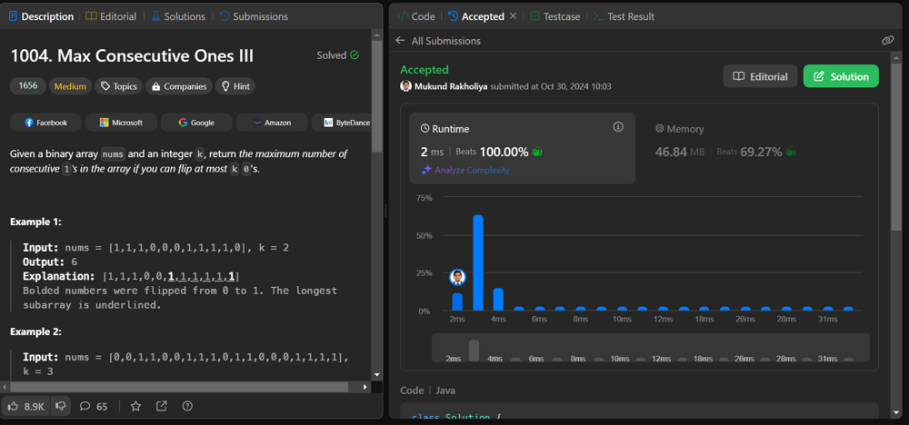

# ✅🔥 EASIEST || 💯🔥 BEATS PROOF || 🧑‍💻✨ MUTIPLE LANG || 🌟🧑‍🎓 BEGINNER FRIENDLY

**Author:** mukund_rakholiya
**Votes:** 5
**Link:** [https://leetcode.com/problems/max-consecutive-ones-iii/solutions/5985017/](https://leetcode.com/problems/max-consecutive-ones-iii/solutions/5985017/)

---



```
```

# \uD83C\uDF1F Intuition
<!-- Describe your first thoughts on how to solve this problem. -->
**The goal is to maximize the length of consecutive 1's by flipping at most k zeros. The problem can be solved by maintaining a window that expands to include as many 1's as possible while allowing at most k zero flips.**

```
```
# \uD83C\uDF1F Approach
<!-- Describe your approach to solving the problem. -->
1. **Use a sliding window approach to expand the window by moving the `right` pointer across `nums`.**

2. **If the current number is `0`, decrease `k` by `1`, representing a flip.**

3. **If `k` becomes negative (indicating more than `k` zero flips in the window), shrink the window from the left by moving the `left` pointer to regain valid `k`.**
    - **If ``nums[left]`` is `0`, increment `k` because this zero is now outside the window.**

4. **Keep track of the maximum window size, calculated as ``right - left + 1.``**
# \uD83C\uDF1F Complexity
- Time complexity:
<!-- Add your time complexity here, e.g. $$O(n)$$ -->
**`O(n)`, where `n` is the length of nums. Each element is processed once by the `right` pointer and at most once by the `left` pointer.**
- Space complexity:
<!-- Add your space complexity here, e.g. $$O(n)$$ -->
**`O(1)`, as no additional space is used except for variables.**
```
```

# \uD83C\uDF1F Code
```java []
class Solution {
    public int longestOnes(int[] nums, int k) {
        int left = 0, n = nums.length, right;

        for (right = 0; right < n; right++) {
            if (nums[right] == 0)
                k -= 1;
            
            if (k < 0) {
                if (nums[left] == 0)
                    k += 1;
                
                left += 1;
            }
        }

        return right - left;
    }
}
```
```Python []
class Solution(object):
    def longestOnes(self, nums, k):
        left = 0

        for right in range(len(nums)):
            if nums[right] == 0:
                k -= 1
            
            if k < 0:
                if nums[left] == 0:
                    k += 1
                
                left += 1
        
        return right - left + 1
```
```C++ []
class Solution {
public:
    int longestOnes(vector<int>& nums, int k) {
        int left = 0;
        int right;

        for (right = 0; right < nums.size(); right++) {
            if (nums[right] == 0) {
                k--;
            }

            if (k < 0) {
                if (nums[left] == 0) {
                    k++;
                }
                left++;
            }
        }
        return right - left;
    }
};

```
```C# []
public class Solution {
    public int LongestOnes(int[] nums, int k) {
        int left = 0;
        int right;

        for (right = 0; right < nums.Length; right++) {
            if (nums[right] == 0) {
                k--;
            }

            if (k < 0) {
                if (nums[left] == 0) {
                    k++;
                }
                left++;
            }
        }
        return right - left;
    }
}
```
```Kotlin []
class Solution {
    fun longestOnes(nums: IntArray, k: Int): Int {
        var left = 0
        var k = k

        for (right in nums.indices) {
            if (nums[right] == 0) {
                k--
            }

            if (k < 0) {
                if (nums[left] == 0) {
                    k++
                }
                left++
            }
        }
        return nums.size - left
    }
}

```
```Python3 []
class Solution:
    def longestOnes(self, nums: List[int], k: int) -> int:
        left = 0

        for right in range(len(nums)):
            if nums[right] == 0:
                k -= 1
            
            if k < 0:
                if nums[left] == 0:
                    k += 1
                
                left += 1
        
        return right - left + 1
```


```
```


