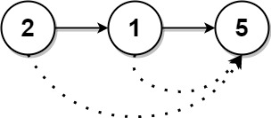

# [1019. Next Greater Node In Linked List](https://leetcode.com/problems/next-greater-node-in-linked-list/)

| Category | Difficulty | Likes | Dislikes |
| :------: | :--------: | :---: | :------: |
| Algorithms | Medium | 3501 | 126 |

**Tags:** [`array`](https://leetcode.com/tag/array), [`linked-list`](https://leetcode.com/tag/linked-list), [`stack`](https://leetcode.com/tag/stack), [`monotonic-stack`](https://leetcode.com/tag/monotonic-stack)

**Companies:** `amazon`, `microsoft`

## Description

You are given the `head` of a linked list with `n` nodes.

For each node in the list, find the value of the **next greater node**. That is, for each node, find the value of the first node that is next to it and has a **strictly larger** value than it.

Return an integer array `answer` where `answer[i]` is the value of the next greater node of the `i^th` node (**1-indexed**). If the `i^th` node does not have a next greater node, set `answer[i] = 0`.

 

**Example 1:**


```

Input: head = [2,1,5]
Output: [5,5,0]

```

**Example 2:**


```

Input: head = [2,7,4,3,5]
Output: [7,0,5,5,0]

```

 

**Constraints:**

	- The number of nodes in the list is `n`.

	- `1 <= n <= 10^4`

	- `1 <= Node.val <= 10^9`

---

**Links:** [Submissions](https://leetcode.com/problems/next-greater-node-in-linked-list/) | [Solutions](https://leetcode.com/problems/next-greater-node-in-linked-list/)
