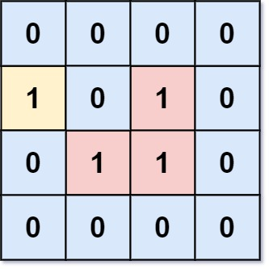
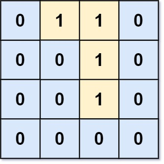

# [1020. Number of Enclaves](https://leetcode.com/problems/number-of-enclaves/)

| Category | Difficulty | Likes | Dislikes |
| :------: | :--------: | :---: | :------: |
| Algorithms | Medium | 4533 | 88 |

**Tags:** [`array`](https://leetcode.com/tag/array), [`depth-first-search`](https://leetcode.com/tag/depth-first-search), [`breadth-first-search`](https://leetcode.com/tag/breadth-first-search), [`union-find`](https://leetcode.com/tag/union-find), [`matrix`](https://leetcode.com/tag/matrix)

**Companies:** `microsoft`, `google`

## Description

You are given an `m x n` binary matrix `grid`, where `0` represents a sea cell and `1` represents a land cell.

A **move** consists of walking from one land cell to another adjacent (**4-directionally**) land cell or walking off the boundary of the `grid`.

Return *the number of land cells in* `grid` *for which we cannot walk off the boundary of the grid in any number of **moves***.

 

**Example 1:**


```

Input: grid = [[0,0,0,0],[1,0,1,0],[0,1,1,0],[0,0,0,0]]
Output: 3
Explanation: There are three 1s that are enclosed by 0s, and one 1 that is not enclosed because its on the boundary.

```

**Example 2:**


```

Input: grid = [[0,1,1,0],[0,0,1,0],[0,0,1,0],[0,0,0,0]]
Output: 0
Explanation: All 1s are either on the boundary or can reach the boundary.

```

 

**Constraints:**

	- `m == grid.length`

	- `n == grid[i].length`

	- `1 <= m, n <= 500`

	- `grid[i][j]` is either `0` or `1`.

---

**Links:** [Submissions](https://leetcode.com/problems/number-of-enclaves/) | [Solutions](https://leetcode.com/problems/number-of-enclaves/)
