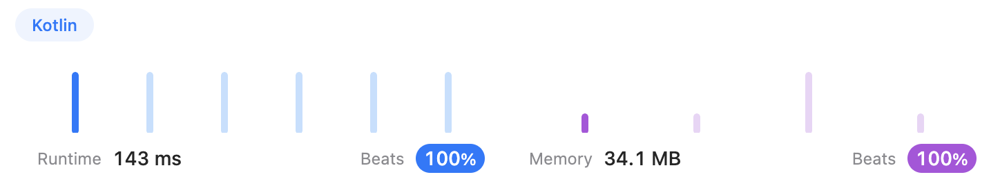

# Kotlin, without sorting

**Author:** 3AKOH
**Votes:** 1
**Link:** [https://leetcode.com/problems/video-stitching/solutions/3128979/](https://leetcode.com/problems/video-stitching/solutions/3128979/)

---

# Intuition

<!-- Describe your first thoughts on how to solve this problem. -->
# Approach
<!-- Describe your approach to solving the problem. -->
# Complexity
- Time complexity:
<!-- Add your time complexity here, e.g. $$O(n)$$ -->

- Space complexity:
<!-- Add your space complexity here, e.g. $$O(n)$$ -->

# Code
```
import kotlin.math.max

class Solution {
    fun videoStitching(clips: Array<IntArray>, time: Int): Int {
        val cTime = mutableMapOf<Int, Int>()

        for ((s, e) in clips) {
            val clip = cTime[s]
            if (clip != null) cTime[s] = max(clip, e)
            else cTime[s] = e
        }

        var result = 0
        var i = 0

        while (i < time) {
            val possPicks = cTime.filter { (k ,v) -> i in k until v }
            if (possPicks.isEmpty()) return -1
            var j = 0
            possPicks.forEach { (_, v) -> if (v - i > j) j = v - i }
            i += j
            result++
        }
        return result
    }
}
```
