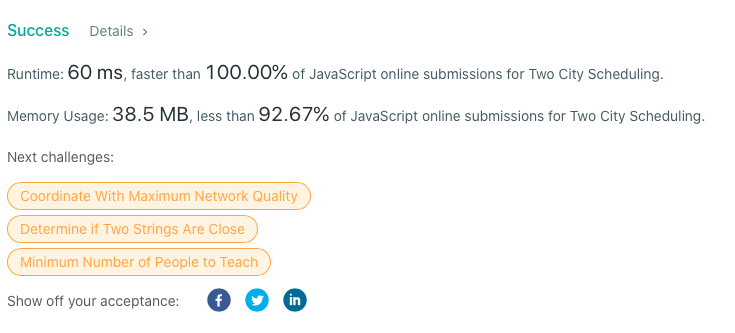

# Concise 100% faster JS , Custom Sort

**Author:** mp3393
**Votes:** 9
**Link:** [https://leetcode.com/problems/two-city-scheduling/solutions/1199974/](https://leetcode.com/problems/two-city-scheduling/solutions/1199974/)

---


```
const twoCitySchedCost = function(costs) {
    let sortedByCostDiff = costs.sort((a,b)=>a[0]-a[1]-(b[0]-b[1]));
    let cost = 0;
    let halfway = sortedByCostDiff.length/2;
    
    for(let i = 0; i < halfway; i++){   
          cost+=sortedByCostDiff[i][0]+sortedByCostDiff[halfway+i][1];
    }
    
    return cost;
};
```

