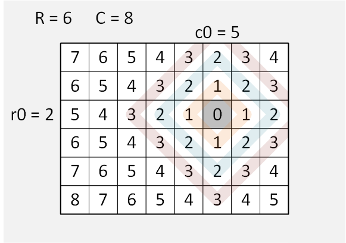

# Java | 2ms 100% O(max_dist^2) | Equal distance diamond patterns | No sorting | Explanation

**Author:** dudeandcat
**Votes:** 16
**Link:** [https://leetcode.com/problems/matrix-cells-in-distance-order/solutions/1094639/](https://leetcode.com/problems/matrix-cells-in-distance-order/solutions/1094639/)

---

This code will usually run in 3ms, but about 1/3th of my submits will run in 2ms.

Cells at equal distance from the start point r0,c0 will form concentric nested diamond-shaped paths of cells in the matrix, as seen in the diagram below.  This code follows the four sides of these diamond-shaped paths, adding valid cells' row and column to the result.  Then move to the next outward diamond-shape path which will have a distance value of one more than the previous inner diamond-shape path.  

In the diagram below, the digits within the grid represent the distance of each cell from the r0,c0 start cell.  The colored diamond-shapes are paths through cells of equal distance.  Some of the larger diamond-shaped paths are not shown in the diagram because the full pattern became too hard on my eyes.




The order for processing the sides of the diamond-shapes, and the direction of processing the side, is listed below as a series of paths between vertices of a diamond-shape:
` ` ` ` ` ` ` ` ` `top to left
` ` ` ` ` ` ` ` ` `left to bottom
` ` ` ` ` ` ` ` ` `bottom to right
` ` ` ` ` ` ` ` ` `right to top
Each side of the diamond-shaped path has its own section within the code below.

Please upvote if useful.
```
class Solution {
    public int[][] allCellsDistOrder(int R, int C, int r0, int c0) {
        int[][] result = new int[R * C][];
        result[0] = new int[] {r0, c0};            // Add start point r0,c0 which has distance 0.
        int resultIdx = 1;
        int lim = Math.max( r0, R-r0-1 ) + Math.max( c0, C-c0-1 );
		                                           // lim is highest distance value.
        for (int dist = 1; dist <= lim; dist++) {  // Process 'lim' diamond-shapes having distance 'dist'.
            int r = r0 - dist;
            int c = c0;
            // Diamond side: Top Left
            for (int count = dist; count > 0; count--) {    
                if (r >= 0 && c >= 0)  result[resultIdx++] = new int[] {r, c};
                r++;
                c--;
            }
            
            // Diamond side: Left Bottom
            for (int count = dist; count > 0; count--) {
                if (r < R && c >= 0)  result[resultIdx++] = new int[] {r, c};
                r++;
                c++;
            }
            
            // Diamond side: Bottom Right
            for (int count = dist; count > 0; count--) {
                if (r < R && c < C)  result[resultIdx++] = new int[] {r, c};
                r--;
                c++;
            }
            
            // Diamond side: Right Top
            for (int count = dist; count > 0; count--) {
                if (r >= 0 && c < C)  result[resultIdx++] = new int[] {r, c};
                r--;
                c--;
            }
        }
        return result;
    }
}
```