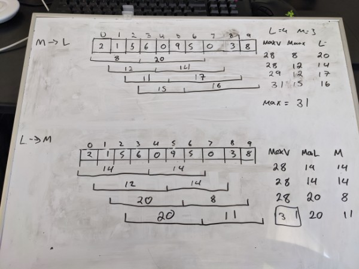

# Easy Step by step solution with whiteboard pictures O(N)

**Author:** Davidcalle3141
**Votes:** 4
**Link:** [https://leetcode.com/problems/maximum-sum-of-two-non-overlapping-subarrays/solutions/882633/](https://leetcode.com/problems/maximum-sum-of-two-non-overlapping-subarrays/solutions/882633/)

---

```
/*
* Really tricky problem but not too hard once you see the method
* here is how I see it lets say you have the following array
*       [2 , 1 , 5 , 6 , 0 , 9 , 5 , 0 , 3 , 8] with L = 3 M 2
* now lets look for our answer when M comes before L we will need to iterate the array like this
*       [2 , 1 , 5 , 6 , 0 , 9 , 5 , 0 , 3 ]
*       [   M  ][    L     ]
*           [   M   ][     L   ]
*               [   M  ][    L   ] 
*                   [   M  ][    L   ]
*                      [   M  ][    L   ] 
* 
*   where we keep track of the MMax and at every iteration we sum up the mMax and the current L and keep track of the maxValue
*   the reasoning behind this is that since the arrays cant intercept mMax will keep track of greatest value of M before our current L
* 
* once we do it one way we now run the algorithm with M and L reversed 
* 
* */
fun maxSumTwoNoOverlap(A: IntArray, L: Int, M: Int): Int {
    val pfsArr = Array(A.size){0}
    /*
    * We first create a prefix sum array it helps us find the sum between ranges with just a look up
    * */
    A.forEachIndexed { i, value ->
        if(i == 0) pfsArr[i] = value
        else{
            pfsArr[i] = pfsArr[i-1]+value
        }
    }
    //we call our getMaxVal twice once with M leading and once with M behind
    return Math.max(getMaxVal(pfsArr, M , L), getMaxVal(pfsArr, L, M))

}

fun getMaxVal(pfsArray: Array<Int>, leftSize:Int, rightSize:Int):Int{
    val totalLength = leftSize + rightSize
    var maxLeft = 0
    var rightVal = 0
    var maxVal = 0
    for(index in leftSize + rightSize - 1 until pfsArray.size){
        //keep track of the maxLeft value 
        maxLeft = Math.max(maxLeft, getRangePfs(pfsArray, index - (totalLength - 1), index - rightSize))
        // our current rightValue 
        rightVal = getRangePfs(pfsArray, index - (rightSize - 1), index)
        maxVal = Math.max(maxVal, maxLeft+rightVal)
    }
    return maxVal
}

//Helper function to get the sum between ranges 
fun getRangePfs(pfsArray: Array<Int>, start: Int, end:Int): Int {
    if(start == 0) return pfsArray[end]
    return pfsArray[end] - pfsArray[start - 1]
}

//PS. In an interview draw it out its really easy to mess up indexes but its much easier to figure them our when you can see them
```


