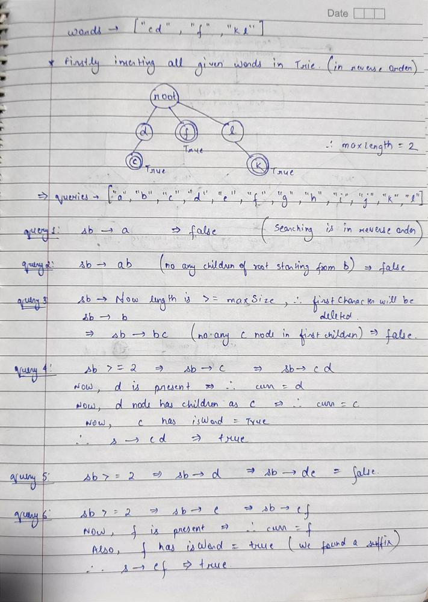
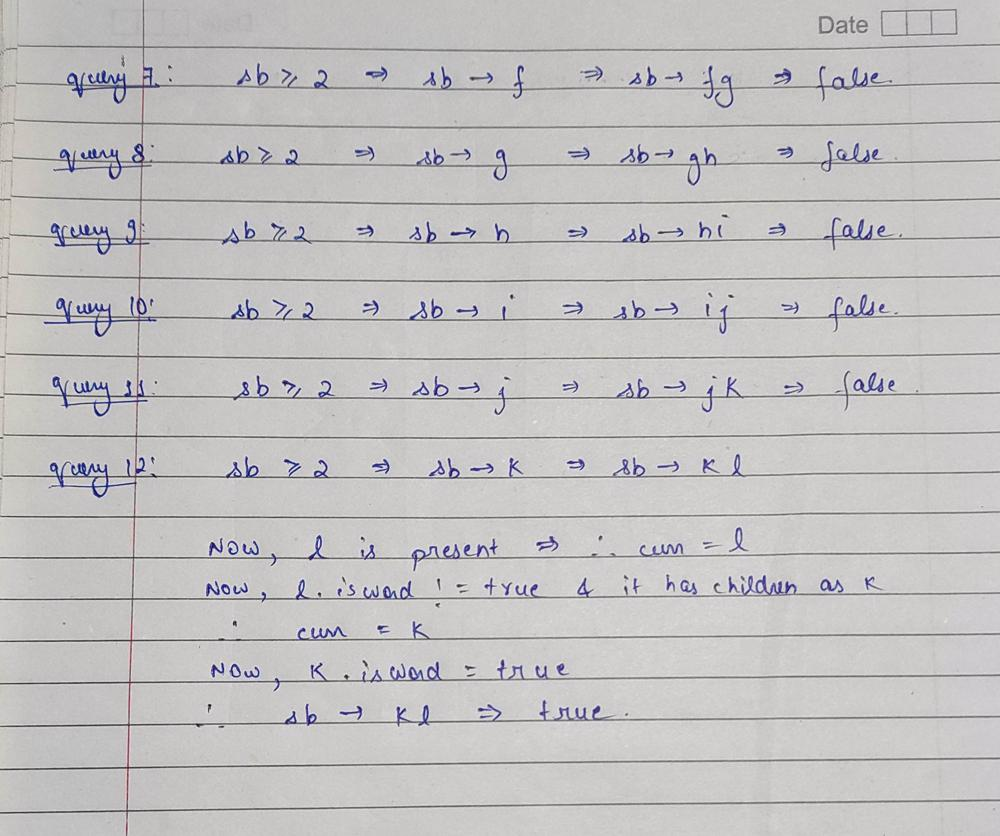

# JAVA Simple Solution | Trie | Detailed Explanation Using Image

**Author:** Chaitanya1706
**Votes:** 48
**Link:** [https://leetcode.com/problems/stream-of-characters/solutions/1610403/](https://leetcode.com/problems/stream-of-characters/solutions/1610403/)

---

**Intution:** We gonna use trie data structure to store the given words for easy searching. So firstly store all the given words in Trie but the catch here is that store every word in **reverse order** because you have to search for prefix every time so u don't have to search full trie from starting to just find last few characters.
After filling trie now using query function read the next coming letter and append it to your StringBuilder and check for the current String/stream if it is present in trie or not.
** One more important thing here is that Don't just keep adding letters in your StringBuilder....find the **maxLength** from given words array and don't let the size of StringBuider increase more than that...otherwise it will give you TLE due to memory out of space problem as StringBuilder will keep growing otherwise.






```
class StreamChecker {

    class TrieNode{
        boolean isWord;
        TrieNode children[] = new TrieNode[26];
    }
    
    TrieNode root = new TrieNode();
    int maxSize;
    StringBuilder sb = new StringBuilder();
    
    public StreamChecker(String[] words) {
        insert(words);
    }
    
    public boolean query(char letter) {
        if(sb.length()>=maxSize){
            sb.deleteCharAt(0);
        }
        sb.append(letter);
        TrieNode curr = root;
        
        for(int i=sb.length()-1;i>=0;i--){
            char ch = sb.charAt(i);
            
            if(curr!=null) curr = curr.children[ch-'a'];
            
            if(curr!=null && curr.isWord) return true;
        }
        return false;
    }
    
    public void insert(String[] words){
        
        for(String s : words){
            maxSize = Math.max(maxSize,s.length());
            TrieNode curr = root;
            for(int i = s.length()-1;i>=0;i--){
                char ch = s.charAt(i);
                if(curr.children[ch-'a']==null){
                    curr.children[ch-'a'] = new TrieNode();
                }
                curr = curr.children[ch-'a'];
            }
            curr.isWord = true;
        }
    }
}
```

I hope this helped u in uderstanding this question...Thanks!!