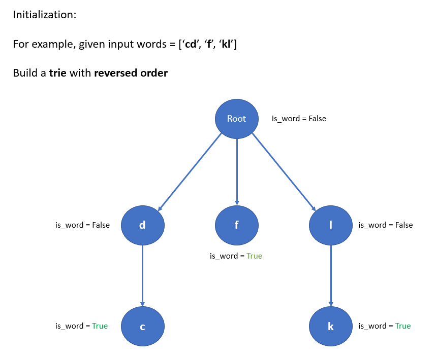
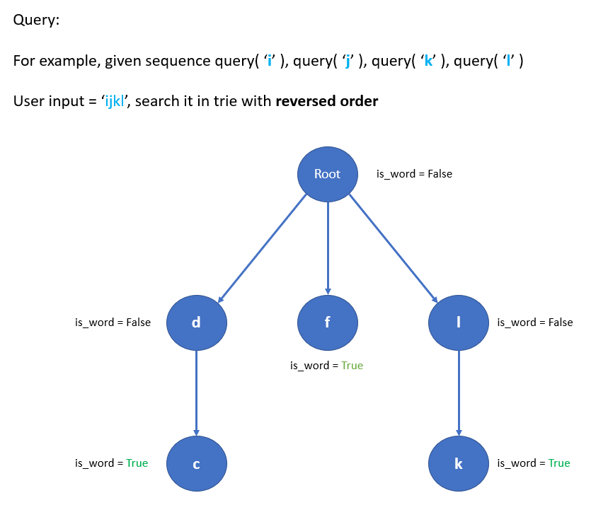
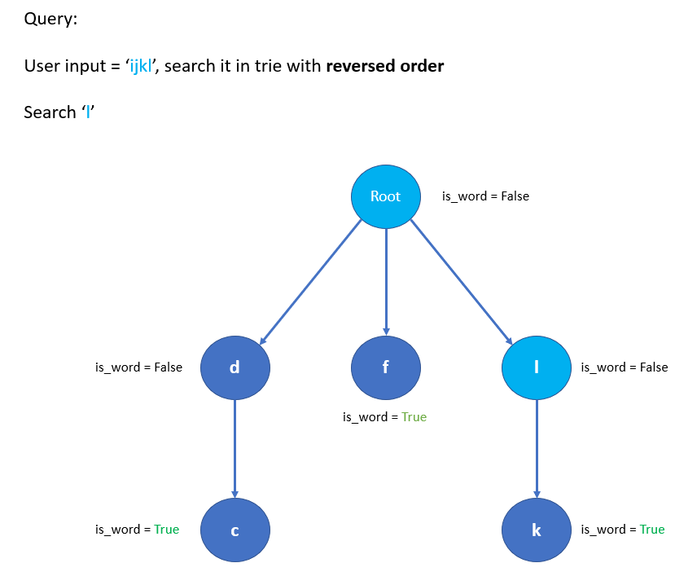
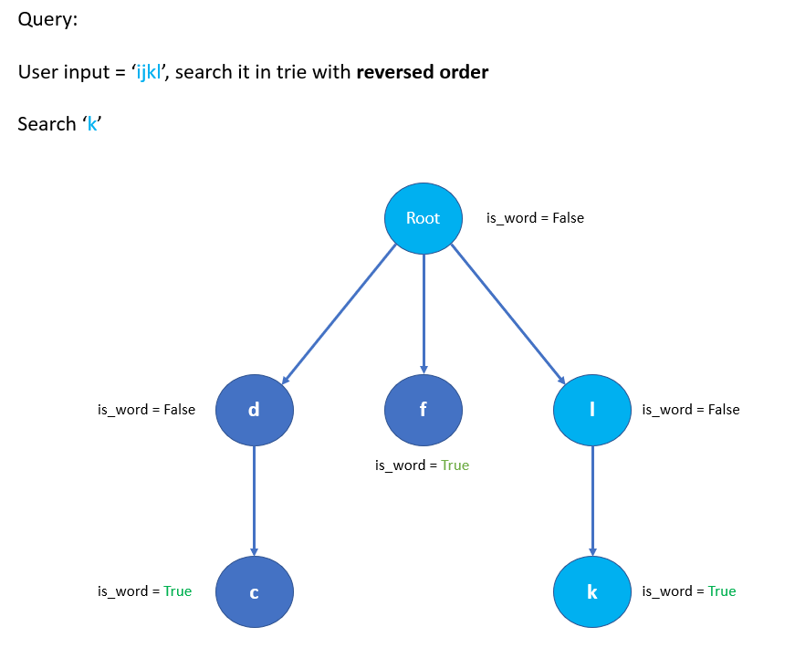
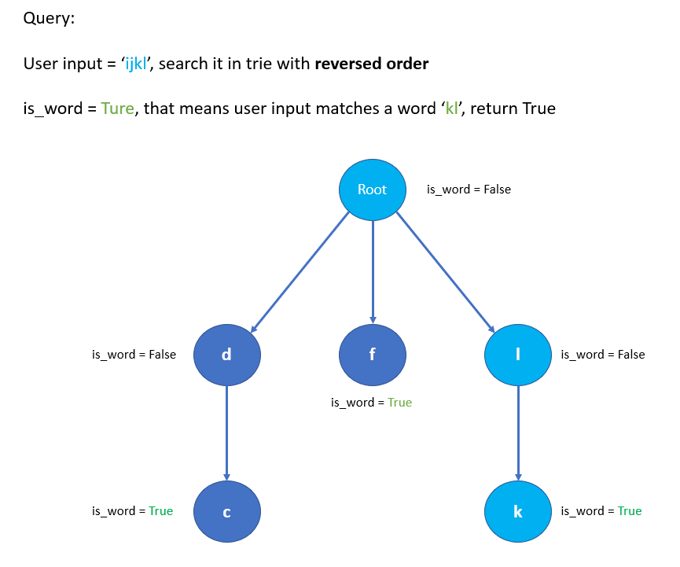

# Python by search in Trie [w/ Visualization]

**Author:** brianchiang_tw
**Votes:** 34
**Link:** [https://leetcode.com/problems/stream-of-characters/solutions/807322/](https://leetcode.com/problems/stream-of-characters/solutions/807322/)

---

Python by search in Trie

---

**Hint**:

Because [description](https://leetcode.com/problems/stream-of-characters/) asks us to search from tail, the **last k characters** queried, where k >= 1,
we build a trie and search word in **reversed order** to satisfy the requirement.

---

**Visualization**











---

**Implementation**:

```
from collections import defaultdict

class TrieNode:
    
    def __init__(self):
        
        self.dict = defaultdict(TrieNode)
        self.is_word = False


class StreamChecker:

    def __init__(self, words: List[str]):
        '''
        Build a trie for each word in reversed order
        '''
		
        # for user query record, init as empty string
        self.prefix = ''
        
        # for root node of trie, init as empty Trie
        self.trie = TrieNode()
        
        for word in words:
            
            cur_node = self.trie
            
			# make word in reverse order
            word = word[::-1]
            
            for char in word:                
                cur_node = cur_node.dict[ char ]
            
			# mark this trie path as a valid word
            cur_node.is_word = True
            
            
            
    def query(self, letter: str) -> bool:
        '''
        Search user input in trie with reversed order
        '''
		
        self.prefix += letter
        
        cur_node = self.trie
        for char in reversed(self.prefix):
            
            if char not in cur_node.dict:
                # current char not in Trie, impossible to match words
                break
            
            cur_node = cur_node.dict[char]
        
            if cur_node.is_word:
                # user input match a word in Trie
                return True
        
        # No match
        return False
```

---

Reference:

[1] [Wiki: Trie](https://en.wikipedia.org/wiki/Trie)