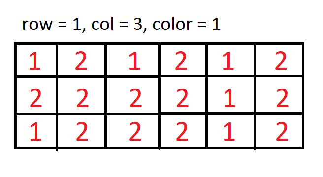
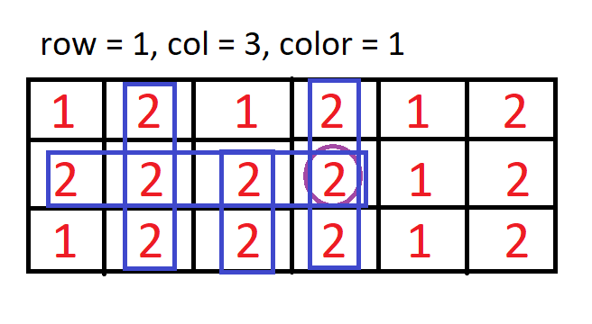
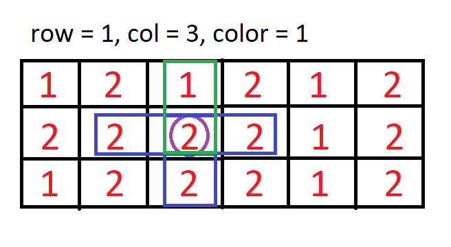
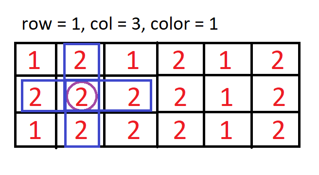
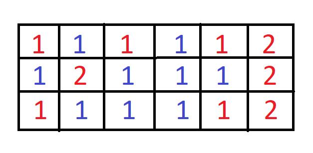
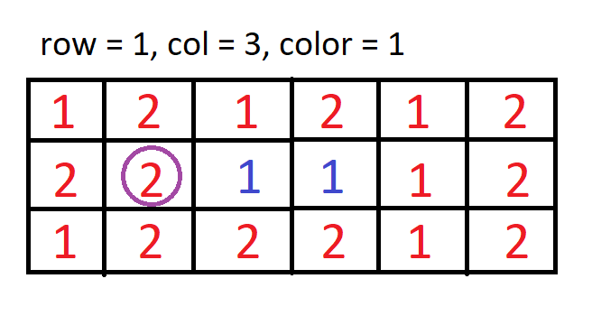
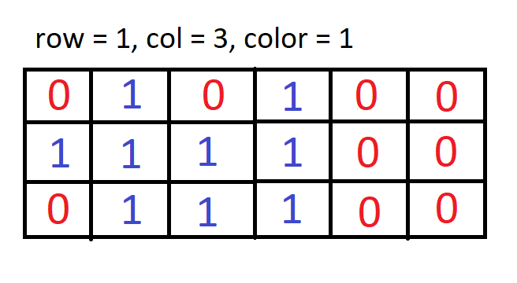

# Detailed Explanation With Pictures

**Author:** speedyy
**Votes:** 17
**Link:** [https://leetcode.com/problems/coloring-a-border/solutions/3686098/](https://leetcode.com/problems/coloring-a-border/solutions/3686098/)

---

` Suppose given `


``` 
All the neighbour(4 directions) of grid[1][3] including neighbours of the neighbours of 
grid[1][3]
```


```
Now you have to go through the all of those grid[1][3]'s neighbours and change the color of 
those cells which are on the border(cell whose 4 direction cells values are not equal to
 that cell value)
```
```
Let's look at the cell grid[1][2].
```


```
Here only the upper neighbour(green marked) is not same as grid[1][2] (purple marked).
So grid[1][2] is on the border and thus we color it to 1.
```
```
For grid[1][1] : 
```


```
For grid[1][1](purple marked) all it's neighbour has the same value as grid[1][1] has, means
this cell is not on the border and that's why we won't color it to 1.
```
```
Final Output : (red = previous color, blue = new color)
```



### My Solution Explanation :
```
If you want to run the dfs and change the border cell to new color in the dfs it would
be huge messy : 
```


```
If I change the color of grid[1][3] and grid[1][2] at the same time in dfs function, then 
for grid[1][1] (purple marked) it's right neighbour(grid[1][2]) is 1 and grid[1][1] will be 
colored to 1 as it's all neighbours value are not same as grid[1][1] BUT grid[1][1] can't be
colored to 1 as in the Q it's all neighbour has the same value as its.
```
```
Instead I made a boolean array of the same size as grid and marked all the neighbours of 
grid[row][col] as 1 in dfs(). Now I can easily traverse the 'visited' array and change the 
border cells of 'grid' to 'color'.
```


```
To check if the current cell (grid[r][c]) is on the border or not :

1. If the cell is on the first or the last row as 'CELLS ON THE FIRST ROW MISSING UPPER 
   NEIGHBOUR' AND 'LAST ROW BOTTOM NEIGHBOUR'.
2. If the cell is on the first colomn(missing left neighbour) or the last colomn(missing right 
   neighbour)
3. If the cell in the middle, then check if all the neighbour has 1 in the 'visited' array, 
   because if one of them is 0 means it's a border cell. 

   NO NEED TO CHECK IF THE CELL (WHOSE NEIGHBOURS HAS 1 OR NOT) HAS ALSO 1 BECAUSE UNLESS THAT 
   CELL HAD NOT 1 WE WOULDN'T BE CHECKING IF ALL ITS NEIGHBOURS AS 1 OR NOT.    
```

```CPP []
class Solution 
{
public:
    vector<vector<int>> diff = {{0, -1}, {-1, 0}, {0, 1}, {1, 0}}; // left up right down
    
    bool on_border_or_neighbours_not_equal(vector<vector<bool>>& visited, int r, int c){
        if(r == 0 || r == visited.size()-1 || c == 0 || c == visited[0].size()-1) // on border conditions
            return true;
        int left = visited[r][c-1], up = visited[r-1][c], right = visited[r][c+1], down = visited[r+1][c];
        return left != 1 || up != 1 || right != 1 || down != 1; // at least one neighbour is different conditions
    }
    
    void create_border(vector<vector<int>>& grid, vector<vector<bool>> &visited, int newcolor)
    {
        for(int r=0; r<visited.size(); r++)
        {
            for(int c=0; c<visited[0].size(); c++)
                if(visited[r][c] == 1 && on_border_or_neighbours_not_equal(visited, r, c))
                    grid[r][c] = newcolor;
        }
    }

    void dfs(vector<vector<int>>& grid, int r, int c, int oldcolor, vector<vector<bool>> &visited)
    {
        if(r<0 || r>=grid.size() || c<0 || c>=grid[0].size() || visited[r][c] == 1 || grid[r][c] != oldcolor)
            return;
        visited[r][c] = 1;
        for(const auto &d : diff)
            dfs(grid, r+d[0], c+d[1], oldcolor, visited);
    }

    vector<vector<int>> colorBorder(vector<vector<int>>& grid, int row, int col, int color)
    {
        vector<vector<bool>> visited(grid.size(), vector<bool>(grid[0].size()));
        dfs(grid, row, col, grid[row][col], visited);
        create_border(grid, visited, color);
        return grid;
    }
};
```
```Python []
class Solution:
    def colorBorder(self, grid: List[List[int]], row: int, col: int, color: int) -> List[List[int]]:
        ROW, COL, oldcolor = len(grid), len(grid[0]), grid[row][col]
        visited = [ [0 for _ in range(COL)] for _ in range(ROW) ]

        def dfs(r:int, c:int):
            if r<0 or r>=ROW or c<0 or c>=COL or visited[r][c] == 1 or grid[r][c] != oldcolor :
                return
            visited[r][c] = 1
            [ dfs(r+x, c+y) for (x,y) in ((0, -1), (-1, 0), (0, 1), (1, 0)) ]
        
        def on_border_or_neighbours_not_equal(r:int, c:int) -> bool:
            if r == 0 or r == ROW-1 or c == 0 or c == COL-1 : # on border
                return True
            left, up, right, down = visited[r][c-1], visited[r-1][c], visited[r][c+1], visited[r+1][c]
            return left != 1 or up != 1 or right != 1 or down != 1 # min 1 neighbour is different or not
        
        def create_border():
            for r in range(ROW):
                for c in range(COL):
                    if visited[r][c] == 1 and on_border_or_neighbours_not_equal(r, c):
                        grid[r][c] = color

        dfs(row, col)
        create_border()
        return grid
```
```
Time  complexity : O(m*n)
Space complexity : O(m*n)
```
### It took me plenty time to explain everything. If the post was useful to you, an upvote will really make me happy. Thank you for reading it till the end.