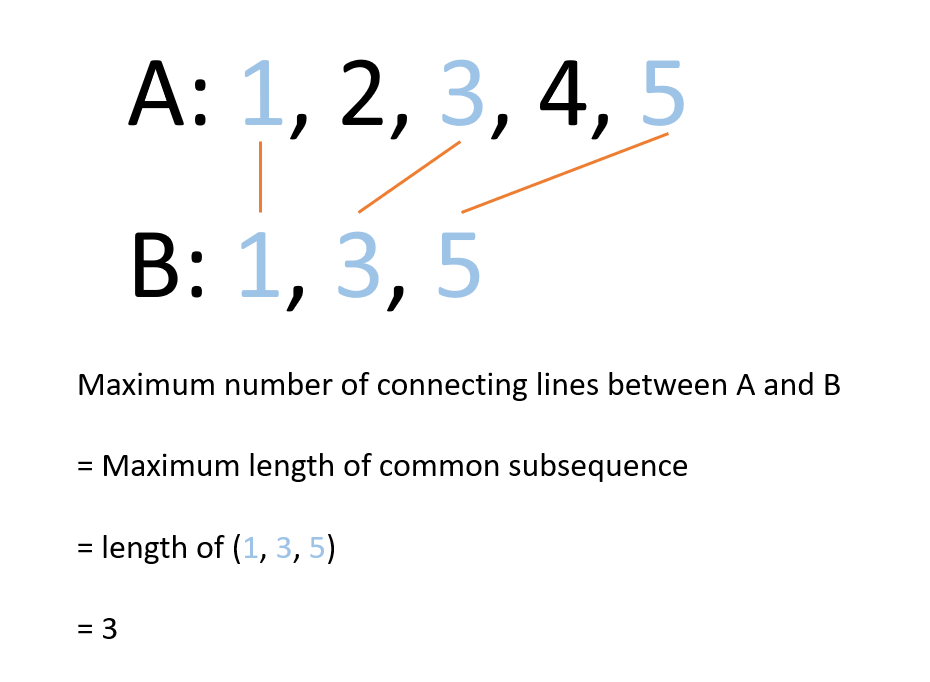

# Python/Java/JS/Go/C++ O( m*n ) DP // Reduction to LCS [w/ Graph] 有中文解析文章

**Author:** brianchiang_tw
**Votes:** 40
**Link:** [https://leetcode.com/problems/uncrossed-lines/solutions/651057/](https://leetcode.com/problems/uncrossed-lines/solutions/651057/)

---

Python by O( m*n ) DP

[\u4E2D\u6587\u89E3\u6790\u6587\u7AE0](https://vocus.cc/article/6660616ffd89780001befb00)

This is a numerical version of [**Longest common subsequence** like Leetcode # 1143](https://leetcode.com/problems/longest-common-subsequence/)

---

**Illustration and Visualization**:



---

**Hint**:

First, add one **dummy -1** to A and B to **represent empty list**

Then, we define the notation **DP[ y ][ x ]**.

Let DP[y][x] denote the maximal number of uncrossed lines between **A[ 1 ... y ]** and **B[ 1 ... x ]**

We have optimal substructure as following:

---

**Base case**:
Any sequence with empty list yield no uncrossed lines.

If y = 0 or x = 0:
DP[ y ][ x ] = 0

---

**General case**:
If A[ y ] == B[ x ]:
DP[ y ][ x ] = DP[ y-1 ][ x-1 ] + 1

Current last number is matched, therefore, add one more uncrossed line

---

If A[ y ] =/= B[ x ]:
DP[ y ][ x ] = **Max**( DP[ y ][ x-1 ], DP[ y-1 ][ x ] )

Current last number is not matched, 
backtrack to **A**[ 1...**y** ]**B**[ 1...**x-1** ], **A**[ 1...**y-1** ]**B**[ 1...**x** ]
to find maximal number of uncrossed line

---

**Implementation** by 2D dynamic programming:

```
class Solution:
    def maxUncrossedLines(self, A: List[int], B: List[int]) -> int:
        
        # padding one dummy -1 to represent empty list
        A = [ -1 ] + A
        B = [ -1 ] + B
        
        h, w = len(A), len(B)
        dp_table = [ [ 0 for _ in range(w) ] for _ in range(h) ]
        
        
        
        for y in range(1, h):
            for x in range(1, w):
                
                if A[y] == B[x]:
                    # current number is matched, add one more uncrossed line
                    dp_table[y][x] = dp_table[y-1][x-1] + 1
                    
                else:
                    # cuurent number is not matched, backtracking to find maximal uncrossed line
                    dp_table[y][x] = max( dp_table[y][x-1], dp_table[y-1][x] )

                    
        return dp_table[-1][-1]
```

---

Java:

```
class Solution {
    public int maxUncrossedLines(int[] nums1, int[] nums2) {
        
        // Image that we add padding one dummy -1 to represent empty list
        // keep this in mind
        // nums1 = [-1] + nums1
        // nums2 = [-1] + nums2
        
        final int h = nums1.length, w = nums2.length;
        
        int[][] dp = new int[h+1][w+1];
        
        for( int y = 0 ; y < h ; y++){
            for( int x = 0 ; x < w ; x++){
                
                if( nums1[y] == nums2[x] ){
                    // current number is matched, add one more uncrossed line
                    dp[y+1][x+1] = dp[y][x] + 1;
                    
                }else{
                    // cuurent number is not matched, backtracking to find maximal uncrossed line
                    dp[y+1][x+1] = Math.max( dp[y][x+1], dp[y+1][x]);
                }
            }
        }
        return dp[h][w];
    }
}
```

---

Javascript:

```
var maxUncrossedLines = function(nums1, nums2) {
  
    // padding one dummy -1 to represent empty list
    nums1 = [ -1 ].concat(nums1);
    nums2 = [ -1 ].concat(nums2);
    
    let [h, w] = [ nums1.length, nums2.length ];
    
    dp = new Array( h ).fill( 0 ).map( () => new Array( w ).fill(0) );
    
    for( let y = 1 ; y < h ; y++){
        for( let x = 1 ; x < w ; x++){
            
            if( nums1[y] == nums2[x] ){
                
                // current number is matched, add one more uncrossed line
                dp[y][x] = dp[y-1][x-1] + 1;
                
            }else{
                // cuurent number is not matched, backtracking to find maximal uncrossed line
                dp[y][x] = Math.max( dp[y-1][x], dp[y][x-1] );
            }
            
        }
    }
    
    return dp[h-1][w-1];
    
};
```

---

Go:


```
func Max( x , y int) int {
    
    if x > y{
        return x
    }else{
        return y
    }
    
}

func maxUncrossedLines(nums1 []int, nums2 []int) int {
    
    // padding one dummy -1 to represent empty list
    nums1 = append( []int{-1}, nums1...)
    nums2 = append( []int{-1}, nums2...)
    
    h, w := len(nums1), len(nums2)
    dp := make( [][]int, h)
    rows := make( []int, h * w)
    for i := 0 ; i < h ; i++{
        dp[i] = rows[ i * w : (i+1) * w ]
    }
    
    for y := 1 ; y < h ; y++{
        for x := 1 ; x < w ; x++{
            
            if( nums1[y] == nums2[x] ){
                // current number is matched, add one more uncrossed line
                dp[y][x] = dp[y-1][x-1] + 1 
            
            }else{
                // cuurent number is not matched, backtracking to find maximal uncrossed line
                dp[y][x] = Max( dp[y-1][x], dp[y][x-1] )
            }
            
        }
    }
    
    return dp[h-1][w-1]

}

```


---

C++

```
class Solution {
public:
    int maxUncrossedLines(vector<int>& nums1, vector<int>& nums2) {
        
        // padding one dummy -1 to represent empty list
        nums1.insert( nums1.begin(), -1);
        nums2.insert( nums2.begin(), -1);
        
        const int h = nums1.size(), w = nums2.size();
        
        vector< vector<int> > dp( h, vector<int>(w, 0) );
        
        for( int y = 1 ; y < h ; y++){
            for( int x = 1 ; x < w ; x++){
                
                if( nums1[y] == nums2[x] ){
                    // current number is matched, add one more uncrossed line
                    dp[y][x] = dp[y-1][x-1] + 1;
                    
                }else{
                    // cuurent number is not matched, backtracking to find maximal uncrossed line
                    dp[y][x] = max( dp[y-1][x], dp[y][x-1]);
                }
            }
        }
        return dp[h-1][w-1];
    }
};
```


---


**Another implementation** by recursion with memoization

```
class Solution:
    def maxUncrossedLines(self, A: List[int], B: List[int]) -> int:
        
        A = [ -1 ] + A
        B = [ -1 ] + B
        
        dp_table = {}
        
        def helper( idx_a, idx_b ):
            
            if (idx_a, idx_b) in dp_table:
                return dp_table[(idx_a, idx_b)]
            
            
            if idx_a == 0 or idx_b == 0:
                # Any list compared to empty list give no uncrossed line
                return 0
            
            elif A[idx_a] == B[idx_b]:
                
                dp_table[(idx_a, idx_b)] = helper(idx_a-1, idx_b-1) + 1
                return dp_table[(idx_a, idx_b)]
            else:
                dp_table[(idx_a, idx_b)] = max( helper(idx_a-1, idx_b), helper(idx_a, idx_b-1))
                return dp_table[(idx_a, idx_b)]
        
        # --------------------------------------------
        return helper( len(A)-1, len(B)-1 )
```