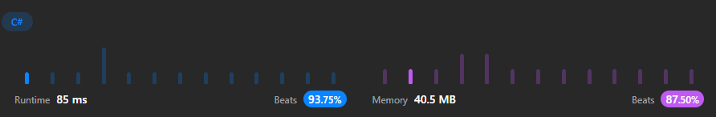

# C#, and TypeScript DP Solution 🔥🚀 with approach. ❇️✅

**Author:** ArafatSabbir
**Votes:** 1
**Link:** [https://leetcode.com/problems/uncrossed-lines/solutions/3510955/](https://leetcode.com/problems/uncrossed-lines/solutions/3510955/)

---

# \u2B06\uFE0FLike|\uD83C\uDFAFShare|\u2B50Favourite

```csharp []
public class Solution {
    public int MaxUncrossedLines(int[] nums1, int[] nums2) {
        int[,] dp = new int[nums1.Length + 1, nums2.Length + 1];
        for (int i = 1; i <= nums1.Length; i++)
        {
            for (int j = 1; j <= nums2.Length; j++)
            {
                if (nums1[i - 1] == nums2[j - 1])
                {
                    dp[i, j] = 1 + dp[i - 1, j - 1];
                }
                else
                {
                    dp[i, j] = Math.Max(dp[i - 1, j], dp[i, j - 1]);
                }
            }
        }
        return dp[nums1.Length, nums2.Length];
    }
}
```
```typescript []
function maxUncrossedLines(nums1: number[], nums2: number[]): number {
    let dp: number[][] = new Array(nums1.length + 1).fill(0).map(() => new Array(nums2.length + 1).fill(0));
    for (let i = 1; i <= nums1.length; i++) {
        for (let j = 1; j <= nums2.length; j++) {
            if (nums1[i - 1] == nums2[j - 1]) {
                dp[i][j] = 1 + dp[i - 1][j - 1];
            }
            else
            {
                dp[i][j] = Math.max(dp[i - 1][j], dp[i][j - 1]);
            }
        }
    }
    return dp[nums1.length][nums2.length];
};
```


# Complexity
- Time complexity:
O(n*m)

- Space complexity:
O(n*m)

# Approach
1. Use DP to solve this problem
2. Create a 2D array to store the max uncrossed lines
3. If the current element in both the arrays are same, then add 1 to the diagonal element
4. Else, take the max of the top and left element
5. Return the last element in the 2D array


