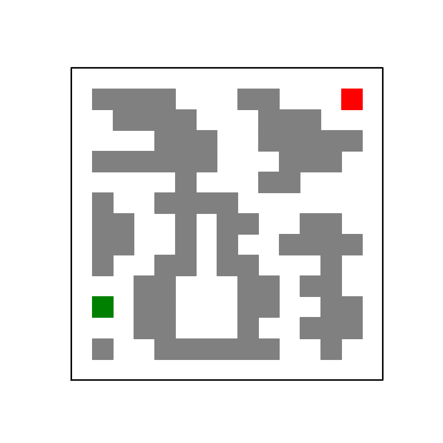
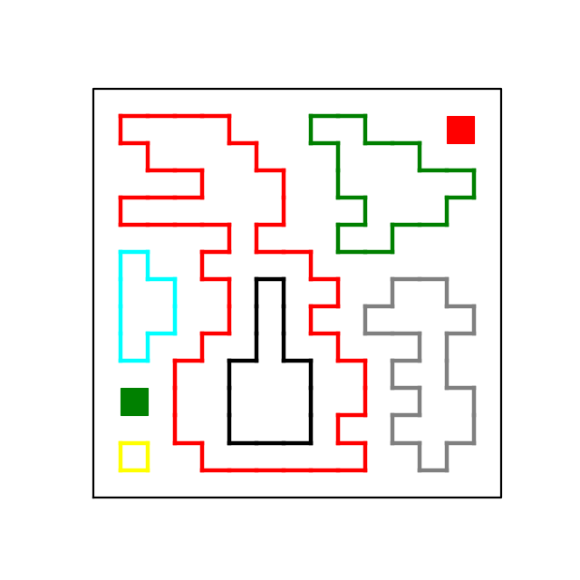
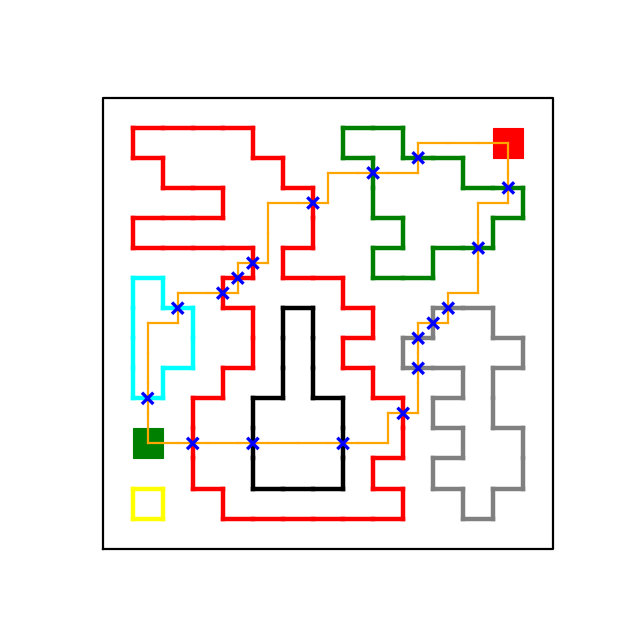
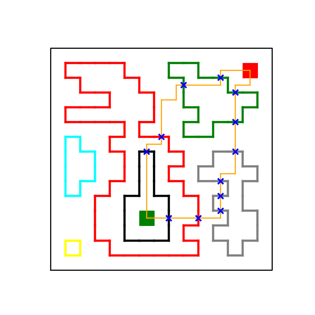
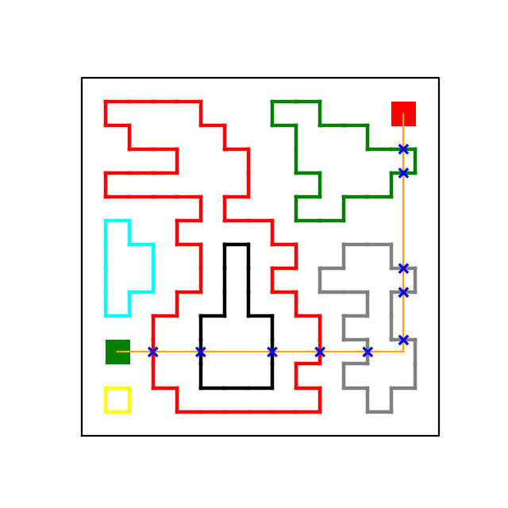
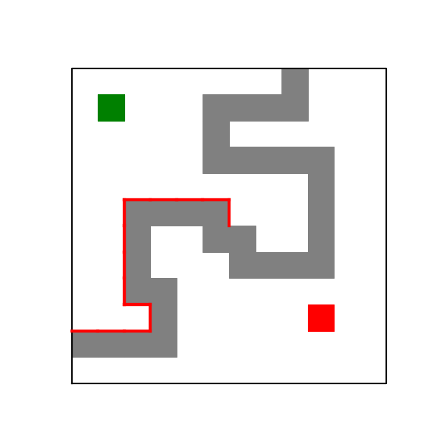
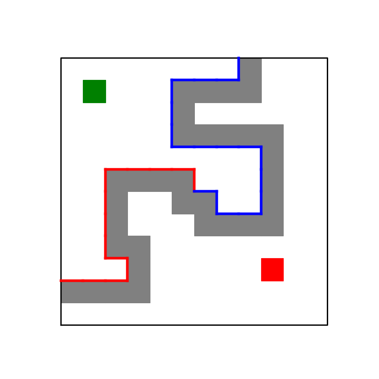
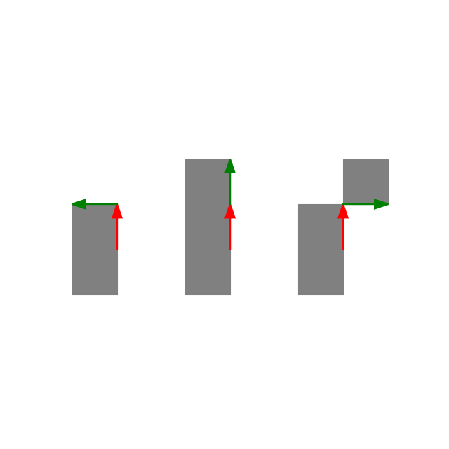
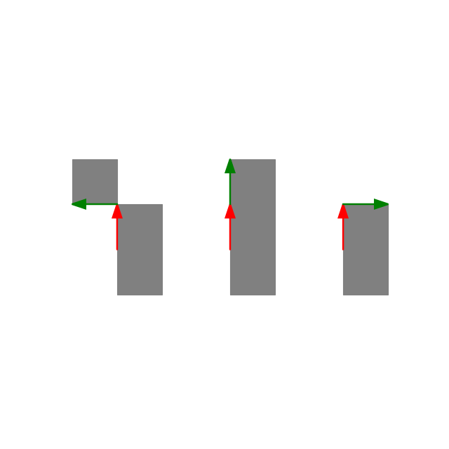

# Python | 100%, O(n), trace outlines, no size limits on blocked/grid

**Author:** taylorott
**Votes:** 2
**Link:** [https://leetcode.com/problems/escape-a-large-maze/solutions/2287674/](https://leetcode.com/problems/escape-a-large-maze/solutions/2287674/)

---

This is a solution that runs in O(n) time in the size of blocked, and works for arbitrary sizes of blocked and the bounding grid.

The key intuition used here is that you can test whether or not the target is reachable from the source by first tracing out all of the outlines that would appear after painting in all of the blocked cells, and then checking to see if there exists an outline that separates the source from the target. 





Given the source, target, and an outline (which is always a closed loop without any branches), there are four possibilites:

1. Both source and target are on the inside of the outline
2. Both source and target are on the outside of the outline
3. Source is inside the outline and target is outside the outline
4. Source is outside the outline and target is inside the outline

For cases 3 & 4, we see that it's impossible to go from source to target without crossing the outline, meaning that no path exists. If we find that, for all outlines, case 1 or 2 is true, then there is a path from source to target.

How do you check which case is true? This is where the topology part comes in. Consider a path P from source to target. For cases 1 & 2, P will cross the outline an even number of times, and for cases 3 & 4, P will cross the outline an odd number of times. 

In the example below , it is possible to reach the source from the target. We see that each loop intersects each of the two orange paths an even number of times.



In the example below, the source is trapped. Here, we see that the loops trapping the source intersect each of the two orange paths an odd nuber of times.



Since this property holds true for any path from the source to the target, we can choose a very simple path that makes checking the number of crossings easy. I chose the path that, starting from the source, goes straight horizontally until reaching the  x coordinate of target, and then travels straight vertically to target. I'll call this the "easy path".  We'll never actually traverse this path (since that would put our time complexity at the manhattan distance between source and target). Instead, given how it's constructed, testing a unit length edge of an outline for whether or not it intersects the "easy path" takes constant time.



The algorithm is just to traverse the edges of each outline, while counting the number of edges that intersect the "easy path". If the number of intersections are all even, return true, otherwise return false. As we go along, we'll mark each edge as visited, so we don't need to retrace the same outline over and over.

One thing to note is that, sometimes,  an outline of blocked cells can link up with the boundaries of the grid to form a loop that prevents source from reaching the target. We do need to check these cases too when they come up, but the issue is that we don't want to trace out the boundary of the grid while traversing an outline, because the grid is huge and this is a waste of time.

Thus, if we do touch the boundary of a grid while tracing an outline,


we stop, go back to where we started, and trace out the rest of the outline in the reverse direction until we hit the grid boundary again, after which point, we can stop (the boundaries of the grid will never intersect the "easy path" anyway, so we don't need to check them).


The outline traversal is mostly bookkeeping. We store blocked in a hashset, so that we can lookup to see if a cell is occupied in constant time (while using linear space). When facing foward along an edge, we'll keep the occupied cell to our left. We can determine when to turn right or left by looking at the two cells ahead of us. If the right of these two cells is occupied, we need to turn right. If the left is occupied but not the right, we go straight. If neither are occupied, we round the corner by turning left:


The rules are flipped when going in the reverse direction (keeping the occupied cells to our right). We don't travel in reverse often (only when we need to complete an outline that touches the grid boundary):


In the code provided, I refer to these two options as counter-clockwise/clockwise, though it's a bit incorrect. If you keep occupied cells to your left, then you will travel in a counter-clockwise loop (winding number of 1) when tracing the exterior of a region, but when tracing the interior, you will travel in a clockwise loop (winding number of -1). It's reversed when keeping occupied cells to your right.

This algorithm is O(n) in the size of blocked, since we only visit each edge  at most twice (once when traversing an outline, and another time as we iterate through blocked cells), and there are at most 4 len(blocked) possible outline edges. The key reason why this works well is  that the outlines of the painted regions do not branch, and an edge cannot belong to more than one outline. Asymptotically, this is better than a graph search (searching for a path from source to target, or searching the graph formed by neighboring blocked cells).

I got it to run in ~81ms. The real tricky part is the coordinate bookkeeping for traversing an outline (either clockwise or counterclockwise), and the fact that we need to keep track of cells, gridpoints and edges (both directed and undirected). 


```
class Solution(object):   
    def isEscapePossible(self, blocked, source, target):
        """
        :type blocked: List[List[int]]
        :type source: List[int]
        :type target: List[int]
        :rtype: bool
        """
        
        self.blocked = blocked
        self.source = source
        self.target = target
        
        #hashset of all blocked cells
        self.blocked_dict = {}
        
        #hashset of all visited edges
        self.edge_dict = {}
        
        #min/max x/y coords used for checking if an edge intersects the "easy path"
        self.min_x = min(self.source[0],self.target[0])
        self.max_x = max(self.source[0],self.target[0])
        self.min_y = min(self.source[1],self.target[1])
        self.max_y = max(self.source[1],self.target[1])
        
        #iterate through all cells in blocked,
        #and add each cell to the hash set
        for blocked_cell in blocked:
            if blocked_cell[0] in self.blocked_dict:
                self.blocked_dict[blocked_cell[0]][blocked_cell[1]] = None
            else:
                self.blocked_dict[blocked_cell[0]]={blocked_cell[1]:None}
        
        #for each cell in blocked
        for blocked_cell in self.blocked:
            
            #list the faces of blocked_cell that belong to an outline (4 of these at most)
            exposed_faces = self.enumerate_exposed_faces(blocked_cell[0],blocked_cell[1])
            
            #for each of these faces
            for face in exposed_faces:
                
                #check to see if we've already visited the edge while tracing out a loop
                x_edge = face[3]
                y_edge = face[4]
                edge_type = face[5]
                edge_visited = (x_edge in self.edge_dict 
                                and y_edge in self.edge_dict[x_edge]
                                and edge_type in self.edge_dict[x_edge][y_edge])
                
                #if not, then we are looking at a new outline that we haven't seen before
                if not edge_visited:   
                   
                    #count the number of edges of the outline that intersect the "easy path"
                    num_intervening_edges =  self.check_loop(face[0],face[1],face[2])
                    
                    #if the number of intersections is odd, a path does not exist. return false
                    if num_intervening_edges%2==1:
                        return False
            
        #if we could not find an outline the separates source from target, return true    
        return True
    
    #lists the faces of occupied cell x,y that do not touch other occupied cells
    #these cell faces are edges that belong to one of the outlines that are formed 
    #by painting in all occupied cells and grid boundaries
    #there are at most 4 such edges per cell
    def enumerate_exposed_faces(self,x,y):
        out_list = []
        
        #iterate through each neighbor of the cell
        for i in range(4):
            
            #if the neighbor cell is not occupied (blocked), then the corresponding face is a boundary face
            #in which case, add it to the list
            if not self.is_occupied(x+self.dxe[i],y+self.dye[i]):
                
                #there is a little bit of accounting going on to keep track of the correct edge coordinates
                #note that what we are really listing here is a starting grid point (not cell) + starting direction
                #and we also need to take into account that cells are indexed by their bottom left corner
                x_star = x+self.dxe2[i]
                y_star = y+self.dye2[i]
                x_edge_coords = x_star + self.dx_edge_coords[(i+2)%4]
                y_edge_coords = y_star + self.dy_edge_coords[(i+2)%4]
                
                out_list.append([x_star,y_star,i,x_edge_coords,y_edge_coords,self.edge_code_list[i]])
        return out_list
        
    #returns the number of times a given outline intersects the "easy path"
    #x_start,y_start is the starting gridpoint on the outline
    #starting_direction is... the starting direction (see __init__ for how it's coded)
    #is_cc is True if traversing in counterclockwise direction, False if clockwise
    #note that (counter)clockwise is referring to the winding number of the whole outline we are tracing
    def check_loop(self,x_start,y_start,starting_direction,is_cc = True):
        #correct the starting direction if it needs to be adjusted
        starting_direction = self.update_edge_direction(x_start,y_start,starting_direction,is_cc)
        direction = starting_direction
        
        x = x_start
        y = y_start
                
        num_intervening_edges = 0
        
        # return False
        touched_grid_boundary = False
        
        #iterate until we either touch the grid boundary
        #or return to where we started
        #this is a do-while, hence the True + break condition
        while True:  
            #evaluate next grid point after moving along edge
            x_new = x+self.dxp[direction]
            y_new = y+self.dyp[direction]
            
            #if the edge is on the boundary, do not proceed. break out of the loop
            if self.edge_on_boundary(x,y,x_new,y_new):
                touched_grid_boundary = True
                break
            
            #otherwise, mark the edge as visited
            x_edge_coords = x + self.dx_edge_coords[direction]
            y_edge_coords = y + self.dy_edge_coords[direction]
            edge_coords = [x_edge_coords,y_edge_coords]
            
            #a little bit of a hassle since it's a dictionary of dictionaries of 1-2 element lists
            if x_edge_coords in self.edge_dict:
                if y_edge_coords in self.edge_dict[x_edge_coords]:
                    if self.edge_code_list[direction] not in self.edge_dict[x_edge_coords][y_edge_coords]:
                        self.edge_dict[x_edge_coords][y_edge_coords].append(self.edge_code_list[direction])
                else:
                    self.edge_dict[x_edge_coords][y_edge_coords] = [self.edge_code_list[direction]] 
            else:
                self.edge_dict[x_edge_coords] = {y_edge_coords: [self.edge_code_list[direction]]}
            
            
            #check to see if the edge intersects our "easy path" from source to target
            #if an intersection has occured, increment the intersection counter
            
            #checks to see if the edge intersects the horizontal portion of the easy path
            #for an edge to do so, it must be vertical, have the same y as source
            #and must have an x between source and target
            if self.edge_code_list[direction]=='v':
                if (self.min_x<edge_coords[0] and edge_coords[0]<=self.max_x
                    and edge_coords[1]==self.source[1]):
                    
                    num_intervening_edges+=1
                    
            #checks to see if the edge interesects the vertical portion of the easy path
            #for an edge to do so, it must be horizontal, have the same x as source
            #and must have a y between source and target
            if self.edge_code_list[direction]=='h':
                if (self.min_y<edge_coords[1] and edge_coords[1]<=self.max_y 
                    and edge_coords[0]==self.target[0]):
                    
                    num_intervening_edges+=1
            
            #update the grid point
            x=x_new
            y=y_new
            
            #update the direction
            direction = self.update_edge_direction(x,y,direction,is_cc)
            
            #if we returned back to the beginning, break out of the loop
            #we need to take direction into account, because it is possible to return to
            #the same grid point during the the middle of the traversal
            #for example, imagine tracing the outline of two cells that are diagonally adjacent
            #here, you would pass through the point where the two cells touch each other twice
            #if you happen to get unlucky and start at such a point, things would break if you 
            #terminated conditioned just on the x/y coordinates
            #taking into account the current direction dodges this issue
            if x==x_start and y==y_start and direction == starting_direction:
                break
        
        #if we touched a grid boundary, we need to go back to the beginning
        #and then go in reverse until we touch the grid boundary again
        #thus finishing the outline.
        #since we are going in reverse direction,
        #the setting is clockwise instead of counter-clockwise
        if touched_grid_boundary and is_cc:
            num_intervening_edges+=self.check_loop(
                x_start,y_start,(starting_direction+2)%4,is_cc = False)
        
        #return the number of intersections between the loop and the easy path
        return num_intervening_edges
    
    #changes the edge direction right or left (or keeps straight)
    #depending on our current grid point and direction
    def update_edge_direction(self,x,y,direction,is_cc):
        #coordinate of the cell in front of us (given our current direction) and to the right
        x_right = x + self.dx_fwrd_right[direction]
        y_right = y + self.dy_fwrd_right[direction]

        #coordinate of the cell in front of us (given our current direction) and to the left
        x_left = x + self.dx_fwrd_left[direction]
        y_left = y + self.dy_fwrd_left[direction]
            
            
        #the following logic tells us how to change the direction as we move along the outline
        #I'm not going to explain it here, but if you draw the cases out, it will become apparent
        #the one thing to note is that, you can still turn right during a counter-clockwise traversal
        #(and left during a clockwise traversal). The traversal handedness is referring 
        #to the global winding number of the whole loop 
        #(which is either +1 or -1 depending on clockwise or counter-clockwise)
        #if we are doing a counterclockwise traversal...
        if is_cc:
            #if the cell in front of us to the right is occupied, turn right
            if self.is_occupied(x_right,y_right):
                direction+=1
                direction%=4
            #if neither cells in front of us are occupied, turn left
            elif not self.is_occupied(x_left,y_left):
                direction-=1
                direction%=4

        #if we are doing a clockwise traversal...
        else:
            #if the cell in front of us to the left is occupied, turn left
            if self.is_occupied(x_left,y_left):
                direction-=1
                direction%=4
            #if neither cells in front of us are occupied, turn right
            elif not self.is_occupied(x_right,y_right):
                direction+=1
                direction%=4
        return direction
    
    #checks to see if an edge belongs to the boundary of the grid
    def edge_on_boundary(self,x0,y0,x1,y1):
        #an edge is on the boundary of the grid iff both endpoints
        #are on the boundary of the grid
        b_test0 = x0==0 or x0==self.l or y0==0 or y0==self.l
        b_test1 = x1==0 or x1==self.l or y1==0 or y1==self.l
        return b_test0 and b_test1
    
    #checks to see if a given cell is blocked. a cell is blocked if either 
    #it is on the boundary/exterior of the grid, or it was listed in blocked
    def is_occupied(self,x,y):
        return (x in self.blocked_dict and y in self.blocked_dict[x]) or x<0 or y<0 or x==self.l or y==self.l
        
    #here is where I hid away all the definitions of constants that we use to make things easier    
    def __init__(self):    
        #grid dimensions, which we use to check if we hit a grid boundary
        self.l = 10**6
        
        #used to traverse perimeter. clockwise order
        #direction 0 = down
        #direction 1 = left
        #direction 2 = up
        #direction 3 = right
        self.dxp = [ 0,-1, 0, 1]
        self.dyp = [-1, 0, 1, 0]
        
        #used to check for faces of a cell that are exposed
        #if the face of a cell is exposed, then that face belongs
        #to a perimeter that may prevent source from reaching target
        
        #perimeters are traversed in a counterclockwise loop by default
        #specifically, while travelling along a perimenter,
        #the cell to your left will always be occupied and the
        #the cell to your right will always be empty
        
        #faces of the cell are indexed as:
        #[left, top, right, bottom]
        #if cell x+dxe[i],y+dye[i] if not occupied, then the ith face
        #of the cell is part of a perimeter, which corresponds to motion
        #in direction i
        self.dxe = [-1, 0, 1, 0]
        self.dye = [ 0, 1, 0,-1]
        
        #used to maps an exposed face of a cell to the corner of the cell
        #used to start the perimeter traversal
        #left face: start at bottom left corner
        #top face: start at top left corner
        #right face: start at top right corner
        #bottom face: start at bottom right corner
        self.dxe2 = [ 0, 0, 1, 1]
        self.dye2 = [ 0, 1, 1, 0]
        
        #used to determine what cells to look at
        #when checking if we need to turn clockwise or counterclockwise
        #while traversing the perimeter
        self.dx_fwrd_right = [-1,-1, 0, 0]
        self.dy_fwrd_right = [-1, 0, 0,-1]
        
        self.dx_fwrd_left  = [ 0,-1,-1, 0]
        self.dy_fwrd_left  = [-1,-1, 0, 0]
        
        #note that, for the above, a grid point and a cell have the same
        #coordinates if the grid point is the bottom left corner of that cell
        
        
        #used to map directed edges to undirected edges
        #we index edges using their bottom/leftmost point, and whether they
        #are vertical or horizontal
        self.edge_code_list = ['v','h','v','h']
        self.dx_edge_coords = [ 0,-1, 0, 0]
        self.dy_edge_coords = [-1, 0, 0, 0]

        

        


        
        

        
