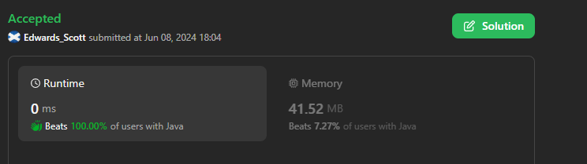
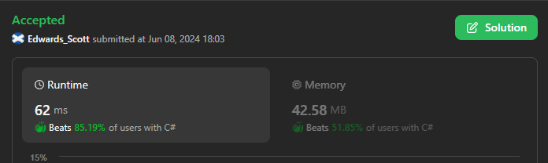
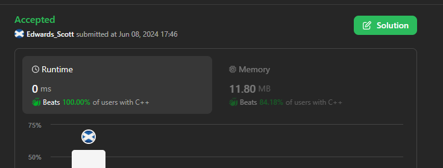
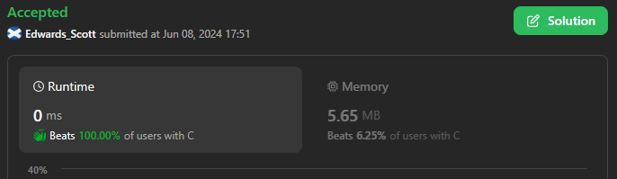
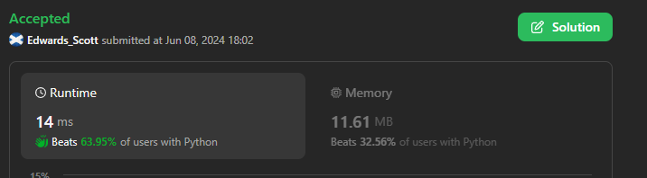

# 💢☠💫Easiest👾Faster✅💯 Lesser🧠 🎯 C++✅Python3🐍✅Java✅C✅Python🐍✅C#✅💥🔥💫Explained☠💥🔥 Beats 💯

**Author:** Edwards310
**Votes:** 3
**Link:** [https://leetcode.com/problems/valid-boomerang/solutions/5279517/](https://leetcode.com/problems/valid-boomerang/solutions/5279517/)

---

# Intuition






```C++ []
class Solution {
public:
    static bool isBoomerang(vector<vector<int>>& points) {
        int x1 = points[0][0], y1 = points[0][1];
        int x2 = points[1][0], y2 = points[1][1];
        int x3 = points[2][0], y3 = points[2][1];
        return (x1 * y2 - x1 * y3) + (y1 * x3 - y1 * x2) + (x2 * y3 - x3 * y2);
    }
};

auto init = []() {
    ios::sync_with_stdio(false);
    cin.tie(nullptr);
    cout.tie(nullptr);
    return 'c';
}();
```
```python3 []
class Solution:
    def isBoomerang(self, points: List[List[int]]) -> bool:
        return (points[1][0] - points[0][0]) * (points[2][1] - points[1][1]) != (points[1][1] - points[0][1]) * (points[2][0] - points[1][0])
```
```C []
bool isBoomerang(int** points, int pointsSize, int* pointsColSize) {
    int x1 = points[0][0], y1 = points[0][1];
    int x2 = points[1][0], y2 = points[1][1];
    int x3 = points[2][0], y3 = points[2][1];
    return y1 * (x3 - x2) + y2 * (x1 - x3) + y3 * (x2 - x1);
}
```
```java []
class Solution {
    public boolean isBoomerang(int[][] points) {
        boolean condition = ((points[0][0] * (points[1][1] - points[2][1]))
                + (points[1][0] * (points[2][1] - points[0][1])) + (points[2][0] * (points[0][1] - points[1][1]))) != 0;
        return condition;
    }
}
```
```python []
class Solution(object):
    def isBoomerang(self, points):
        """
        :type points: List[List[int]]
        :rtype: bool
        """
        x1, y1 = points[0]
        x2, y2 = points[1]
        x3, y3 = points[2]      
        area = abs(x1 * (y2 - y3) + x2 * (y3 - y1) + x3 * (y1 - y2))
        return area != 0
        
```
```C# []
public class Solution {
    public bool IsBoomerang(int[][] points) {
        int x1 = points[0][0], y1 = points[0][1];
        int x2 = points[1][0], y2 = points[1][1];
        int x3 = points[2][0], y3 = points[2][1];
        return (y1 * (x3 - x2) + y2 * (x1 - x3) + y3 * (x2 - x1)) != 0;
    }
}
```

<!-- Describe your first thoughts on how to solve this problem. -->

# Approach
<!-- Describe your approach to solving the problem. -->

# Complexity
- Time complexity:
<!-- Add your time complexity here, e.g. $$O(n)$$ -->
     O(1)
- Space complexity:
<!-- Add your space complexity here, e.g. $$O(n)$$ -->
     O(1)
# Code
```
class Solution(object):
    def isBoomerang(self, points):
        """
        :type points: List[List[int]]
        :rtype: bool
        """
        x1, y1 = points[0]
        x2, y2 = points[1]
        x3, y3 = points[2]      
        area = abs(x1 * (y2 - y3) + x2 * (y3 - y1) + x3 * (y1 - y2))
        return area != 0
        
```

