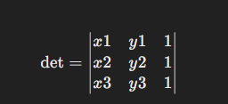
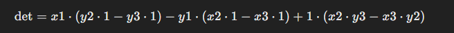

# "Collinearity Check in O(1) — The Ultimate Boomerang Test!"

**Author:** Bityta
**Votes:** 0
**Link:** [https://leetcode.com/problems/valid-boomerang/solutions/6060298/](https://leetcode.com/problems/valid-boomerang/solutions/6060298/)

---

### Intuition
To determine whether three points in a 2D plane form a boomerang (i.e., whether the points are not collinear), we can use the concept of a **determinant** from linear algebra. If the points are collinear, the area of the triangle formed by these points will be zero, meaning the determinant of the matrix formed by their coordinates will also be zero. Conversely, if the points are not collinear, the determinant will be non-zero.

### Approach
The approach to solving this problem is based on calculating the **determinant** of a matrix formed by the three points in a 2D space. For three points to be non-collinear (i.e., they form a valid boomerang), the determinant of the matrix formed by their coordinates must not be zero. 

To form the matrix, we treat the points as coordinates in 2D, and for convenience, we add a third column with constant value `1` (this is a common trick used when working with 2D determinants to ensure the matrix is square).

Given three points `P1(x1, y1)`, `P2(x2, y2)`, and `P3(x3, y3)`, the determinant of the matrix is calculated as:




This determinant is calculated using the formula:




If the determinant equals zero, the points are collinear (i.e., they lie on the same line), and hence not a valid boomerang. Otherwise, they form a valid boomerang.

### Code Explanation
In the provided solution, we are computing the determinant directly using the formula and checking if it's non-zero:

```kotlin
class Solution {
    fun isBoomerang(points: Array<IntArray>): Boolean {
        // Extracting the coordinates of the three points
        val x1 = points[0][0]
        val y1 = points[0][1]
        val x2 = points[1][0]
        val y2 = points[1][1]
        val x3 = points[2][0]
        val y3 = points[2][1]

        // Calculate the determinant
        val determinant = x1 * (y2 - y3) - y1 * (x2 - x3) + (x2 * y3 - x3 * y2)

        // If the determinant is non-zero, the points are not collinear, i.e., a valid boomerang
        return determinant != 0
    }
}
```

### Time and Space Complexity
- **Time complexity**: The algorithm performs a constant amount of work for each test case (calculating a determinant), so the time complexity is \\(O(1)\\).
- **Space complexity**: We are only storing a few variables for the coordinates of the points and the determinant, so the space complexity is also \\(O(1)\\).

### Conclusion
This solution efficiently checks whether three points form a valid boomerang using linear algebra (determinant calculation), ensuring the solution is both time-efficient and space-efficient.