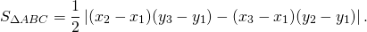

# Rust solution

**Author:** BigMih
**Votes:** 3
**Link:** [https://leetcode.com/problems/valid-boomerang/solutions/1529124/](https://leetcode.com/problems/valid-boomerang/solutions/1529124/)

---

We can use formula:

```
impl Solution {
    pub fn is_boomerang(p: Vec<Vec<i32>>) -> bool {
        let (x0, y0) = (p[0][0], p[0][1]);
        let (x1, y1) = (p[1][0], p[1][1]);
        let (x2, y2) = (p[2][0], p[2][1]);

        ((x0 - x1) * (y2 - y1) - (x2 - x1) * (y0 - y1)).abs() > 0
    }
}
```