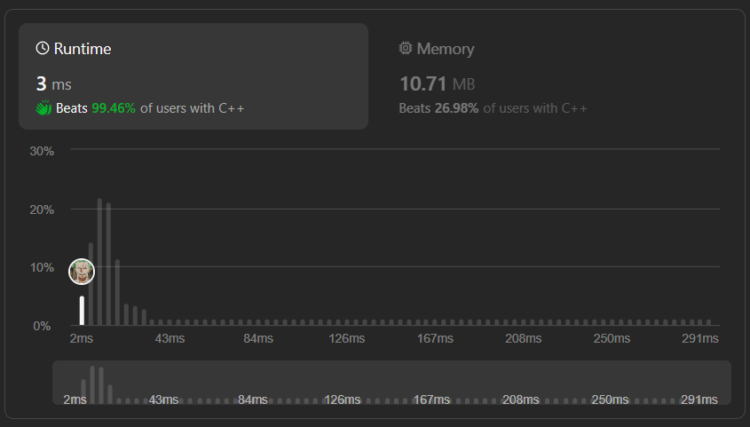

# ✅☑Beats 99% Users || [C++/Java/Python/JavaScript] || EXPLAINED🔥

**Author:** MarkSPhilip31
**Votes:** 94
**Link:** [https://leetcode.com/problems/partition-array-for-maximum-sum/solutions/4668560/](https://leetcode.com/problems/partition-array-for-maximum-sum/solutions/4668560/)

---

# PLEASE UPVOTE IF IT HELPED

---


---

# Approaches
(Also explained in the code)

1.  Uses dynamic programming to find the maximum sum after partitioning an array.

1.  Initializing an array `dp` to store the maximum sum at each position.

1.  Iterating through the array from the end to the beginning. For each position,  considering all possible partitions of the array.

1.  Within each partition, we calculates the maximum value and updates the dynamic programming array `dp` to store the maximum sum.

1.  The final result is stored in `dp[0]`, representing the maximum sum after partitioning the entire array.


# Complexity
- Time complexity:
   $$O(n*k)$$
*(where N is the size of the input array and K is the given parameter.)*
    

- Space complexity:
   $$O(k)$$
    


# Code
```C++ []
class Solution {
public:
    int maxSumAfterPartitioning(vector<int>& arr, int k) {
        int N = arr.size();
        int K = k + 1;

        int dp[k + 1];
        memset(dp, 0, sizeof(dp));

        for (int start = N - 1; start >= 0; start--) {
            int currMax = 0;
            int end = min(N, start + k);
            
            for (int i = start; i < end; i++) {
                currMax = max(currMax, arr[i]);
                dp[start % K] = max(dp[start % K], dp[(i + 1) % K] + currMax * (i - start + 1));
            }
        }
        return dp[0];
    }
};


```
```Java []

class Solution {
    public int maxSumAfterPartitioning(int[] arr, int k) {
        int N = arr.length;
        int K = k + 1;

        int[] dp = new int[k + 1];
        Arrays.fill(dp, 0);

        for (int start = N - 1; start >= 0; start--) {
            int currMax = 0;
            int end = Math.min(N, start + k);

            for (int i = start; i < end; i++) {
                currMax = Math.max(currMax, arr[i]);
                dp[start % K] = Math.max(dp[start % K], dp[(i + 1) % K] + currMax * (i - start + 1));
            }
        }
        return dp[0];
    }
}


```
```python3 []
class Solution:
    def maxSumAfterPartitioning(self, arr, k):
        N = len(arr)
        K = k + 1

        dp = [0] * K

        for start in range(N - 1, -1, -1):
            curr_max = 0
            end = min(N, start + k)

            for i in range(start, end):
                curr_max = max(curr_max, arr[i])
                dp[start % K] = max(dp[start % K], dp[(i + 1) % K] + curr_max * (i - start + 1))

        return dp[0]


```
```javascript []
class Solution {
    maxSumAfterPartitioning(arr, k) {
        const N = arr.length;
        const K = k + 1;

        const dp = Array(K).fill(0);

        for (let start = N - 1; start >= 0; start--) {
            let currMax = 0;
            const end = Math.min(N, start + k);

            for (let i = start; i < end; i++) {
                currMax = Math.max(currMax, arr[i]);
                dp[start % K] = Math.max(dp[start % K], dp[(i + 1) % K] + currMax * (i - start + 1));
            }
        }
        return dp[0];
    }
}


```
---


# PLEASE UPVOTE IF IT HELPED

---
---


---