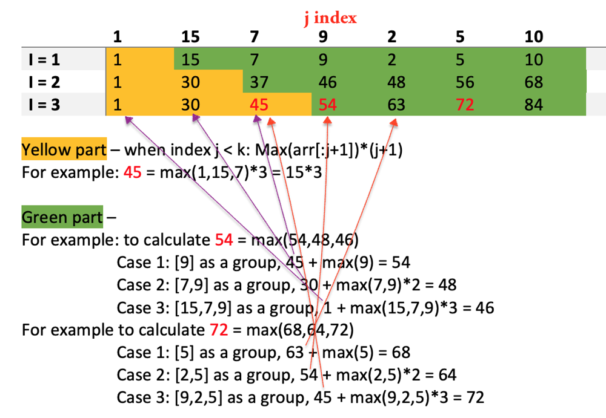

# [Python] Easy DP with Visualization and examples

**Author:** sashaxx
**Votes:** 102
**Link:** [https://leetcode.com/problems/partition-array-for-maximum-sum/solutions/1621079/](https://leetcode.com/problems/partition-array-for-maximum-sum/solutions/1621079/)

---


How to approach:

Assume we only look ***back*** for dividing groups

Take an example to see how to calculate and roll over:


Then the states and transition function is as below:
-	First is to calculate a result for all cases:
```
curr = []  # current sub-list
for m in range(k):  # in total m cases
	curr += dp[i][j-m-1] + max(arr[(j-m):(j+i)]) * (m+1)
```
dp[i][j-m-1] : is to use the previous dp result for the previous sum
arr[(j-m):(j+i)] : by looking back m+1 numbers to find the max and repeat m+1 times

-	Then is to choose the max result
```
dp[i][j] = max(curr)
```

- Since index i in not necessary, we only need j (index of arr), and m (index of k), the script is as below:
```
class Solution:
    def maxSumAfterPartitioning(self, arr: List[int], k: int) -> int:
        n = len(arr)
        dp = [0]*n
        
        # handle the first k indexes differently
        for j in range(k): dp[j]=max(arr[:j+1])*(j+1)
        
        # we can get rid of index i by running i times
        for j in range(k,n):
            curr = []
            for m in range(k):
                curr.append(dp[j-m-1] + max(arr[(j-m):(j+1)]) * (m+1))
            dp[j] = max(curr)

        return dp[-1]
```