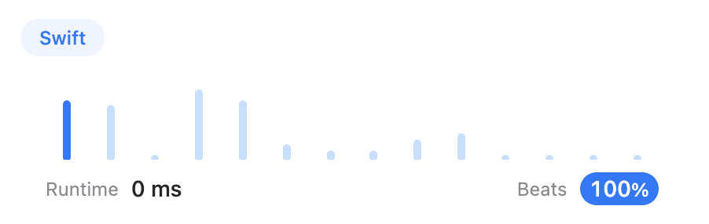

# Simple solution on Swift / Beats 100%

**Author:** blackbirdNG
**Votes:** 4
**Link:** [https://leetcode.com/problems/last-stone-weight/solutions/3045449/](https://leetcode.com/problems/last-stone-weight/solutions/3045449/)

---

### Please upvote if the solution was useful!
```
func lastStoneWeight(_ stones: [Int]) -> Int {
    var stones = stones.sorted(by: >)
    while stones.count != 1 {
        let secondItem = stones.remove(at: 1)
        stones[0] -= secondItem
        stones = stones.sorted(by: >)
    }
    return stones[0]
}
```

