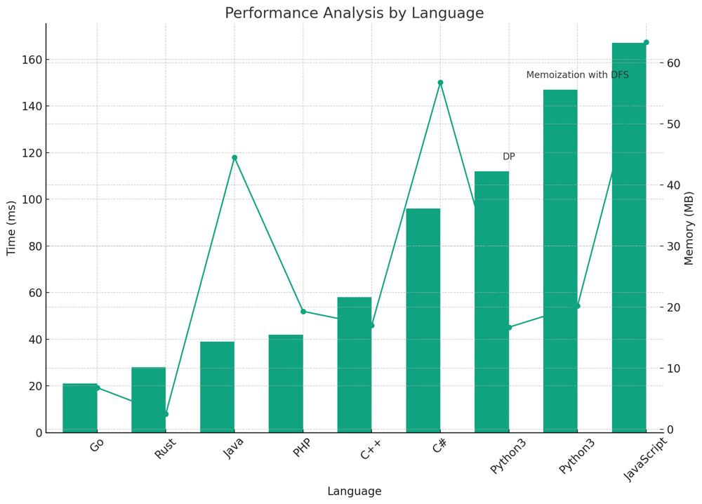

# ✅ 95.46% DP & Memo

**Author:** vanAmsen
**Votes:** 96
**Link:** [https://leetcode.com/problems/longest-string-chain/solutions/4078579/](https://leetcode.com/problems/longest-string-chain/solutions/4078579/)

---

# Interview Guide: "Longest String Chain" Problem

## Problem Understanding

The "Longest String Chain" problem presents you with an array of words. The objective is to identify the lengthiest chain of words where every word in the chain acts as a predecessor to the subsequent word. A word, say `A`, stands as a predecessor to another word, `B`, if you can inject just a single letter at any position in `A`, without altering the sequence of its other characters, to match it to `B`.

### Key Points to Ponder:

1. **Grasp the Boundaries**
   Start by thoroughly comprehending the constraints of the problem. Words in the array can be as few as 1 or as many as 1000. Each word's length can range between 1 to 16 characters. Understanding these limits can guide your solution's design and efficiency.

2. **Diverse Pathways**
   Multiple avenues can be explored to crack this problem, such as:
   - Dynamic Programming
   - Depth-First Search (DFS) with Memoization

   Every approach carries its own time and space complexity. Thus, select wisely, keeping the constraints in mind.

3. **Be Wary of Edge Cases**
   If you notice words that don't adhere to the lowercase English letters rule or exceed the mentioned lengths, they can be potential edge cases to consider.

4. **Narrate Your Thought Journey**
   As you unravel the problem, always articulate your thought process and the rationale behind picking a certain methodology. Shed light on any trade-offs you're contemplating in terms of computational time and space.

5. **Test and Validate**
   Once you've drafted a solution, validate it with different test cases, especially edge cases, to ensure its robustness.

### Conclusion

The "Longest String Chain" problem is a classic example of challenges that examine your string manipulation and optimization skills. Being adept at various solution techniques and understanding the nuances can not only help you solve the problem efficiently but also make a strong impression in technical discussions or interviews. Your ability to understand, analyze, and optimize will set you apart.

---

# Strategy to Solve the Problem:

## Live Coding Special
https://youtu.be/EiQpUgUghzY?si=leq4DHTH6WC7iiSB

## Approach: Dynamic Programming

Tackling the "Longest String Chain" puzzle requires a blend of systematic organization and methodical computation. Our primary weapon of choice for this challenge is Dynamic Programming, a strategy that breaks problems down into smaller, more manageable sub-problems. The beauty of this approach lies in its ability to remember past results, which significantly speeds up computing the final solution.

### Key Data Structures:

- `dp`: A dictionary, acting like our memory vault, that remembers the longest chain length we can achieve for each word.

### Detailed Breakdown:

1. **Setting the Stage - Organizing Words**:
   - Imagine you're arranging dominoes; the smallest pieces first, growing to the largest. Similarly, we start by sorting our words from shortest to longest. This ensures that when we're looking at a word, any potential 'parent' word (a word it could have evolved from) has already been evaluated.

2. **Constructing Chains**:
   - For every word, we assume it to be a unique entity and assign a chain length of 1. This is our base scenario, the minimal chain.
   - Now, we dive deep into each word. By omitting one character at a time, we attempt to form a predecessor word. If this predecessor exists in our `dp` (our memory vault), it means our current word could have evolved from it. Using the transition function, we then update our current word's chain length based on the predecessor's length.

**Why the Transition Function?**  
In dynamic programming, transition functions act like bridges, connecting sub-problems to construct the bigger picture. Here, it helps us decide if the chain length of the current word should be updated based on its predecessor. It's the heart of our solution, ensuring we always have the longest chain possible.

### Complexity Commentary:

**Time Complexity**: 
- Our method involves scanning through our sorted list of words. For each word, it evaluates all possible words it could have evolved from. This double traversal gives rise to a time complexity of $$ O(n \	imes m) $$, where $$ n $$ denotes the total number of words and $$ m $$ signifies the average word length.

**Space Complexity**: 
- Our `dp` dictionary occupies space based on the number of words, giving us a space complexity of $$ O(n) $$.


# Code Dynamic Programming
``` Python []
class Solution:
    def longestStrChain(self, words: List[str]) -> int:
        words.sort(key=len)
        dp = {}
        max_chain = 0
        for word in words:
            dp[word] = 1
            for i in range(len(word)):
                prev_word = word[:i] + word[i+1:]
                if prev_word in dp:
                    dp[word] = max(dp[word], dp[prev_word] + 1)
            max_chain = max(max_chain, dp[word])
        return max_chain
```
``` Go []
func longestStrChain(words []string) int {
    sort.Slice(words, func(i, j int) bool {
        return len(words[i]) < len(words[j])
    })
    dp := make(map[string]int)
    max_chain := 0
    for _, word := range words {
        dp[word] = 1
        for i := 0; i < len(word); i++ {
            prev_word := word[:i] + word[i+1:]
            if val, exists := dp[prev_word]; exists {
                dp[word] = max(dp[word], val + 1)
            }
        }
        max_chain = max(max_chain, dp[word])
    }
    return max_chain
}

func max(a, b int) int {
    if a > b {
        return a
    }
    return b
}
```
``` Rust []
use std::collections::HashMap;

impl Solution {
    pub fn longest_str_chain(words: Vec<String>) -> i32 {
        let mut words = words;
        words.sort_by_key(|a| a.len());
        let mut dp: HashMap<String, i32> = HashMap::new();
        let mut max_chain = 0;
        for word in &words {
            dp.insert(word.clone(), 1);
            for i in 0..word.len() {
                let prev_word = format!("{}{}", &word[..i], &word[i+1..]);
                if let Some(val) = dp.get(&prev_word) {
                    dp.insert(word.clone(), std::cmp::max(dp[word], val + 1));
                }
            }
            max_chain = std::cmp::max(max_chain, dp[word]);
        }
        max_chain
    }
}
```
``` C++ []
class Solution {
public:
    int longestStrChain(std::vector<std::string>& words) {
        std::sort(words.begin(), words.end(), [](const std::string& a, const std::string& b) {
            return a.size() < b.size();
        });
        
        std::unordered_map<std::string, int> dp;
        int max_chain = 0;
        for (const auto& word : words) {
            dp[word] = 1;
            for (int i = 0; i < word.size(); ++i) {
                std::string prev_word = word.substr(0, i) + word.substr(i + 1);
                if (dp.find(prev_word) != dp.end()) {
                    dp[word] = std::max(dp[word], dp[prev_word] + 1);
                }
            }
            max_chain = std::max(max_chain, dp[word]);
        }
        return max_chain;
    }
};
```
``` Java []
public class Solution {
    public int longestStrChain(String[] words) {
        Arrays.sort(words, (a, b) -> a.length() - b.length());
        HashMap<String, Integer> dp = new HashMap<>();
        int max_chain = 0;
        for (String word : words) {
            dp.put(word, 1);
            for (int i = 0; i < word.length(); i++) {
                String prev_word = word.substring(0, i) + word.substring(i + 1);
                if (dp.containsKey(prev_word)) {
                    dp.put(word, Math.max(dp.get(word), dp.get(prev_word) + 1));
                }
            }
            max_chain = Math.max(max_chain, dp.get(word));
        }
        return max_chain;
    }
}
```
``` PHP []
class Solution {
    function longestStrChain($words) {
        usort($words, function($a, $b) {
            return strlen($a) - strlen($b);
        });
        $dp = [];
        $max_chain = 0;
        foreach ($words as $word) {
            $dp[$word] = 1;
            for ($i = 0; $i < strlen($word); $i++) {
                $prev_word = substr($word, 0, $i) . substr($word, $i + 1);
                if (isset($dp[$prev_word])) {
                    $dp[$word] = max($dp[$word], $dp[$prev_word] + 1);
                }
            }
            $max_chain = max($max_chain, $dp[$word]);
        }
        return $max_chain;
    }
}
```
``` JavaScritp []
var longestStrChain = function(words) {
    words.sort((a, b) => a.length - b.length);
    const dp = {};
    let max_chain = 0;
    for (const word of words) {
        dp[word] = 1;
        for (let i = 0; i < word.length; i++) {
            const prev_word = word.slice(0, i) + word.slice(i + 1);
            if (prev_word in dp) {
                dp[word] = Math.max(dp[word], dp[prev_word] + 1);
            }
        }
        max_chain = Math.max(max_chain, dp[word]);
    }
    return max_chain;
};
```
``` C# []
public class Solution {
    public int LongestStrChain(string[] words) {
        Array.Sort(words, (a, b) => a.Length.CompareTo(b.Length));
        Dictionary<string, int> dp = new Dictionary<string, int>();
        int max_chain = 0;
        foreach (var word in words) {
            dp[word] = 1;
            for (int i = 0; i < word.Length; i++) {
                string prev_word = word.Remove(i, 1);
                if (dp.ContainsKey(prev_word)) {
                    dp[word] = Math.Max(dp[word], dp[prev_word] + 1);
                }
            }
            max_chain = Math.Max(max_chain, dp[word]);
        }
        return max_chain;
    }
}
```

---

## Memoization with DFS Approach:

This approach uses DFS to explore the potential chains starting from each word. To optimize the solution, the results of expensive recursive calls are cached using memoization.

### Key Data Structures:

- `memo`: A dictionary to cache the results of DFS calls for each word.

### Enhanced Breakdown:

1. **DFS Exploration**:
   - For each word, recursively explore its potential predecessors by removing one character at a time.
   - Cache the result of the DFS exploration for each word to avoid redundant calculations.

2. **Check Maximum Chain Length**:
   - After exploring all potential chains starting from a word, store the maximum chain length found in the `memo` dictionary.

### Complexity Analysis:

**Time Complexity**: 
- The algorithm explores each word once and, for each word, checks all its potential predecessors. Due to memoization, repeated calculations are avoided. The time complexity is $$ O(n \	imes m) $$.

**Space Complexity**: 
- The space complexity is $$ O(n) $$ due to the storage requirements of the `memo` dictionary and the `word_set`.


## Code Memoization with DFS
``` Python []
class Solution:
    def longestStrChain(self, words: List[str]) -> int:
        word_set = set(words)
        memo = {}

        def dfs(word):
            if word not in word_set:
                return 0

            if word in memo:
                return memo[word]

            max_chain = 1
            for i in range(len(word)):
                next_word = word[:i] + word[i+1:]
                max_chain = max(max_chain, 1 + dfs(next_word))

            memo[word] = max_chain
            return max_chain

        return max(dfs(word) for word in words)
```

## Performance

| Language    | Time (ms) | Memory (MB) | Solution Technique    |
|-------------|----------:|------------:|-----------------------|
| Go          | 21        | 6.8         | DP                    |
| Rust        | 28        | 2.5         | DP                    |
| Java        | 39        | 44.5        | DP                    |
| PHP         | 42        | 19.3        | DP                    |
| C++         | 58        | 17.0        | DP                    |
| C#          | 96        | 56.8        | DP                    |
| Python3     | 112       | 16.7        | DP                    |
| Python3     | 147       | 20.2        | Memoization with DFS  |
| JavaScript  | 167       | 63.4        | DP                    |




## Summary

All strategies provided above tackle the problem effectively. The dynamic programming approach offers a systematic way of computing the chain lengths, making it intuitive and efficient. On the other hand, the DFS with memoization approach provides a depth-first exploration of the problem, optimized by caching results. Depending on the nature of the input and specific use cases, one can choose the appropriate strategy to solve the problem.