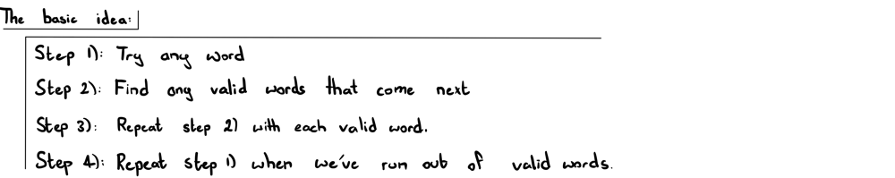
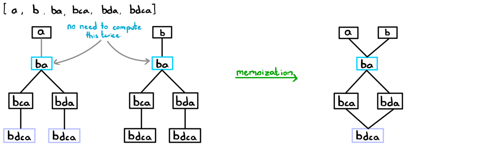
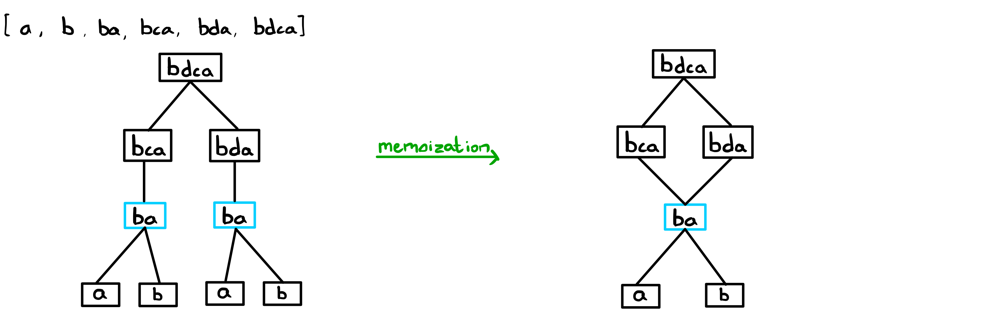
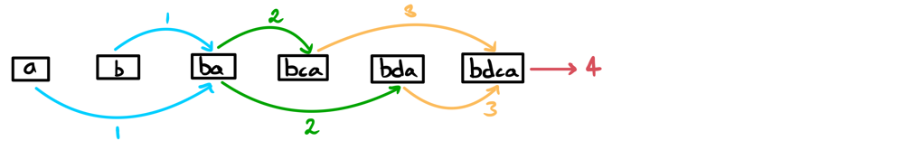

# Explaining Three Approaches | JAVA

**Author:** ciote
**Votes:** 106
**Link:** [https://leetcode.com/problems/longest-string-chain/solutions/2153004/](https://leetcode.com/problems/longest-string-chain/solutions/2153004/)

---

### Intuition:
There are quite a few ways to solve this problem. Below are some ways I've compiled together and I'll try my best to explain how they work and how you might transition from an intuitive thought process to code. Let's get started! 

The fundamental logic behind all three solutions remains the same: 


Below are the three main approaches I'll go through that follow the above template:
1. **DFS + Memoization:** <ins>Increasing the length of the word in each call</ins>.
2. **DFS + Memoization:** <ins>Decreasing the length of the word in each call</ins>.
3. **DP:** <ins>Decreasing the length of the word in each iteration</ins>.
___
### DFS + Memoization:
When you're first thinking of a memoization solution to this question, you've probably thought of starting  from any word and then finding all the valid "next words" that follow after. This makes the most sense intuitively since this is quite literally what the question is asking.

**Approach 1: Increase Word Length:**


As you can see from the above illustration, we're computing the results for some strings multiple times. If we already know how deep a path can go from any given string, why calculate it again? We don't have to; we can just store the result of that string in a memo cache and never have to recalculate for that string ever again. This concept is known as <ins>memoization</ins>. 

<ins>How do we implement this in code?</ins>
Turns out that all the valid words that follow the current word are guaranteed to be exactly one letter longer. Therefore, we can just store all the words with their associated lengths in a hashmap. E.g. Words with length 1: "a" and "b" would be stored with key `1`. Therefore, we can just get the list of words with a certain length, loop through them and see if any of them are valid words to continue the chain. 
To compare two words, we'll use a custom function as you'll see in the code. 
___
**Approach 2: Decrease Word Length:**
The slightly less intuitive idea here is to go in reverse; removing a letter from each word as the "next" step. This is a good example of the "reframing the question" strategy I've discussed in previous posts! This approach has the same time complexity as the previous approach but it's a good example of how you can approach a question from multiple angles. Let's see how this would work:

Again, memoization is applied to avoid recomputation.

<ins>How do we implement this in code?</ins>
The way we find the next (or in this case, the previous) words is a bit different to how we did it in the previous approach despite following the same general structure. Since we're decreasing a letter each time, we can simply chop off a letter from the current word, see if it exists in `words[]`, and add the letter back afterwards before continuing to the next letter. 
For constant time look-up, we'll convert our `words[]` array to a hash set. 
___
### Dynamic Programming:
This is just your usual memoization to DP conversion. Nothing special! It's basically an iterative version of the corresponding memoization algorithm. We can choose either of the above methods to convert to but I've chosen the second approach. As an exercise for yourself, try converting approach 1 from memoization to DP :)

**Approach 3: Decrease Word Length using DP:**


<ins>How do we implement this in code?</ins>
The most important adjustment here is that we need to sort our input array by length since at each word, we add to it the max length from each previous string in the chain. So, we would like all shorter strings to be computed before longer ones. If you chose to convert approach 1 to DP, you'd have to sort the array in reverse order. Remember, the fundamental approach hasn't changed, but our execution has altered slightly since we're replacing our memo table with a DP table,

That's it! Now we're ready to code something up.
___
### Code:
If you have any questions, suggestions or improvements, please feel free to let me know. Thanks for reading!
For the below complexity analyses, assume that `n` is the length of the array and `m` is the max word length.

**DFS + Memoization | Increasing Word Length:**
> Time complexity: `O(n*m^2)`: In dfs(), we look at `n` word at most one time due to memoization. At each dfs(), we compare all nextWords which takes at most `O(m^2)` 
> Space complexity: `O(n)` due to the call stack
```java
private Map<Integer, List<String>> wordLengthMap;
private Map<String, Integer> memo;

public int longestStrChain(String[] words) {
	// store each word with its corresponding length
	wordLengthMap = new HashMap<>();
	for (String word: words) {
		wordLengthMap.putIfAbsent(word.length(), new ArrayList<>());
		wordLengthMap.get(word.length()).add(word);
	}

	int maxPath = 1;
	memo = new HashMap<>();
	for (String word: words) 
		maxPath = Math.max(maxPath, dfs(word));

	return maxPath;
}

private int dfs(String word) {
	if (!wordLengthMap.containsKey(word.length() + 1)) return 1; // if there are no words of the next length, we're done with this path.
	if (memo.containsKey(word)) return memo.get(word); // if we're computed this word before, return the result.

	int maxPath = 0;
	// for each word, find all words which are 1 letter longer and see if they are valid successors.
	List<String> nextWords = wordLengthMap.get(word.length() + 1);
	for (String nextWord: nextWords) 
		if (isOneOff(word, nextWord)) 
			maxPath = Math.max(maxPath, dfs(nextWord));
	
	memo.put(word, maxPath + 1); // store our result
	return memo.get(word);
}

// returns true if two strings differ by no more than 1 letter
private boolean isOneOff(String a, String b) {
	int count = 0;
	for (int i=0, j=0; i<b.length() && j<a.length() && count <= 1; i++) {
		if (a.charAt(j) != b.charAt(i)) count++;
		else j++;
	}
	return count <= 1;
}
```

**DFS + Memoization | Decreasing Word Length:**
> Time complexity: `O(n*m^2)`: In dfs(), we look at 'n' words at most one time due to memoization. At each dfs(), we loop through `m` characters and use `remove()` and `insert()` which each cost `O(m)`.
> Space complexity: `O(n)` due to the call stack.
```java
private Set<String> wordDict;
private Map<String, Integer> memo;

public int longestStrChain(String[] words) {
	wordDict = new HashSet<>();
	Collections.addAll(wordDict, words); // adding all words to a set for constant look-up

	int maxPath = 1;
	memo = new HashMap<>();
	for (String word: words) 
		maxPath = Math.max(maxPath, dfs(word));

	return maxPath;
}

private int dfs(String word) {
	if (memo.containsKey(word)) return memo.get(word); // if we're computed this word before, return the result.

	StringBuilder sb = new StringBuilder(word);
	int maxPath = 0;
	// delete each character, check if that's a valid word in the set, add the character back and continue
	for (int i=0; i<word.length(); i++) {
		sb.deleteCharAt(i);
		String prevWord = sb.toString();
		if (wordDict.contains(prevWord)) 
			maxPath = Math.max(maxPath, dfs(prevWord));
		sb.insert(i, word.charAt(i));
	}
	
	memo.put(word, maxPath + 1); // store the result
	return memo.get(word);
}
```

**DP | Decreasing Word Length:**
> Time complexity: `O(nlogn + n*m^2)`: sorting + same reasons as above.
> Space complexity: `O(n)` for the dp map.
```java
public int longestStrChain(String[] words) {
	Arrays.sort(words, (String a, String b) -> a.length() - b.length()); // sort by length
	Map<String, Integer> dp = new HashMap<>();

	int maxPath = 1;
	// same idea behind the previous approach but performed iteratively.
	for (String word: words) {
		int currLength = 1;
		StringBuilder sb = new StringBuilder(word);
		for (int i=0; i<word.length(); i++) {
			sb.deleteCharAt(i);
			String prevWord = sb.toString();
			currLength = Math.max(currLength, dp.getOrDefault(prevWord, 0) + 1); 
			sb.insert(i, word.charAt(i));
		}
		dp.put(word, currLength);
		maxPath = Math.max(maxPath, currLength);
	}

	return maxPath;
}
```