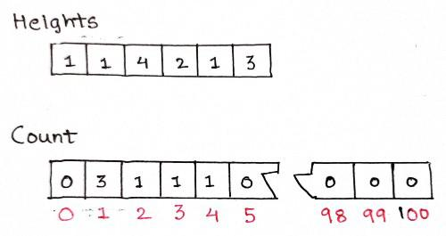

# C++ | Using Counter Array | O(n) | With Explanation

**Author:** nikhil682
**Votes:** 45
**Link:** [https://leetcode.com/problems/height-checker/solutions/1281312/](https://leetcode.com/problems/height-checker/solutions/1281312/)

---

The heights range from 1 to 100. We can use this to construct a solution with time-complexity O(n).

We can create an array of size 101 to store the occurrence of heights.


Now we will traverse the **array heights** and **array count** and compare the **index of count** with **value of heights**. 

```
    int heightChecker(vector<int>& heights) {
        int mismatch = 0; //count the number of mismatches
        vector<int> count(101, 0); // store the count of heights

        for(int i = 0; i < heights.size(); i++) count[heights[i]]++;

        int i = 1, j = 0; 
        while(i < 101){
			// check value of count
            if(count[i] == 0){
                i++;
            }
            else{
				// compare the index of count with value of height
                if(i != heights[j]) mismatch++;
                j++; count[i]--;
            }
        }

        return mismatch;
    }
```