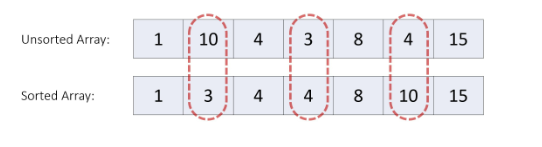

# Easy🔥Interview Approach ✅ || Beat 💯 || All Language 🔥|| Sorting ✅

**Author:** naman_malik
**Votes:** 3
**Link:** [https://leetcode.com/problems/height-checker/solutions/5287284/](https://leetcode.com/problems/height-checker/solutions/5287284/)

---


# Approach - 1 
<!-- Describe your approach to solving the problem. -->
Sorting




# Complexity
- Time complexity: O(NlogN)
<!-- Add your time complexity here, e.g. $$O(n)$$ -->

- Space complexity: O(N)
<!-- Add your space complexity here, e.g. $$O(n)$$ -->

# Code
```C++ []
class Solution {
public:
    int heightChecker(vector<int>& heights) {
        vector<int>v;
        int cnt=0;

        for(auto i: heights)
        v.push_back(i);

        sort(v.begin(),v.end());

        for(int i=0; i<v.size(); i++)
        {
            if(heights[i]!=v[i])
            cnt++;
        }
        
        return cnt;
    }
};
```
```java []
class Solution {
    public int heightChecker(int[] heights) {
        int[] v = Arrays.copyOf(heights, heights.length);
        int cnt = 0;

        Arrays.sort(v);

        for (int i = 0; i < v.length; i++) {
            if (heights[i] != v[i]) {
                cnt++;
            }
        }

        return cnt;
    }
}

```
```python []
class Solution:
    def heightChecker(self, heights: List[int]) -> int:
        v = heights[:]
        cnt = 0

        v.sort()

        for i in range(len(v)):
            if heights[i] != v[i]:
                cnt += 1
        
        return cnt

```


