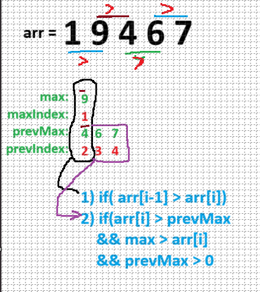

# ✅✅✅ Beats 100% users with image explanation 🔥🔥

**Author:** EliasHridoy
**Votes:** 0
**Link:** [https://leetcode.com/problems/previous-permutation-with-one-swap/solutions/4271210/](https://leetcode.com/problems/previous-permutation-with-one-swap/solutions/4271210/)

---


<!-- Describe your first thoughts on how to solve this problem. -->
# 1053. Previous Permutation With One Swap
Given an array of positive integers arr (not necessarily distinct), return the 
lexicographically
 largest permutation that is smaller than arr, that can be made with exactly one swap. If it cannot be done, then return the same array.

Note that a swap exchanges the positions of two numbers arr[i] and arr[j]

 

Example 1:

Input: arr = [3,2,1]
Output: [3,1,2]
Explanation: Swapping 2 and 1.
Example 2:

Input: arr = [1,1,5]
Output: [1,1,5]
Explanation: This is already the smallest permutation.
Example 3:

Input: arr = [1,9,4,6,7]
Output: [1,7,4,6,9]
Explanation: Swapping 9 and 7.
 

Constraints:

1 <= arr.length <= 104
1 <= arr[i] <= 104
# Approach
<!-- Describe your approach to solving the problem. -->


# Complexity
- Time complexity:
<!-- Add your time complexity here, e.g. $$O(n)$$ -->

- Space complexity:
<!-- Add your space complexity here, e.g. $$O(n)$$ -->

# Code
```
public class Solution {
    public int[] PrevPermOpt1(int[] arr) {
        int maxIndex = 0, prevIndex = 0, max = 0, prevMax = 0;
        for(int i = 1; i < arr.Count(); i++){
            if(arr[i-1] > arr[i] ){
                maxIndex = i-1;
                prevIndex = i;
                max = arr[i-1];
                prevMax = arr[i];
            }
            if(arr[i] > prevMax && max > arr[i] && prevMax > 0){
                prevIndex = i;
                prevMax = arr[i];
            }
        }
        int tmp = arr[maxIndex];
        arr[maxIndex] = arr[prevIndex]; 
        arr[prevIndex] = tmp;
        //Console.WriteLine($"{max}\	{prevMax}\
{maxIndex}\	{prevIndex}" );
        return arr;
    }
}
```