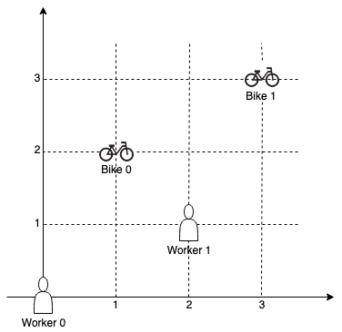
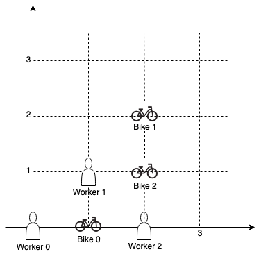

# [1057. Campus Bikes](https://leetcode.com/problems/campus-bikes/)

| Category | Difficulty | Likes | Dislikes |
| :------: | :--------: | :---: | :------: |
| Algorithms | Medium | 1002 | 198 |

**Tags:** [`array`](https://leetcode.com/tag/array), [`sorting`](https://leetcode.com/tag/sorting), [`heap-priority-queue`](https://leetcode.com/tag/heap-priority-queue)

**Companies:** `google`

## Description

On a campus represented on the X-Y plane, there are `n` workers and `m` bikes, with `n <= m`.

You are given an array `workers` of length `n` where `workers[i] = [x_i, y_i]` is the position of the `i^th` worker. You are also given an array `bikes` of length `m` where `bikes[j] = [x_j, y_j]` is the position of the `j^th` bike. All the given positions are **unique**.

Assign a bike to each worker. Among the available bikes and workers, we choose the `(worker_i, bike_j)` pair with the shortest **Manhattan distance** between each other and assign the bike to that worker.

If there are multiple `(worker_i, bike_j)` pairs with the same shortest **Manhattan distance**, we choose the pair with **the smallest worker index**. If there are multiple ways to do that, we choose the pair with **the smallest bike index**. Repeat this process until there are no available workers.

Return *an array *`answer`* of length *`n`*, where *`answer[i]`* is the index (**0-indexed**) of the bike that the *`i^th`* worker is assigned to*.

The **Manhattan distance** between two points `p1` and `p2` is `Manhattan(p1, p2) = |p1.x - p2.x| + |p1.y - p2.y|`.

 

**Example 1:**


```

Input: workers = [[0,0],[2,1]], bikes = [[1,2],[3,3]]
Output: [1,0]
Explanation: Worker 1 grabs Bike 0 as they are closest (without ties), and Worker 0 is assigned Bike 1. So the output is [1, 0].

```

**Example 2:**


```

Input: workers = [[0,0],[1,1],[2,0]], bikes = [[1,0],[2,2],[2,1]]
Output: [0,2,1]
Explanation: Worker 0 grabs Bike 0 at first. Worker 1 and Worker 2 share the same distance to Bike 2, thus Worker 1 is assigned to Bike 2, and Worker 2 will take Bike 1. So the output is [0,2,1].

```

 

**Constraints:**

	- `n == workers.length`

	- `m == bikes.length`

	- `1 <= n <= m <= 1000`

	- `workers[i].length == bikes[j].length == 2`

	- `0 <= x_i, y_i < 1000`

	- `0 <= x_j, y_j < 1000`

	- All worker and bike locations are **unique**.

---

**Links:** [Submissions](https://leetcode.com/problems/campus-bikes/) | [Solutions](https://leetcode.com/problems/campus-bikes/)
