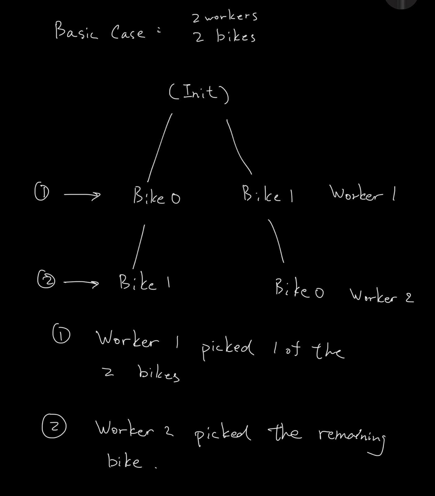
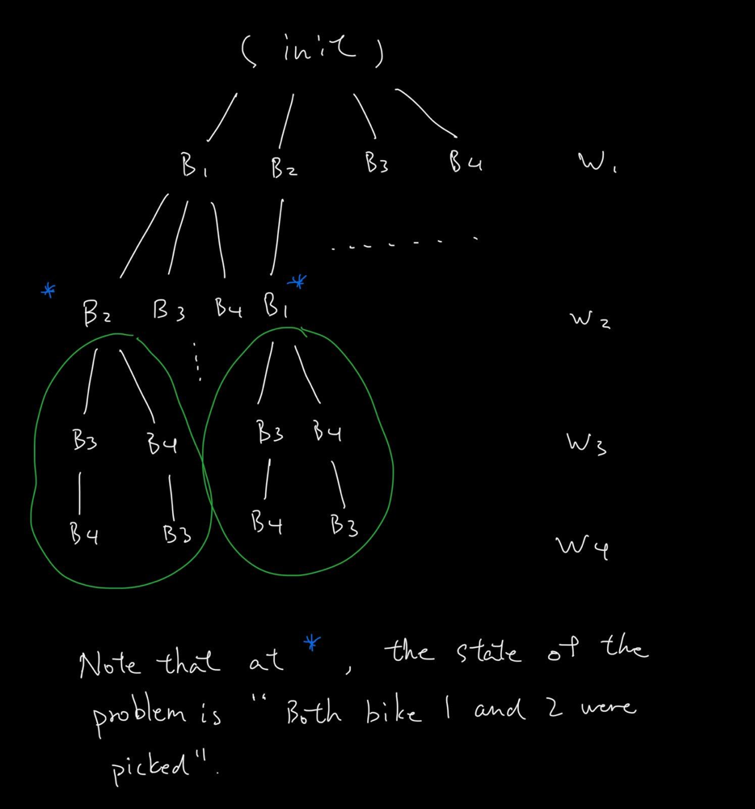
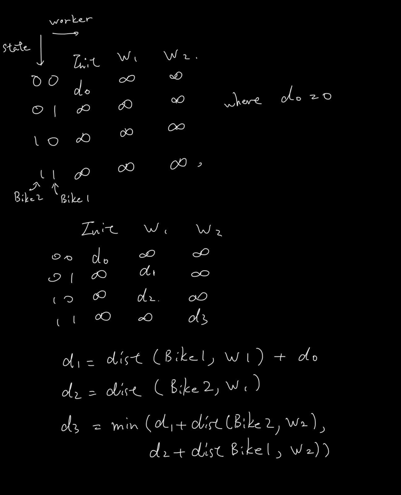

# [C++] Detail explanation of DFS + Memo and DP

**Author:** tinfu330
**Votes:** 6
**Link:** [https://leetcode.com/problems/campus-bikes-ii/solutions/1679754/](https://leetcode.com/problems/campus-bikes-ii/solutions/1679754/)

---

Since I cannot find a clear enough solution, I decided to write my own here. I tried my best to explain, welcome to leave some suggestions on how I can improve this paragraph.

Assuming you are in the interview, without knowning anything about the boundary of bikes.size() and workers.size(), it is tempting to assume that this is a greedy problem, which I did :(. Such solution will not work since we do not have enough information to know which bike is best for each worker (due to not knowing which and how many bikes are picked previously), maybe there is, but I failed to proof it. So I moved on to backtracking.

Before we take a look at backtracking, we have to understand why this question is tricky compare to other medium DP questions. This question is tricky because it is in-fact a 3 dimentional dynamic propgram with each dimention being wokers, bikes, and the current state of the algorithm (which and how many bikes are picked previously), the most tricky part is to figure out what to store in the DP.

As a side note, for those who are not too familiar with DP, according to wikipedia, a problem can be solved using dynamic programming when it has a optimal substructure and overlapping sub-problems. In simple words, a problem that can be divided into sub problems (i.e. divide and conqure) and the sub-problem overlaps (i.e. merge sort is not DP). 

Based on the above definition, we can first try to figure out the 'optimal substructure', i.e. can this problem be solved in a recursive manner? To do so, let's try to draw a decision tree of the problem.

First we begin drawing the so called 'decision tree' for the most simple case, 2 workers with 2 bikes. In the image, we can see the basic structure of the solution confirming that this problem can be solved using the 'divide and conqure' strategy.



Expanding on the previous tree, now let's draw for the case '4 workers, 4 bikes'. As highlighted in the image, we start to see some overlapping problem once workers.size() is large enough.



So this problem can be solved using dynamic programming... but how?

To understand the problem deeper, let's first look at our first solution, bottom-up DFS + memo solution. The idea is to build our result using the distance and bike choice the next woker picked. In our first image, the total distance of worker 1 picking bike 0 is based on worker 2 picking bike 1, same for worker 1 picking bike 1. When a node has 2 child, get the minium result out of two. To prevent overlapping traversal, we store the minimum bottom-up distance leading to each state.

We use state to represent which bike is picked before reaching the hands of the next worker, since the previous worker's choice will affect the current worker's options. In the problem, it is stated that there are at most 10 bikes, thus we can use a 16 bit memory to store the taken bikes with bit masking. The tricky part is that the states goes top-bottom but the distance goes bototm up.

The bottom-up solution provides a foundation for us to rewrite it in a more dynamic program way.

```
class Solution {
private:
    // Get the number of possible states, where each bit represents if the
	// corresponding bike is picked.
    uint16_t getRange(int cnt) {
        uint16_t mask = 1;
        uint16_t res = 0;
        while(cnt-- > 0) {
            res |= mask;
            mask <<= 1;
        }
        return res;
    }
    
	// Calculate Manhaton distance
    int calDist(vector<int> &worker, vector<int> &bike) {
        return abs(worker[0] - bike[0]) + abs(worker[1] - bike[1]);
    }
    
    // Code is a little messy, but you get the idea
    int dfs(int w, int b, vector<vector<int>> &workers, vector<vector<int>> &bikes, vector<int> &memo, uint16_t usedBikes) {
        
		// Reached the bottom worker, start building up the distance bottom-up.
        if (w == workers.size() - 1) return calDist(workers[w], bikes[b]);
		
		// The minimum distance of the current state has been calculated,
		// use the result to build the solution bottom-up
        if (memo[usedBikes] != INT_MIN) return calDist(workers[w], bikes[b]) + memo[usedBikes];
        
		// For each possible next state, get the minimum distance.
        int minDist = INT_MAX;
        for (int i = 0; i < bikes.size(); i++) {
            if (usedBikes & (1 << i)) continue; // Bike is already taken
            minDist = min(minDist, dfs(w + 1, i, workers, bikes, memo, (usedBikes ^ (1 << i))));
        }
        
		// Memoize the optimal bottom-up distance of the current state
        memo[usedBikes] = minDist;
		
		// Build bottom-up distance
        return minDist + calDist(workers[w], bikes[b]);
    }
public:
    int assignBikes(vector<vector<int>>& workers, vector<vector<int>>& bikes) {
        vector<int> memo (getRange(bikes.size()) + 1, INT_MIN);
        int res = INT_MAX;
        
		// Initialize DFS by allowing worker 0 to pick each of the bikes.
        for (int i = 0; i < bikes.size(); i++) {
            res = min(res, dfs(0, i, workers, bikes, memo, (1 << i)));
        }
        return res;
    }
};
```
Now we see the DFS + memo solution, we try to use a more dynamic programming approach to resolve it. The idea is basically follow the decision tree of the previous solution and mark down the optimal shortest distance leading to each state. The below image shows the structure of our solution.


* d2 = dist(Bike2, W1) + d0


```
class Solution {
private:   
    // Get the number of possible states, where each bit represents if the
	// corresponding bike is picked.
    uint16_t getRange(int cnt) {
        uint16_t mask = 1;
        uint16_t res = 0;
        while(cnt-- > 0) {
            res |= mask;
            mask <<= 1;
        }
        return res;
    }
    
	// Calculate Manhaton distance
    int calDist(vector<int> &worker, vector<int> &bike) {
        return abs(worker[0] - bike[0]) + abs(worker[1] - bike[1]);
    }
    
public:
    int assignBikes(vector<vector<int>>& workers, vector<vector<int>>& bikes) {
        uint16_t range = getRange(bikes.size());
        vector<int> dp(range + 1, INT_MAX);
        int res = INT_MAX;
        
        dp[0] = 0; // You need 0 distance to reach state where no bick is picked
        
        for (int i = 0; i < workers.size(); i++) { // for each worker (each layer of decision tree)
            for (int j = range; j >= 0; j--) { // for each possible state, backward as space optimization since only need the results for current state
                if (dp[j] == INT_MAX) continue;
                for (int k = 0; k < bikes.size(); k++) { // pick each of the availabe bikes
                    if (j & (1 << k)) continue; // bike is taken
                    uint16_t nextJ = j ^ (1 << k); // next state where we take bike k
                    dp[nextJ] = min(dp[nextJ], dp[j] + calDist(workers[i], bikes[k]));
                }
                dp[j] = INT_MAX; // reset the current slot, prepare for next worker
            }
        }
        
        // There might be more bikes than workers, thus the DP might not reach
		// it's final state, i.e. dp[range], so we need to use O(n) check
        for (int &eachDp : dp) {
            res = min(res, eachDp);
        }
        
        return res;
    }
};
```

Time Complexity O(MKN), M = workers.size(), N = bikes.size(), K = 2^bikes.size() + 2 ^ (bikes.size() - 1) + ..., approximate to 2^bikes.size()
Space Complexity O(K), where K = 2^bikes.size() + 2 ^ (bikes.size() - 1) + ..., approximate to 2^bikes.size()

rewriting above leads to O(MN2^N) time, O(2^N) space, N = bikes.size();