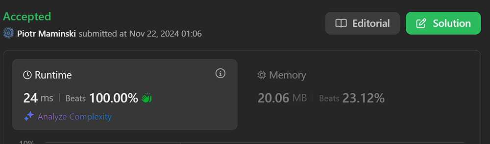

# ✅Beats 100% | Video Full Explain | Simple & Short

**Author:** Piotr_Maminski
**Votes:** 118
**Link:** [https://leetcode.com/problems/flip-columns-for-maximum-number-of-equal-rows/solutions/6070318/](https://leetcode.com/problems/flip-columns-for-maximum-number-of-equal-rows/solutions/6070318/)

---



https://youtu.be/MsdLjL87BEo?si=Hqrg3T3OR1vbsBn6
# #1 Hash Map  (Python,Go,Swift,Rust,Ruby,TS,JS - 100%, Java 94%,C# 80% )
```python3 []
class Solution:
    def maxEqualRowsAfterFlips(self, mat: List[List[int]]) -> int:
        pat_freq = Counter()
        
        for r in mat:
            pattern = tuple(r) if r[0] == 0 else tuple(bit ^ 1 for bit in r)
            pat_freq[pattern] += 1
            
        return max(pat_freq.values())
```
```cpp []
class Solution {
public:
    int maxEqualRowsAfterFlips(vector<vector<int>>& mat) {
        unordered_map<string, int> patFreq;
        
        for (const auto& row : mat) {
            string pattern;
            if (row[0] == 0) {
                for (int bit : row) pattern += to_string(bit);
            } else {
                for (int bit : row) pattern += to_string(bit ^ 1);
            }
            patFreq[pattern]++;
        }
        
        int maxFreq = 0;
        for (const auto& pair : patFreq) {
            maxFreq = max(maxFreq, pair.second);
        }
        return maxFreq;
    }
};
```
```java []
class Solution {
    public int maxEqualRowsAfterFlips(int[][] mat) {
        Map<String, Integer> patFreq = new HashMap<>();
        
        for (int[] row : mat) {
            StringBuilder pattern = new StringBuilder();
            if (row[0] == 0) {
                for (int bit : row) pattern.append(bit);
            } else {
                for (int bit : row) pattern.append(bit ^ 1);
            }
            patFreq.merge(pattern.toString(), 1, Integer::sum);
        }
        
        return Collections.max(patFreq.values());
    }
}
```
```csharp []
public class Solution {
    public int MaxEqualRowsAfterFlips(int[][] mat) {
        Dictionary<string, int> patFreq = new Dictionary<string, int>();
        
        foreach (int[] row in mat) {
            StringBuilder pattern = new StringBuilder();
            if (row[0] == 0) {
                foreach (int bit in row) pattern.Append(bit);
            } else {
                foreach (int bit in row) pattern.Append(bit ^ 1);
            }
            
            string key = pattern.ToString();
            if (!patFreq.ContainsKey(key)) patFreq[key] = 0;
            patFreq[key]++;
        }
        
        return patFreq.Values.Max();
    }
}
```
```golang []
func maxEqualRowsAfterFlips(mat [][]int) int {
    patFreq := make(map[string]int)
    
    for _, row := range mat {
        pattern := make([]byte, len(row))
        if row[0] == 0 {
            for i, bit := range row {
                pattern[i] = byte(bit) + '0'
            }
        } else {
            for i, bit := range row {
                pattern[i] = byte(bit ^ 1) + '0'
            }
        }
        patFreq[string(pattern)]++
    }
    
    maxFreq := 0
    for _, freq := range patFreq {
        if freq > maxFreq {
            maxFreq = freq
        }
    }
    return maxFreq
}
```
```swift []
class Solution {
    func maxEqualRowsAfterFlips(_ mat: [[Int]]) -> Int {
        var patFreq: [String: Int] = [:]
        
        for row in mat {
            var pattern = ""
            if row[0] == 0 {
                pattern = row.map { String($0) }.joined()
            } else {
                pattern = row.map { String($0 ^ 1) }.joined()
            }
            patFreq[pattern, default: 0] += 1
        }
        
        return patFreq.values.max() ?? 0
    }
}

```
```javascript [JS]
// JavaScript

var maxEqualRowsAfterFlips = function(mat) {
    const patFreq = new Map();
    
    for (const row of mat) {
        const pattern = row[0] === 0 
            ? row.join('')
            : row.map(bit => bit ^ 1).join('');
            
        patFreq.set(pattern, (patFreq.get(pattern) || 0) + 1);
    }
    
    return Math.max(...patFreq.values());
};
```
```typescript [TS]
// TypeScript

function maxEqualRowsAfterFlips(mat: number[][]): number {
    const patFreq = new Map<string, number>();
    
    for (const row of mat) {
        const pattern = row[0] === 0 
            ? row.join('')
            : row.map(bit => bit ^ 1).join('');
            
        patFreq.set(pattern, (patFreq.get(pattern) || 0) + 1);
    }
    
    return Math.max(...patFreq.values());
}
```
```rust []
use std::collections::HashMap;

impl Solution {
    pub fn max_equal_rows_after_flips(mat: Vec<Vec<i32>>) -> i32 {
        let mut pat_freq = HashMap::new();
        
        for row in mat {
            let pattern = if row[0] == 0 {
                row.iter().map(|&x| x.to_string()).collect::<String>()
            } else {
                row.iter().map(|&x| (x ^ 1).to_string()).collect::<String>()
            };
            
            *pat_freq.entry(pattern).or_insert(0) += 1;
        }
        
        *pat_freq.values().max().unwrap()
    }
}
```
```ruby []
def max_equal_rows_after_flips(mat)
    pat_freq = Hash.new(0)
    
    mat.each do |row|
        pattern = row[0] == 0 ? 
            row.join : 
            row.map { |bit| bit ^ 1 }.join
            
        pat_freq[pattern] += 1
    end
    
    pat_freq.values.max
end
```
- Complexity: Time O(n*m) & Spce O(m)

# #2 Hash Map  (from video)

```python3 []
class Solution:
    def maxEqualRowsAfterFlips(self, matrix: List[List[int]]) -> int:
        count = defaultdict(int)

        for row in matrix:
            row_key = tuple(row)

            if row[0]:
                row_key = tuple([0 if n else 1 for n in row])

            count[row_key] += 1

        return max(count.values())

```
```cpp []
class Solution {
public:
    int maxEqualRowsAfterFlips(vector<vector<int>>& matrix) {
        unordered_map<string, int> count;
        
        for (const auto& row : matrix) {
            string key;
            bool flip = row[0] == 1;
            
            for (int num : row) {
                key += flip ? ('0' + (1 - num)) : ('0' + num);
            }
            
            count[key]++;
        }
        
        int maxCount = 0;
        for (const auto& pair : count) {
            maxCount = max(maxCount, pair.second);
        }
        
        return maxCount;
    }
};
```
```java []
class Solution {
    public int maxEqualRowsAfterFlips(int[][] matrix) {
        Map<String, Integer> count = new HashMap<>();
        
        for (int[] row : matrix) {
            StringBuilder key = new StringBuilder();
            
            if (row[0] == 1) {
                for (int n : row) {
                    key.append(n == 0 ? 1 : 0);
                }
            } else {
                for (int n : row) {
                    key.append(n);
                }
            }
            
            count.merge(key.toString(), 1, Integer::sum);
        }
        
        return Collections.max(count.values());
    }
}
```
```csharp []
public class Solution {
    public int MaxEqualRowsAfterFlips(int[][] matrix) {
        var count = new Dictionary<string, int>();
        
        foreach (var row in matrix) {
            var key = new int[row.Length];
            for (int i = 0; i < row.Length; i++) {
                key[i] = row[0] == 1 ? 1 - row[i] : row[i];
            }
            var rowKey = string.Join(",", key);
            count[rowKey] = count.GetValueOrDefault(rowKey, 0) + 1;
        }
        
        return count.Values.Max();
    }
}
```
```golang []
func maxEqualRowsAfterFlips(matrix [][]int) int {
    count := make(map[string]int)
    
    for _, row := range matrix {
        key := make([]byte, len(row))
        for i, n := range row {
            if row[0] == 1 {
                key[i] = byte('0' + (1 - n))
            } else {
                key[i] = byte('0' + n)
            }
        }
        count[string(key)]++
    }
    
    maxCount := 0
    for _, v := range count {
        if v > maxCount {
            maxCount = v
        }
    }
    return maxCount
}
```
```swift []
class Solution {
    func maxEqualRowsAfterFlips(_ matrix: [[Int]]) -> Int {
        var count: [String: Int] = [:]
        
        for row in matrix {
            var key = ""
            for (i, num) in row.enumerated() {
                key += String(row[0] == 1 ? 1 - num : num)
            }
            count[key, default: 0] += 1
        }
        
        return count.values.max() ?? 0
    }
}
```
```javascript [JS]
// JavaScript

var maxEqualRowsAfterFlips = function(matrix) {
    const count = new Map();
    
    for (const row of matrix) {
        const key = row.map(n => row[0] ? 1 - n : n).join(',');
        count.set(key, (count.get(key) || 0) + 1);
    }
    
    return Math.max(...count.values());
};
```
```typescript [TS]
// TypeScript

function maxEqualRowsAfterFlips(matrix: number[][]): number {
    const count = new Map<string, number>();
    
    for (const row of matrix) {
        const key = row.map(n => row[0] ? 1 - n : n).join(',');
        count.set(key, (count.get(key) || 0) + 1);
    }
    
    return Math.max(...count.values());
}
```
```rust []
use std::collections::HashMap;

impl Solution {
    pub fn max_equal_rows_after_flips(matrix: Vec<Vec<i32>>) -> i32 {
        let mut count: HashMap<String, i32> = HashMap::new();
        
        for row in matrix.iter() {
            let key: String = row.iter()
                .map(|&n| if row[0] == 1 { 1 - n } else { n })
                .map(|n| n.to_string())
                .collect();
                
            *count.entry(key).or_insert(0) += 1;
        }
        
        *count.values().max().unwrap()
    }
}
```
```ruby []
def max_equal_rows_after_flips(matrix)
    count = Hash.new(0)
    
    matrix.each do |row|
        key = row.map { |n| row[0] == 1 ? 1 - n : n }
        count[key] += 1
    end
    
    count.values.max
end
```
- Complexity: Time O(m * n) & Space O(m * n)

# Bonus: Overkill - Bit Manipulation [[0ms]](https://leetcode.com/problems/flip-columns-for-maximum-number-of-equal-rows/submissions/1459625413) [[0ms]](https://leetcode.com/problems/flip-columns-for-maximum-number-of-equal-rows/submissions/1459686355)


```>>>> []
to roll up long code
```
```cpp [C++ v2]
class Solution {
public:
    int maxEqualRowsAfterFlips(vector<vector<int>>& matrix) {
        const int r = matrix.size(), c = matrix[0].size();
        unordered_map<bitset<300>, int, hash<bitset<300>>> mp(r);
        bitset<300> pattern;
        int max_rows = 0;

        for (int i = 0; i < r; i++) {
            const bool term0 = matrix[i][0];
            int j = 0;
            
            for (; j + 7 < c; j += 8) {
                unsigned char packed = 0;
                for (int k = 0; k < 8; k++) {
                    if (matrix[i][j + k] ^ term0) {
                        packed |= (1 << k);
                    }
                }
                for (int k = 0; k < 8; k++) {
                    pattern[j + k] = (packed >> k) & 1;
                }
            }
            for (; j < c; j++) {
                pattern[j] = matrix[i][j] ^ term0;
            }
            max_rows = max(max_rows, ++mp[pattern]);
            pattern.reset();
        }
        return max_rows;
    }
};
```
```cpp [C++ v1]
class Solution {
public:
    int maxEqualRowsAfterFlips(vector<vector<int>>& mat) {
        int res = 0;
        const int n = mat[0].size();
        unordered_map<string, int> freq;
        string pattern;
        pattern.reserve(n);
        
        for (const auto& row : mat) {
            pattern.clear();
            const int firstBit = row[0];
            
            int i = 0;
            for (; i + 7 < n; i += 8) {
                char packed = 0;
                for (int j = 0; j < 8; j++) {
                    if (row[i + j] != firstBit) {
                        packed |= (1 << j);
                    }
                }
                pattern += packed;
            }
            
            if (i < n) {
                char packed = 0;
                for (int j = 0; i + j < n; j++) {
                    if (row[i + j] != firstBit) {
                        packed |= (1 << j);
                    }
                }
                pattern += packed;
            }
            
            res = max(res, ++freq[pattern]);
        }
        return res;
    }
};
```
```java []
class Solution {
    public int maxEqualRowsAfterFlips(int[][] matrix) {
        int n = matrix.length;
        int m = matrix[0].length;
        Map<Integer, Integer> map = new HashMap<>();
        int maxCount = 0;
        
        for (int i = 0; i < n; i++) {
            if (matrix[i][m-1] == 1) {
                for (int j = 0; j < m; j++) {
                    matrix[i][j] ^= matrix[i][m-1];
                }
            }
            int count = map.merge(Arrays.hashCode(matrix[i]), 1, Integer::sum);
            maxCount = Math.max(maxCount, count);
        }
        return maxCount;
    }
}
```


- Complexity: Time O(n*m) & Spce O(m)


# Explanation


 


---


# Intuition


- When we can flip any column, two rows can become equal if they are either:
    - Identical
    - Complete opposites (0s and 1s swapped)

Key to recogize pattern

For example:

```
1 0 1 0
0 1 0 1
1 1 0 0
0 0 1 1
```
Before you write instructions for a program...
###  what would you do?

1. Grouping Similar Patterns
```
Group 1 (same pattern):
1 0 1 0 > > convert > > 0 1 0 1
0 1 0 1 > > convert > > 0 1 0 1

Group 2 (different pattern):
1 1 0 0 > > convert > > 0 0 1 1
0 0 1 1 > > convert > > 0 0 1 1
```

- Group 1: These rows are flipped versions of each other and can become equal by flipping certain columns


2. Pattern Matching

```
Type A: 1 0 1 0 \u2194 0 1 0 1 (complementary pairs)
Type B: 1 1 0 0 \u2194 0 0 1 1 (complementary pairs)
```
Time to...

3. Converting

```
Group 1:
1 0 1 0    \u2192    1 1 1 0    \u2192    1 1 1 1
0 1 0 1    \u2192    0 1 0 1    \u2192    0 1 0 1
           flip col 2        flip col 4
```


Last step... 

4. Counting

```
Normalized Patterns \u2192 Count
(0,1,0,1) \u2192 2 rows
(0,0,1,1) \u2192 2 rows

Maximum = 2 (result)
```

## Aproach #1 Step by Step

```java [PSEUDOCODE]
Algorithm MaxEqualRowsAfterFlips(matrix):
    Initialize empty frequency map pattern_count

    For each row in matrix:
        // Create pattern by normalizing row to start with 0
        If first element of row is 0:
            pattern = row as-is
        Else:
            pattern = flip all bits in row (0\u21921, 1\u21920)
        
        Increment count of pattern in pattern_count

    Return maximum value from pattern_count

End Algorithm
```
```python3 []
class Solution:
    def maxEqualRowsAfterFlips(self, mat: List[List[int]]) -> int:
        pat_freq = Counter()
        
        for r in mat:
            pattern = tuple(r) if r[0] == 0 else tuple(bit ^ 1 for bit in r)
            pat_freq[pattern] += 1
            
        return max(pat_freq.values())
```


1. Tracking Pattern Frequency

```
pat_freq = Counter()
```
2. Row Processing Loop

```
for r in mat:
```
3. Converting/Normalization

```
pattern = tuple(r) if r[0] == 0 else tuple(bit ^ 1 for bit in r)
```
- If row starts with 0: keeps the pattern as-is 
(for easy pattern matching, to get standard form, visualization above in point 2)
- If row starts with 1: flips all bits using XOR operation
- Converts to tuple for hashability in Counter

4. Counting

```
pat_freq[pattern] += 1
```
- **+1** for each normalized pattern/ Grouping Equal Rows

5. Return Maximum Size Equal (Largest Group)

```
return max(pat_freq.values())
```

Done.

If I failed to explain, tell me in the comments
If I succeeded, there is a funny up arrow, in the lower left corner of the screen.


---


