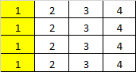
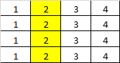
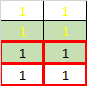
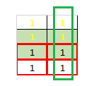
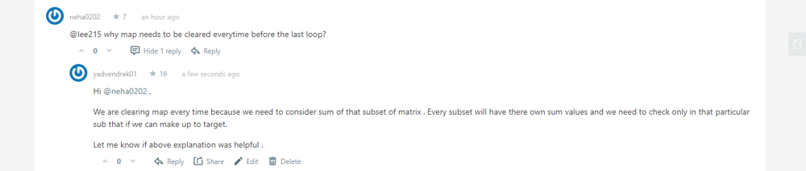

# [C++] Easy Solution with Explanation

**Author:** yadvendrak01
**Votes:** 57
**Link:** [https://leetcode.com/problems/number-of-submatrices-that-sum-to-target/solutions/1162748/](https://leetcode.com/problems/number-of-submatrices-that-sum-to-target/solutions/1162748/)

---

**Intution :**
* We need to apply same logic which we used in : **[Subarray Sum Equals K](https://leetcode.com/problems/subarray-sum-equals-k/)**. If you have not done this pls check it out first .
* Calculate prefix sum for each row.
* Calculate  sum for each column and check if **sum - target** is there in the DS or not .If it is there then add the count. (DS is data structure , in this question we will use **`unordered_map<int,int> counter`**)
		** Why sum - target ? Because if sum - target is there in the DS it means that there is a subset whose sum == target.
		Example :   target = 4 
		***1***  *1  1*  1 
		***1***  *1  1*  1 
		sum of bold = 2 , sum of bold + Italic = 6 ,,, 6 - 4 = **2** , it means the italic sub matrix sum = target.


**Example** : 4 * 4 matrix , target = 4,
```
1 1 1 1
1 1 1 1
1 1 1 1
1 1 1 1
```
**1. Calculate prefix sum for each row ;**

```
1 2 3 4
1 2 3 4
1 2 3 4
1 2 3 4
```

**2. For every possible range between two columns, accumulate the prefix sum of submartrixes that can be formed between these two columns by adding up the sum of values between these two columns for every row.**

For first column  :



```
Sum = 1 + 1 + 1 + 1 =4
sum - target =  0 , which is there in map so count will be increased by 1.
```

For second column  :



Here   when row = 1 ,  2 - target is not there in the DS so we will add  2 into DS with count 1,  **sum = 2**     `DS : {{0 , 1 } , {2 , 1}`
when row = 2  , **sum = 4** 4 - target is there so increase count. `DS : {{0 , 1 } , {2 , 1} , { 4 ,1}`
when row = 3  , **sum = 6** 6 - target = 2, which is there in DS so increase count.`DS : {{0 , 1 } , {2 , 1} , { 4 ,1} ,{6,1}`
when row = 4 , **sum = 8** 8 - target = 4 , which is there in DS so increase count. `DS : {{0 , 1 } , {2 , 1} , { 4 ,1} ,{6,1}, {8,1}`

**In this way for each column we will get number of sub matrixes whose sum is equals to target. Like wise we will do this for all the columns . Now the problem is in this way we are missing some  sub matrixes**


As you can see in the image for column 2 we have considered 3 sub matrixes :
1. Yellow 1's
2. boxes with color inside it.
3. Red border color boxes. so **what we missed ?????**

**We missed the 1's in green box. So to count those sub matrixes  we need to subtract  previous column sum. For this third loop is there which checks if column start is greater than 0  then subtract the sum of previous column and sum.**

```
class Solution {
public:
    int numSubmatrixSumTarget(vector<vector<int>>& matrix, int target) {
        int rows = matrix.size() , cols = matrix[0].size();
        
        if(rows < 1){
            return 0;
        }
        
        // calculate prefix sum for rows
        for(int row = 0 ; row < rows ; row++){
            for(int col = 1 ; col < cols ;col++){
                matrix[row][col] =  matrix[row][col] + matrix[row][col -1];
            }
        }
      
        int count = 0 , sum ;
        unordered_map<int , int> counter;
        for(int colstart = 0 ; colstart < cols ;colstart++){
            for(int col = colstart ; col < cols; col++){
                counter.clear();
                counter[0] = 1;
                sum =0;
                for(int row = 0 ; row < rows ;row++){
                    sum += matrix[row][col] - (colstart > 0 ? matrix[row][colstart - 1] : 0 );
                    count += (counter.find(sum- target) != counter.end() ? counter[sum-target] : 0);
                    counter[sum]++;
                }
            }
        }
        return count;
    }
};
```

***Time Complexity   :  O(row * column^2)
Space Complexity :O(N)***

**Update 18/04/2021 :**

Incase anyone else is having same doubt : 


**Hello,
	Feel free to comment for doubts . I will love to clear them . If something is wrong please let me know in comment section.
Thanks !! Happy Coding.**