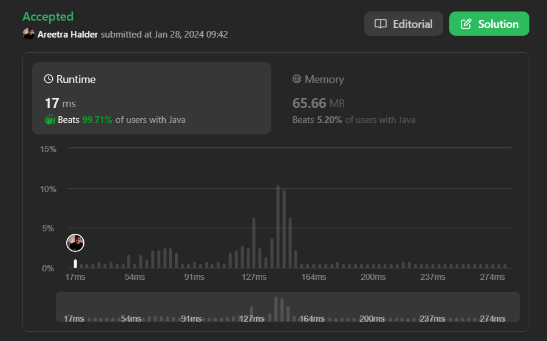

# 🔥✅✅Beats 99.71% with Proof | Very Easy to Understand | Prefix Sum Approach✅✅🔥

**Author:** areetrahalder
**Votes:** 28
**Link:** [https://leetcode.com/problems/number-of-submatrices-that-sum-to-target/solutions/4637019/](https://leetcode.com/problems/number-of-submatrices-that-sum-to-target/solutions/4637019/)

---

# Proof - Upvote if you're watching the proof



# Intuition
<!-- Describe your first thoughts on how to solve this problem. -->
The key intuition here is to use the prefix sum technique to efficiently compute the sum of submatrices. The idea is to preprocess the matrix by calculating the cumulative sum of each row. Then, for any submatrix defined by two column indices `c1` and `c2`, and two row indices `row1` and `row2`, the sum of elements in this submatrix can be computed in constant time using the prefix sum array.

# Approach
<!-- Describe your approach to solving the problem. -->
1. Preprocess the matrix to calculate the cumulative sum for each row. This is done by iterating through each row and updating each element to be the sum of itself and the previous element in the row.
2. Iterate over all possible pairs of column indices `c1` and `c2`.
3. For each pair of column indices, iterate over all possible pairs of row indices `row1` and `row2`.
4. Calculate the sum of the submatrix defined by `c1`, `c2`, `row1`, and `row2` using the preprocessed cumulative sum array.
5. Use a HashMap to keep track of the frequency of each sum encountered so far.
6. Check if the current sum minus the target value exists in the HashMap. If it does, increment the count by the frequency of that sum.
7. Update the HashMap with the current sum.
8. Return the final count as the result.

# Complexity
- Time complexity: $$O(m * n^2)$$
<!-- Add your time complexity here, e.g. $$O(n)$$ -->
> where m is the number of rows and n is the number of columns. The nested loops iterate over all possible submatrices, and the inner loop involves constant time operations.
- Space complexity: $$O(n)$$
<!-- Add your space complexity here, e.g. $$O(n)$$ -->
> where n is the number of columns. The space is used for the HashMap to store the frequency of sums encountered.
# Code
```Java []
class Solution {
    public int numSubmatrixSumTarget(int[][] matrix, int target) {
        int m = matrix.length;
        int n = matrix[0].length;

        for (int row = 0; row < m; row++) {
            for (int col = 1; col < n; col++) {
                matrix[row][col] += matrix[row][col - 1];
            }
        }

        int count = 0;

        for (int c1 = 0; c1 < n; c1++) {
            for (int c2 = c1; c2 < n; c2++) {
                Map<Integer, Integer> map = new HashMap<>();
                map.put(0, 1);
                int sum = 0;

                for (int row = 0; row < m; row++) {
                    sum += matrix[row][c2] - (c1 > 0 ? matrix[row][c1 - 1] : 0);
                    count += map.getOrDefault(sum - target, 0);
                    map.put(sum, map.getOrDefault(sum, 0) + 1);
                }
            }
        }

        return count;
    }
}
```
```C []
int numSubmatrixSumTarget(int** matrix, int matrixSize, int* matrixColSize, int target) {
    int m = matrixSize;
    int n = *matrixColSize;

    // Preprocess the matrix to calculate cumulative sum for each row
    for (int row = 0; row < m; row++) {
        for (int col = 1; col < n; col++) {
            matrix[row][col] += matrix[row][col - 1];
        }
    }

    int count = 0;

    // Iterate over all possible pairs of column indices c1 and c2
    for (int c1 = 0; c1 < n; c1++) {
        for (int c2 = c1; c2 < n; c2++) {
            int sum = 0;
            int prefixSum[100]; // Assuming a maximum size for the prefix sum array

            // Initialize prefix sum array
            for (int i = 0; i < m; i++) {
                prefixSum[i] = 0;
            }

            // Iterate over all possible pairs of row indices row1 and row2
            for (int row = 0; row < m; row++) {
                // Calculate the sum of the submatrix using cumulative sum
                sum += matrix[row][c2] - (c1 > 0 ? matrix[row][c1 - 1] : 0);

                // Check if the current sum minus the target exists in the prefix sum array
                if (sum == target) {
                    count++;
                }

                // Update the prefix sum array
                prefixSum[row] = sum;

                // Check if the (sum - target) exists in the prefix sum array
                for (int k = 0; k < row; k++) {
                    if (prefixSum[row] - prefixSum[k] == target) {
                        count++;
                    }
                }
            }
        }
    }

    return count;
}
```
```C++ []
class Solution
{
    public:
    Solution()
    {
        cin.tie(NULL);
        cout.tie(NULL);
        ios_base :: sync_with_stdio(false);
    }
    int numSubmatrixSumTarget(vector<vector<int>>& matrix, int target)
    {
        int ans = 0;
        int n = matrix.size(), m = matrix[0].size();
        for(int left = 0 ; left < m ; left++)
        {
            vector<int>pre(n, 0);
            for(int right = left ; right < m ; right++)
            {
                for(int i = 0 ; i<n; i++)
                {
                    pre[i] += matrix[i][right];
                }

                for(int i = 0 ; i<n;i++)
                {
                    int sum = 0;
                    for(int j = i ; j<n; j++)
                    {
                        sum += pre[j];
                        if(sum == target)
                        {
                            ans += 1;
                        }
                    }
                }
            }
        }
        return ans;
    }
};
```
```C# []
public class Solution {
    public int NumSubmatrixSumTarget(int[][] matrix, int target) {
        int m = matrix.Length;
        int n = matrix[0].Length;

        // Preprocess the matrix to calculate the cumulative sum for each row
        for (int row = 0; row < m; row++) {
            for (int col = 1; col < n; col++) {
                matrix[row][col] += matrix[row][col - 1];
            }
        }

        int count = 0;

        // Iterate over all possible pairs of column indices c1 and c2
        for (int c1 = 0; c1 < n; c1++) {
            for (int c2 = c1; c2 < n; c2++) {
                Dictionary<int, int> map = new Dictionary<int, int>();
                map[0] = 1;
                int sum = 0;

                // Iterate over all possible pairs of row indices row1 and row2
                for (int row = 0; row < m; row++) {
                    sum += matrix[row][c2] - (c1 > 0 ? matrix[row][c1 - 1] : 0);
                    count += map.GetValueOrDefault(sum - target, 0);
                    map[sum] = map.GetValueOrDefault(sum, 0) + 1;
                }
            }
        }

        return count;
    }
}
```
```Javascript []
/**
 * @param {number[][]} matrix
 * @param {number} target
 * @return {number}
 */
var numSubmatrixSumTarget = function(matrix, target) {
    const m = matrix.length;
    const n = matrix[0].length;

    // Preprocess the matrix to calculate cumulative sum for each row
    for (let row = 0; row < m; row++) {
        for (let col = 1; col < n; col++) {
            matrix[row][col] += matrix[row][col - 1];
        }
    }

    let count = 0;

    for (let c1 = 0; c1 < n; c1++) {
        for (let c2 = c1; c2 < n; c2++) {
            const map = new Map();
            map.set(0, 1);
            let sum = 0;

            for (let row = 0; row < m; row++) {
                sum += matrix[row][c2] - (c1 > 0 ? matrix[row][c1 - 1] : 0);
                count += map.get(sum - target) || 0;
                map.set(sum, (map.get(sum) || 0) + 1);
            }
        }
    }

    return count;
};
```
```Typescript []
function numSubmatrixSumTarget(matrix: number[][], target: number): number {
    const m = matrix.length;
    const n = matrix[0].length;

    for (let row = 0; row < m; row++) {
        for (let col = 1; col < n; col++) {
            matrix[row][col] += matrix[row][col - 1];
        }
    }

    let count = 0;

    for (let c1 = 0; c1 < n; c1++) {
        for (let c2 = c1; c2 < n; c2++) {
            const map = new Map<number, number>();
            map.set(0, 1);
            let sum = 0;

            for (let row = 0; row < m; row++) {
                sum += matrix[row][c2] - (c1 > 0 ? matrix[row][c1 - 1] : 0);
                count += map.get(sum - target) || 0;
                map.set(sum, (map.get(sum) || 0) + 1);
            }
        }
    }

    return count;
}
```
```Python []
class Solution(object):
    def numSubmatrixSumTarget(self, matrix, target):
        rows, cols = len(matrix), len(matrix[0])
        prefix_sum = [[0] * (cols + 1) for _ in range(rows + 1)]

        # Compute the 2D prefix sum
        for i in range(1, rows + 1):
            for j in range(1, cols + 1):
                prefix_sum[i][j] = matrix[i - 1][j - 1] + prefix_sum[i - 1][j] + prefix_sum[i][j - 1] - prefix_sum[i - 1][j - 1]

        count = 0

        # Iterate through all possible pairs of columns
        for col1 in range(1, cols + 1):
            for col2 in range(col1, cols + 1):
                # Use a hashmap to count the number of subarrays with a given sum
                prefix_sum_map = {0: 1}
                current_sum = 0
                for row in range(1, rows + 1):
                    current_sum = prefix_sum[row][col2] - prefix_sum[row][col1 - 1]
                    if current_sum - target in prefix_sum_map:
                        count += prefix_sum_map[current_sum - target]
                    if current_sum in prefix_sum_map:
                        prefix_sum_map[current_sum] += 1
                    else:
                        prefix_sum_map[current_sum] = 1

        return count
```
```Python3 []
class Solution:
    def numSubmatrixSumTarget(self, matrix: List[List[int]], target: int) -> int:
        m, n = len(matrix), len(matrix[0])

        # Step 1: Preprocess the matrix to calculate cumulative sum for each row
        for row in range(m):
            for col in range(1, n):
                matrix[row][col] += matrix[row][col - 1]

        count = 0

        # Step 2: Iterate over all pairs of column indices c1 and c2
        for c1 in range(n):
            for c2 in range(c1, n):
                # Step 3: Iterate over all pairs of row indices row1 and row2
                prefix_sum_map = {0: 1}
                sum_val = 0

                # Step 4: Calculate the sum of submatrix using cumulative sum
                for row in range(m):
                    sum_val += matrix[row][c2] - (matrix[row][c1 - 1] if c1 > 0 else 0)

                    # Step 5 and 6: Update count and prefix_sum_map
                    count += prefix_sum_map.get(sum_val - target, 0)
                    prefix_sum_map[sum_val] = prefix_sum_map.get(sum_val, 0) + 1

        # Step 8: Return the final count
        return count
```
# Upvote - Please

