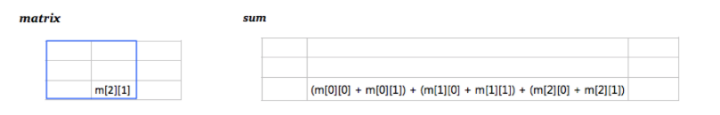
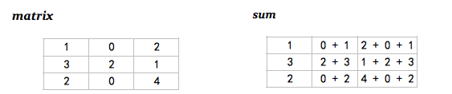
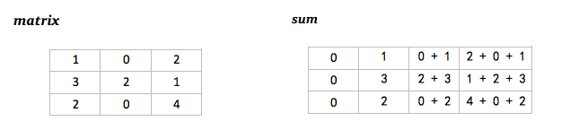
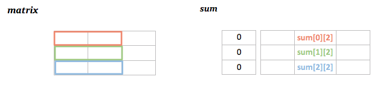
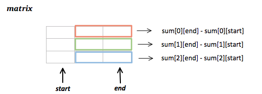
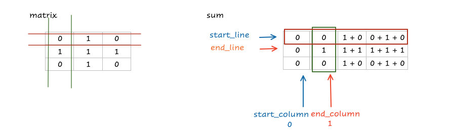
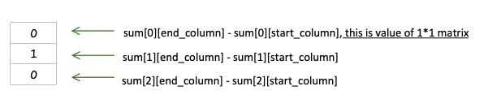

# Java Solution with Detailed Explanation

**Author:** Conor-jiahaochen
**Votes:** 168
**Link:** [https://leetcode.com/problems/number-of-submatrices-that-sum-to-target/solutions/803353/](https://leetcode.com/problems/number-of-submatrices-that-sum-to-target/solutions/803353/)

---

## Before this problem
>https://leetcode.com/problems/subarray-sum-equals-k/
>https://leetcode.com/problems/subarray-sum-equals-k/discuss/803317/Java-Solution-with-Detailed-Explanation
## Thinkings

1.  For a matrix, what is the prefix sum ?

	   sum[x] [y] is the sum of submatrix 

	   (The upper left corner is matrix[0] [0], the lower right corner is matrix[x] [y])

	  


2. How to calculate the sum of all submatrices ***whose upper left corners are matrix[0] [0]*** \uFF1F

   Step 1. Calculate the prefix sum of each line.

	  


   ```java
   // Like the one-dimensional prefix sum, 
   // in order to prevent index out of range and facilitate calculations,
   // we add an extra column with all 0s at the forefront.
   int line = matrix.length;
   int column = matrix[0].length + 1;
   int[][] sum = new int[line][column]; // Initialization default is all 0
           
   for (int l = 0; l < sum.length; l++){
     // start from the second column
     for (int c = 1; c < sum[0].length; c++){
       sum[l][c] = sum[l][c - 1] + matrix[l][c - 1]; // "c - 1",because of an extra column.
     }
   }
   ```

	  


   Step 2. Using the prefix sum of each line to calculate the sum of submatrix.

   


   ```java\xA0
   sum[1][2] = sum[1][2] + sum[0][2]; // green + orange
   ```

   ```java
   sum[2][2] = sum[2][2] + sum[1][2] + sum[0][2]; // blue + green + orange
   ```

   So, to caculate any sum of submatrices ***whose upper left corner are matrix[0] [0].***

   ```java
   int sumOfSubMatrix = 0;
   
   for(int l = 0; l < line; l++){
   	sumOfSubMatrix += sum[l][column]; // one of submatrices
   }
   ```


3. How to find all submatrices ?

   1. Any submatrix needs any two rows and any two columns to form, that is to say, four variables and four nested loops are required.

      ```java
      // Use double nested "for" loop to select any two columns
      for (int start = 0; start < column; start++){
                  for (int end = start + 1; end < column; end++ ){
                    	// ...
                    	// Then Use double nested "for" loop to select any two lines
                  	}
                  }
      ```

   2. Convert 2D to 1D

      Step 1 : Use the ***prefix sum of each row*** to calculate the matrix sum between the "start" column and "end" column.

      


      Step 2 : Rotate it 90 degrees to the left, ***it can be regarded as a one-dimensional array.***

		 


      Then the problem is transformed into how many sub-arrays whose sum == target ?

      ***It's the same with >https://leetcode.com/problems/subarray-sum-equals-k/***

      Step 3 : In the same way, we can use hashmap to optimize the double nested loop for any two lines, and only need one loop

      ```java
      int sumOfSubMatrix = 0;
      Map<Integer, Integer> map = new HashMap<Integer, Integer>();
      map.put(0, 1);
      
      for(int l = 0; l < line; l++){
        // prefix sum
      	sumOfSubMatrix += sum[l][end] - sum[l][start];
        
      	if (map.containsKey(sumOfSubMatrix - target))
      		count += map.get(sumOfSubMatrix - target);
        
      	map.put(sumOfSubMatrix, map.getOrDefault(sumOfSubMatrix, 0) + 1);
      ```

      

      

## Code

```java
class Solution {
    public int numSubmatrixSumTarget(int[][] matrix, int target) {
        int count = 0;
        int line = matrix.length;
        int column = matrix[0].length + 1;
        int[][] sum = new int[line][column];
        
        for (int i = 0; i < sum.length; i++){
            for (int j = 1; j < sum[0].length; j++){
                sum[i][j] = sum[i][j - 1] + matrix[i][j - 1];
            }
        }
        
        
        for (int start = 0; start < column; start++){
            for (int end = start + 1; end < column; end++ ){
                
                int sumOfSubMatrix = 0;
                Map<Integer, Integer> map = new HashMap<Integer, Integer>();
                map.put(0, 1);
                for(int l = 0; l < line; l++){
                    sumOfSubMatrix += sum[l][end] - sum[l][start];
                    if (map.containsKey(sumOfSubMatrix - target))
                        count += map.get(sumOfSubMatrix - target);
                    map.put(sumOfSubMatrix, map.getOrDefault(sumOfSubMatrix, 0) + 1);
                    
                }
            }
        }
        
        return count;
        
    }
}
```


## Update
For the commet from jun.
1. What's the meaning of this sentence ?
+ "Any submatrix needs any two rows and any two columns to form, that is to say, four variables and four nested loops are required." 

	eg. |0| is the submatrix I want to find, whose index is [0][0]
	In the "sum", the column 1 corresponds to column 0 in "matrix".  SO we bound the area like this


Since we have done prefix sum for every line, we need to do sum[line][end_column] - sum[line][start_column], and in this case elements in start_column is all 0, when we subtract sum[line][0], It actually did nothing.

Also, since "end_cloumn" starts from "end_cloumn = start_column + 1", it is impossible to treat the first column of "sum" as part of our result.



