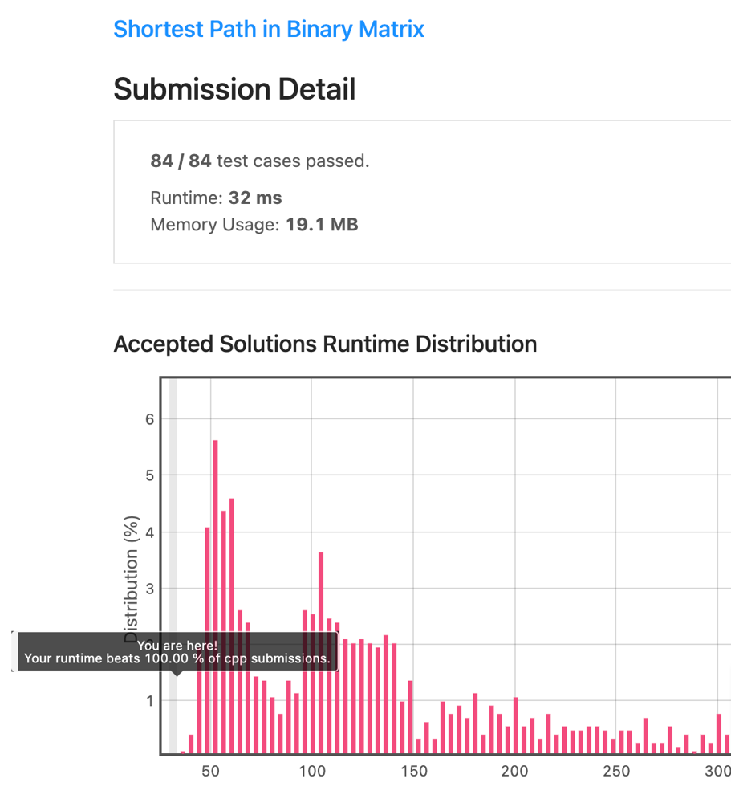
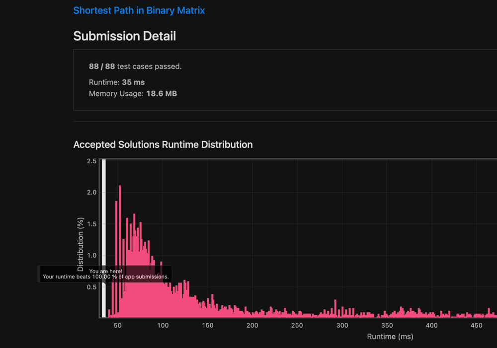

# [C++] Optimised BFS vs. DFS, Fastest Solution to Date, 100% Time (35ms), ~99% Space (18.3MB)

**Author:** Ajna2
**Votes:** 89
**Link:** [https://leetcode.com/problems/shortest-path-in-binary-matrix/solutions/1063734/](https://leetcode.com/problems/shortest-path-in-binary-matrix/solutions/1063734/)

---

Handbook maze exploration problem and we know we might be better served with a BFS in this case; and if you want to practice more of it, please also [check this somehow similar problem](https://leetcode.com/problems/is-graph-bipartite/), that I discussed [here](https://leetcode.com/problems/is-graph-bipartite/discuss/1065215/).

To do so, we will first of all rule out the edge case in which either the start or target cell are unreachable, to save needless computation and be sure later of some loop invariants.

If that was not the case, then we will declare a few support variables:
* `res`, initialised to `2`, since it would normally at least take 2 steps to move from start to target;
* `len`, the length of our queue, preset to the value of `1`;
* `maxX` and `maxY` as the extremes of our grid (I know it is a square one, but allow me to immolate a couple of bytes to make this solution more general);
* `q`, a queue of pairs of integers representing the coordinates and that we will initially set to contain the starting point, pushing `{0, 0}` into it, provided we are not in a single cell maze.

If that is the case (`!maxX && !maxY`), we will then return `1 - (grid[0][0] << 1)`, which is just a cool way to write `grid[0][0] ? -1 : 1`, which in turn means we will have the edge case of a single step only if our single cell is empty, impossible path (`-1`) otherwise.

If that was not the case, we will also then mark the first cell as visited and move on with our main BFS loop, that will run as long as we have elements in the queue (`len !=0`) and that will:
* have another inner loop running `len` times in which we:
	* extract `cx` and `cy` from the top of the queue;
	* pop the top;
	* use `cx` and `cy` to loop around all the neighbours, setting the initial value of `x` and `y` to the the maximum between `0` and the current value (`cx` or `cy`, respectively) `- 1`, and the upper limit of the loop as the minimum value between the current value `+ 1` and either `maxX` or `maxY`, included, then:
		* we computed `maxX` and `maxY` smaller than one step from the actual size to have an easier life here - we will return `res` when `x == maxX && y == maxY` - meaning we reached the target;
		* alternatively, we will check if `grid[y][x]` is still unexplored and if so, we will mark it and push it into q for the the next loop;
* increase `res` by `1`;
* update `len` with the current length of the queue.

If we leave the loop, it means no path was found, so we can safely return `-1` :)

The code:

```cpp
class Solution {
public:
    int shortestPathBinaryMatrix(vector<vector<int>>& grid) {
        // edge case: start or end not accessible
        if (grid[0][0] || grid.back().back()) return -1;
        // support variables
        int res = 2, len = 1, maxX = grid[0].size() - 1, maxY = grid.size() - 1;
        queue<pair<int, int>> q;
        // edge case: single cell matrix
        if (!maxX && !maxY) return 1 - (grid[0][0] << 1);
        // adding the starting point
        q.push({0, 0});
        // marking start as visited
        grid[0][0] = -1;
        while (len) {
            while (len--) {
                // reading and popping the coordinates on the front of the queue
                auto [cx, cy] = q.front();
                q.pop();
                for (int x = max(0, cx - 1), lmtX = min(cx + 1, maxX); x <= lmtX; x++) {
                    for (int y = max(0, cy - 1), lmtY = min(cy + 1, maxY); y <= lmtY; y++) {
                        // check if we reached the target
                        if (x == maxX && y == maxY) return res;
                        // marking it as visited and adding it to the q if it was still a valid cell
                        if (!grid[y][x]) {
                            grid[y][x] = -1;
                            q.push({x, y});
                        }
                    }
                }
            }
            // preparing for the next loop
            res++;
            len = q.size();
        }
        return -1;
    }
};
```

The brag \uD83D\uDE0E :



The fun - getting it with also with a backtracking DFS!

Let me anticipate that it just TLEs on bigger maps, but it was still nice to practice with it.

Notice that we moved all the support variables to be private class variables and we do need also some less logic to handle edge cases in our main function, which is now limited to assigning values to both `maxX` and `maxY`, then computing the shortest path.

Most of the logic goes into our `dfs` helper that will first of all return the current value of  our coordinates and, if they are the ones of the target, then we just  `return res`; otherwise, we:
* declare `partRes` as `INT_MAX`;
* mark the current cell as visited;
* increase `res` by one;
* loop through all the visitable adjacent cells and, for each available one, call `dfs` on it and assigning to `partRes` the smaller value between the current one and what was found on that path;
* finally we backtrack, specularly to our first operations, unmarking the current cell as visited and
* decreasing `res` by `1`.

Back in our main function, we overwrite `res` with the final result and return `-1` if it is still `INT_MAX` (ie: no paths found), `res` itself otherwise :)

The code:

```cpp
class Solution {
private:
    // support variables
    int maxX, maxY, res = 1;
    int dfs(vector<vector<int>>& grid, int cx = 0, int cy = 0) {
        // check if we reached the target
        if (cx == maxX && cy == maxY) return res;
        // support variable
        int partRes = INT_MAX;
        // marking the cell as visited and increasing res
        grid[cy][cx] = -1;
        res++;
        for (int x = max(0, cx - 1), lmtX = min(cx + 1, maxX); x <= lmtX; x++) {
            for (int y = max(0, cy - 1), lmtY = min(cy + 1, maxY); y <= lmtY; y++) {
                if (!grid[y][x]) {
                    partRes = min(partRes, dfs(grid, x, y));
                }
            }
        }
        // backtracking the cell as non-visited and decreasing res
        grid[cy][cx] = 0;
        res--;
        return partRes;
    }
public:
    int shortestPathBinaryMatrix(vector<vector<int>>& grid) {
        // edge case: start or end not accessible
        if (grid[0][0] || grid.back().back()) return -1;
        maxX = grid[0].size() - 1, maxY = grid.size() - 1;
        // searching from the starting point
        res = dfs(grid);
        return res == INT_MAX ? -1 : res;
    }
};
```

I guess we might have had a better luck with a double-ended BFS, moving to diagonals first and stopping as soon as we find a path, though\uD83E\uDD14

Edit: no, going through diagonal first fails - consider this case for example: `[[0,0,0],[0,1,0],[0,0,0]]`; and then run it with this code:

```cpp
class Solution {
private:
    // support variables
    int maxX, maxY, res = 1, x, y;
    bool found = false;
    pair<int, int> dirs[8] = {{1, 1}, {-1, 1}, {1, -1}, {-1, -1}, {0, 1}, {1, 0}, {0, -1}, {-1, 0}};
    void dfs(vector<vector<int>>& grid, int cx = 0, int cy = 0) {
        // check if we reached the target
        if (cx == maxX && cy == maxY) {
            found = true;
            return;
        }
        // marking the cell as visited and increasing res
        res++;
        grid[cy][cx] = -1;
        for (auto dir: dirs) {
            x = cx + dir.first, y = cy + dir.second;
            if (x >= 0 && x <= maxX && y >= 0 && y <= maxY && !grid[y][x]) {
                dfs(grid, x, y);
                if (found) return;
            }
        }
        // backtracking the cell as non-visited and decreasing res
        grid[cy][cx] = 0;
        res--;
    }
public:
    int shortestPathBinaryMatrix(vector<vector<int>>& grid) {
        // edge case: start or end not accessible
        if (grid[0][0] || grid.back().back()) return -1;
        maxX = grid[0].size() - 1, maxY = grid.size() - 1;
        // searching from the starting point
        dfs(grid);
        return found ? res : -1;
    }
};
```

To fix it would require going back to that cumbersome, heavy backtracking we had above.

The double BFS idea worked better instead and it allowed me to improve both performance and memory usage - same logic as the first example, but despite using 2 queues, we end up filling them up less:

```cpp
class Solution {
public:
    int shortestPathBinaryMatrix(vector<vector<int>>& grid) {
        // edge case: start or end not accessible
        if (grid[0][0] || grid.back().back()) return -1;
        // support variables
        int res = 2, len = 1, maxX = grid[0].size() - 1, maxY = grid.size() - 1;
        queue<pair<int, int>> q1, q2;
        bool isStartTurn = true;
        // edge case: single cell matrix
        if (!maxX && !maxY) return 1 - (grid[0][0] << 1);
        // adding the start and ending points
        q1.push({0, 0});
        q2.push({maxX, maxY});
        // marking start and ending points as visited
        grid[0][0] = -1;
        grid[maxY][maxX] = -2;
        while (len) {
            while (len--) {
                // reading and popping the coordinates on the front of the queue
                auto [cx, cy] = (isStartTurn ? q1 : q2).front();
                (isStartTurn ? q1 : q2).pop();
                for (int x = max(0, cx - 1), lmtX = min(cx + 1, maxX); x <= lmtX; x++) {
                    for (int y = max(0, cy - 1), lmtY = min(cy + 1, maxY); y <= lmtY; y++) {
                        // check if we reached an already visited cell fromm the other side
                        if (grid[y][x] == (isStartTurn ? -2 : -1)) return res;
                        // marking it as visited and adding it to the q if it was still a valid cell
                        if (!grid[y][x]) {
                            grid[y][x] = isStartTurn ? -1 : -2;
                            (isStartTurn ? q1 : q2).push({x, y});
                        }
                    }
                }
            }
            // preparing for the next loop
            res++;
            isStartTurn = !isStartTurn;
            len = (isStartTurn ? q1 : q2).size();
        }
        return -1;
    }
};
```

Today I forgot I did this already, so I re-coded it from scratch, trying to optimise it in the computation of adjacent cells, going for diagonal firsts, marking them immediately as explored and thus not storing duplicated cells in my queue; it worked pretty well, despite some verbose/duplicated code to check only the necessary condition for out of boundaries cases:

```cpp
using pathType = pair<int, int>;

class Solution {
    void markAndAdd(vector<vector<int>> &grid, queue<pathType> &q, int x, int y) {
        // marking the current node as visited and adding it to q
        grid[y][x] = 1;
        q.push({x, y});
    }
public:
    int shortestPathBinaryMatrix(vector<vector<int>> &grid) {
        int res = 0, t = grid.size() - 1, qLen = 1, cx, cy, x, y;
        if (grid[0][0] || grid[t][t]) return -1;
        queue<pathType> q{{{0, 0}}};
        // marking the start as visited
        grid[0][0] = 1;
        while (qLen) {
            res++;
            // increasing the counter
            while (qLen--) {
                // extracting the front of the queue
                auto &front = q.front();
                cx = front.first;
                cy = front.second;
                // checking if we had a match
                if (cx == t && cy == t) return res;
                q.pop();
                // adding adjacent unexplored nodes to the queue
                // diagonals:
                // upper left
                x = cx - 1, y = cy - 1;
                if (x >= 0 && y >= 0 && !grid[y][x]) markAndAdd(grid, q, x, y);
                // upper right
                x = cx + 1;
                if (x <= t && y >= 0 && !grid[y][x]) markAndAdd(grid, q, x, y);
                // lower right
                y = cy + 1;
                if (x <= t && y <= t && !grid[y][x]) markAndAdd(grid, q, x, y);
                // lower left
                x = cx - 1;
                if (x >= 0 && y <= t && !grid[y][x]) markAndAdd(grid, q, x, y);
                // adjacent ones:
                // mid left
                y = cy;
                if (x >= 0 && !grid[y][x]) markAndAdd(grid, q, x, y);
                // mid right
                x = cx + 1;
                if (x <= t && !grid[y][x]) markAndAdd(grid, q, x, y);
                // upper mid
                x = cx, y = cy - 1;
                if (y >= 0 && !grid[y][x]) markAndAdd(grid, q, x, y);
                // lower mid
                y = cy + 1;
                if (y <= t && !grid[y][x]) markAndAdd(grid, q, x, y);
            }
            qLen = q.size();
        }
        return -1;
    }
};
```

But, wait a moment... We had that sweet double ended BFS idea in mind, right?

Well, turns out it works even better with my uber-optimised solutions; and since one year ago, I can do even better, just avoiding painful ternary operators all the time and just swapping queues and markers as we go; `res` is also initialised to be `1` (since we already do one extra step marking `{t, t}` too), unless `t == 0`.

The updated code:

```cpp
using pathType = pair<int, int>;

class Solution {
    int startMark = -1, endMark = -2;
    queue<pathType> q1{{{0, 0}}}, q2;
    void markAndAdd(vector<vector<int>> &grid, int x, int y) {
        // marking the current node as visited and adding it to q
        grid[y][x] = startMark;
        q1.push({x, y});
    }
public:
    int shortestPathBinaryMatrix(vector<vector<int>> &grid) {
        int t = grid.size() - 1, res = bool(t), qLen = 1, cx, cy, x, y, currVal;
        if (grid[0][0] || grid[t][t]) return -1;
        // marking the start end end as visited
        q2.push({t, t});
        grid[0][0] = startMark;
        grid[t][t] = endMark;
        while (qLen) {
            // increasing the counter
            res++;
            while (qLen--) {
                // extracting the front of the queue
                auto &front = q1.front();
                cx = front.first;
                cy = front.second;
                // checking if we had a match
                if (grid[cy][cx] == endMark) return res;
                q1.pop();
                // adding adjacent unexplored nodes to the queue
                // diagonals:
                // upper left
                x = cx - 1, y = cy - 1;
                if (x >= 0 && y >= 0) {
                    currVal = grid[y][x];
                    if (currVal == endMark) return res;
                    if (!currVal) markAndAdd(grid, x, y);
                }
                // upper right
                x = cx + 1;
                if (x <= t && y >= 0) {
                    currVal = grid[y][x];
                    if (currVal == endMark) return res;
                    if (!currVal) markAndAdd(grid, x, y);
                }
                // lower right
                y = cy + 1;
                if (x <= t && y <= t) {
                    currVal = grid[y][x];
                    if (currVal == endMark) return res;
                    if (!currVal) markAndAdd(grid, x, y);
                }
                // lower left
                x = cx - 1;
                if (x >= 0 && y <= t) {
                    currVal = grid[y][x];
                    if (currVal == endMark) return res;
                    if (!currVal) markAndAdd(grid, x, y);
                }
                // adjacent ones:
                // mid left
                y = cy;
                if (x >= 0) {
                    currVal = grid[y][x];
                    if (currVal == endMark) return res;
                    if (!currVal) markAndAdd(grid, x, y);
                }
                // mid right
                x = cx + 1;
                if (x <= t) {
                    currVal = grid[y][x];
                    if (currVal == endMark) return res;
                    if (!currVal) markAndAdd(grid, x, y);
                }
                // upper mid
                x = cx, y = cy - 1;
                if (y >= 0) {
                    currVal = grid[y][x];
                    if (currVal == endMark) return res;
                    if (!currVal) markAndAdd(grid, x, y);
                }
                // lower mid
                y = cy + 1;
                if (y <= t) {
                    currVal = grid[y][x];
                    if (currVal == endMark) return res;
                    if (!currVal) markAndAdd(grid, x, y);
                }
            }
            swap(q1, q2);
            swap(startMark, endMark);
            qLen = q1.size();
        }
        return -1;
    }
};
```

The updated brag:

