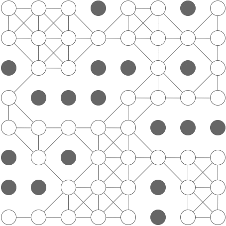
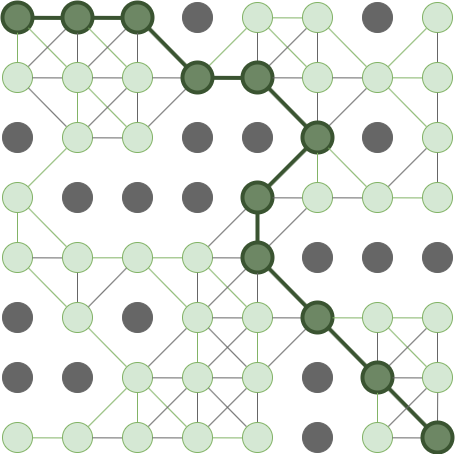

# A* search in Python

**Author:** lxnn
**Votes:** 424
**Link:** [https://leetcode.com/problems/shortest-path-in-binary-matrix/solutions/313347/](https://leetcode.com/problems/shortest-path-in-binary-matrix/solutions/313347/)

---

An A* search is like a breadth-first seach, except that in each iteration, instead of expanding the cell with the shortest path from the origin, we expand the cell with the lowest overall estimated path length -- this is the distance so far, plus a heuristic (rule-of-thumb) estimate of the remaining distance. As long as the heuristic is [consistent](https://en.wikipedia.org/wiki/Consistent_heuristic), an A* graph-search will find the shortest path. This can be somewhat more efficient than breadth-first-search as we typically don't have to visit nearly as many cells. Intuitively, an A* search has an approximate sense of direction, and uses this sense to guide it towards the target.

# Example

```
[
	[0,0,0,1,0,0,1,0],
	[0,0,0,0,0,0,0,0],
	[1,0,0,1,1,0,1,0],
	[0,1,1,1,0,0,0,0],
	[0,0,0,0,0,1,1,1],
	[1,0,1,0,0,0,0,0],
	[1,1,0,0,0,1,0,0],
	[0,0,0,0,0,1,0,0]
]
```

With this grid, an A* search will expolore only the green cells in this animation:



Whereas a BFS will visit *every* cell:



# Implementation

We perform an A* search to find the shortest path, then return it's length, if there is one. Note: I chose to deal with the special case, that the starting cell is a blocking cell, here rather than complicate the search implementation.

```python
class Solution:
    def shortestPathBinaryMatrix(self, grid):
        shortest_path = a_star_graph_search(
            start              = (0, 0), 
            goal_function      = get_goal_function(grid),
            successor_function = get_successor_function(grid),
            heuristic          = get_heuristic(grid)
        )
        if shortest_path is None or grid[0][0] == 1:
            return -1
        else:
            return len(shortest_path)
```

## A* search function

This implementation is somewhat general and will work for other constant-cost search problems, as long as you provide a suitable goal function, successor function, and heuristic.

```python
def a_star_graph_search(
            start,
            goal_function,
            successor_function,
            heuristic
	):
    visited = set()
    came_from = dict()
    distance = {start: 0}
    frontier = PriorityQueue()
    frontier.add(start)
    while frontier:
        node = frontier.pop()
        if node in visited:
            continue
        if goal_function(node):
            return reconstruct_path(came_from, start, node)
        visited.add(node)
        for successor in successor_function(node):
            frontier.add(
                successor,
                priority = distance[node] + 1 + heuristic(successor)
            )
            if (successor not in distance
                or distance[node] + 1 < distance[successor]):
                distance[successor] = distance[node] + 1
                came_from[successor] = node
    return None

def reconstruct_path(came_from, start, end):
    """
    >>> came_from = {'b': 'a', 'c': 'a', 'd': 'c', 'e': 'd', 'f': 'd'}
    >>> reconstruct_path(came_from, 'a', 'e')
    ['a', 'c', 'd', 'e']
    """
    reverse_path = [end]
    while end != start:
        end = came_from[end]
        reverse_path.append(end)
    return list(reversed(reverse_path))
```

## Goal function

We need a function to check whether we have reached the goal cell:

```python
def get_goal_function(grid):
    """
    >>> f = get_goal_function([[0, 0], [0, 0]])
    >>> f((0, 0))
    False
    >>> f((0, 1))
    False
    >>> f((1, 1))
    True
    """
    M = len(grid)
    N = len(grid[0])
    def is_bottom_right(cell):
        return cell == (M-1, N-1)
    return is_bottom_right
```

## Successor function

We also need a function to find the cells adjacent to the current cell:

```python
def get_successor_function(grid):
    """
    >>> f = get_successor_function([[0, 0, 0], [0, 1, 0], [1, 0, 0]])
    >>> sorted(f((1, 2)))
    [(0, 1), (0, 2), (2, 1), (2, 2)]
    >>> sorted(f((2, 1)))
    [(1, 0), (1, 2), (2, 2)]
    """
    def get_clear_adjacent_cells(cell):
        i, j = cell
        return (
            (i + a, j + b)
            for a in (-1, 0, 1)
            for b in (-1, 0, 1)
            if a != 0 or b != 0
            if 0 <= i + a < len(grid)
            if 0 <= j + b < len(grid[0])
            if grid[i + a][j + b] == 0
        )
    return get_clear_adjacent_cells
```

## Heuristic

The chosen heuristic is simply the distance to the goal in a clear grid of the same size. This turns out to be the maximum of the x-distance and y-distance from the goal. This heuristic is [admissible](https://en.wikipedia.org/wiki/Admissible_heuristic) and [consistent](https://en.wikipedia.org/wiki/Consistent_heuristic).

```python
def get_heuristic(grid):
    """
    >>> f = get_heuristic([[0, 0], [0, 0]])
    >>> f((0, 0))
    1
    >>> f((0, 1))
    1
    >>> f((1, 1))
    0
    """
    M, N = len(grid), len(grid[0])
    (a, b) = goal_cell = (M - 1, N - 1)
    def get_clear_path_distance_from_goal(cell):
        (i, j) = cell
        return max(abs(a - i), abs(b - j))
    return get_clear_path_distance_from_goal
```

## Priority queue

The Python standard library provides a heap data structure, but not a priority-queue, so we need to implement one ourselves.

```python
from heapq import heappush, heappop

class PriorityQueue:
    
    def __init__(self, iterable=[]):
        self.heap = []
        for value in iterable:
            heappush(self.heap, (0, value))
    
    def add(self, value, priority=0):
        heappush(self.heap, (priority, value))
    
    def pop(self):
        priority, value = heappop(self.heap)
        return value
    
    def __len__(self):
        return len(self.heap)
```

And that's it. 

# Breadth-first search

Here is a breadth-first-search implementation, for comparison:

```python
from collections import deque

def breadth_first_search(grid):
    N = len(grid)

    def is_clear(cell):
        return grid[cell[0]][cell[1]] == 0

    def get_neighbours(cell):
        (i, j) = cell
        return (
            (i + a, j + b)
            for a in (-1, 0, 1)
            for b in (-1, 0, 1)
            if a != 0 or b != 0
            if 0 <= i + a < N
            if 0 <= j + b < N
            if is_clear( (i + a, j + b) )
        )

    start = (0, 0)
    goal = (N - 1, N - 1)

    queue = deque()
    if is_clear(start):
        queue.append(start)
    visited = set()
    path_len = {start: 1}

    while queue:
        cell = queue.popleft()
        if cell in visited:
            continue
        if cell == goal:
            return path_len[cell]
        visited.add(cell)
        for neighbour in get_neighbours(cell):
            if neighbour not in path_len:
                path_len[neighbour] = path_len[cell] + 1
            queue.append(neighbour)

    return -1
```