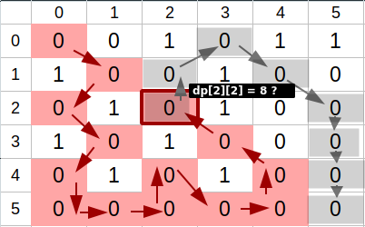
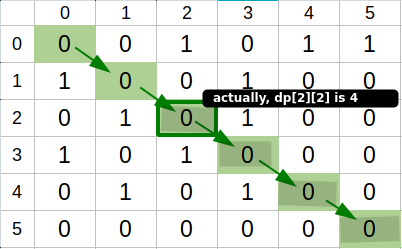

# This is why DP and Memoization fail (illustrated example)

**Author:** rcomesan
**Votes:** 52
**Link:** [https://leetcode.com/problems/shortest-path-in-binary-matrix/solutions/2046009/](https://leetcode.com/problems/shortest-path-in-binary-matrix/solutions/2046009/)

---

Here's an illustrated example of why memoizing our answers ("dp top-down") also won't work. 

Let's say we define a function **countCellsToTarget(i, j)**, that returns the **minimum number of '0' cells** that we need to go through in order to get from position (i, j) to our target position (n-1, n-1).

Given the following input: [[0,0,1,0,1,1],[1,0,0,1,0,0],[0,1,0,1,0,0],[1,0,1,0,0,0],[0,1,0,1,0,0],[0,0,0,0,0,0]], with an expected result of 6, depending on the **order** in which we move onto the adjacent cells, we might discover a long path before we actually discover the shortest one. Therefore, memoizing an incorrect result.

In the following example let's imagine that, because of how we defined our directions array, we end up visiting our neighbors in a very strange order (red arrows):



Every time twe visit a cell (painted in red) we mark it as visited, so that we don't visit it again during the same path. Every time we hit a cell that we don't have our result memoized, we start exploring all the different paths from there to our destination.

Let's just focus on cell (2,2). Once we get there, our only option is moving to the top. The reason behind this is that we're actually using the **surrounding state** of the current path to calculate the answer to cell (2,2) (that is cells marked as already visited!)

From cell (1,2) we'd start exploring different paths trying to get to the (n-1, n-1) cell:
1.  We'd first move to the top-left cell (0, 1) leading us to a dead end.
2.  Then, we'd backtrack to cell (1, 2), and then move to the top-right cell (0, 3) that would get us to the last cell in a path of total length 8 (highlighted in gray).

After we reach to our target, the solution for cell (2, 2) appears to be 8. At that point we'd probably store this solution in our dp array and continue our exploration **based on this premise which is false**, leading us to a wrong answer.

As you can see here, in the shortest path, the solution for cell (2, 2) is actually 4



This is the reason why we can't do better than exponential time complexity O(7^(n^2)) when doing a backtracking solution as we cannot get rid of duplicate work by memoizing our answers.

Unlike BFS, DFS doesn't guarantee that we choose the shortest path first. So, we might actually take the longest one first and end up finding a path based on the current state of the visited set, and then finding and memoizing an incorrect result.

With memoization enabled, this test case gives WA (returns 8 instead of 6). If we remove the memoization, the backtracking solution takes around 7 seconds to complete but it works fine:

**WARNING: this solution is for example purposes only. It won't pass all leetcode test cases!**
```
class Solution:
    NO_CLEAR_PATH = -1

    def shortestPathBinaryMatrix(self, grid: List[List[int]]) -> int:
        n = len(grid)
        dirs = [(-1, -1), (0, -1), (1, -1), (-1, 0), (1, 0), (-1, 1), (0, 1), (1, 1)]
        dp = [[None] * n for _ in range(n)]

        def countCellsToTarget(i, j):
            if i < 0 or j < 0 or i >= n or j >= n or grid[i][j] == 1: return self.NO_CLEAR_PATH
            if (i, j) == (n-1, n-1): return 1
            #if dp[i][j] is not None: return dp[i][j] # memoization removed

            result = math.inf
            grid[i][j] = 1

            for di, dj in dirs:
                ii, jj = i + di, j + dj

                cellsToTarget = countCellsToTarget(ii, jj)
                if cellsToTarget < 1: continue
                result = min(result, 1 + cellsToTarget)

            if result == math.inf: result = self.NO_CLEAR_PATH
            grid[i][j] = 0
            dp[i][j] = result
            return result
        
        return countCellsToTarget(0, 0)
```