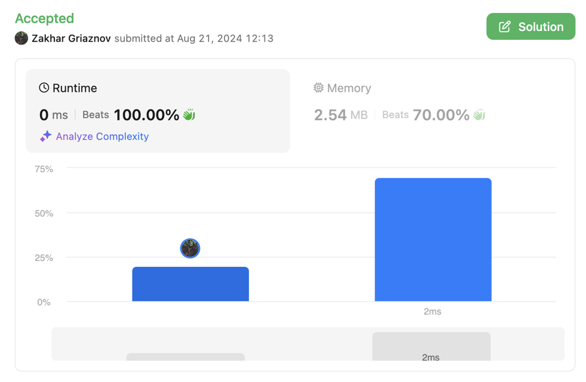

# Easy to understand Golang solution O(n) w/o extra space

**Author:** zkhrg
**Votes:** 0
**Link:** [https://leetcode.com/problems/statistics-from-a-large-sample/solutions/5668566/](https://leetcode.com/problems/statistics-from-a-large-sample/solutions/5668566/)

---



# Approach
<!-- Describe your approach to solving the problem. -->
Based on the constraints of the task, it is clear that we will not be allowed to create a separate sample array and fill it in and then calculate it comfortably. We will have to use the simulation pattern and calculate all the metrics in the first pass that do not require us to know the count of all numbers from the sample.
These are the metrics max, min, mean, mode.
They are counted in one loop.
Then, when we have the calculated number of elements from the sample, we can add a certain number to approach half of all the numbers.
And there are 3 options
If we added the number of the next digit and jumped half, then it is easy to understand that these will be consecutive numbers and we can just write down this number itself, if we stopped at exactly half, then we need to check whether the total number is even or not. Depending on this, we will look for the next element with a non-zero number and use it or just `(i + next_not_null_i) / 2`.

# Complexity
- Time complexity:
<!-- Add your time complexity here, e.g.  -->
$$O(n + n) = O(n)$$ 
- Space complexity:
<!-- Add your space complexity here, e.g. $$O(n)$$ -->
$$O(1)$$
# Code
```golang []
func sampleStats(count []int) []float64 {
	// min, max, mean, median, mode
	res := make([]float64, 5, 5)
	res[0] = 1 << 31
	c, mc := 0, 0
	for i, v := range count {
		if v != 0 {
			res[0] = min(res[0], float64(i))
			res[1] = max(res[1], float64(i))
		}
		res[2] += float64(i * v)
		if v > mc {
			mc = v
			res[4] = float64(i)
		}
		c += v
	}
	res[2] = res[2] / float64(c)
	cc := 0
	for i, v := range count {
		cc += v
		if cc == c/2{
            mi := i + 1
            for ; mi < len(count); mi++ {
                if count[mi] > 0 {
                    break
                }
            }
			if c%2 == 0 {
				res[3] = (float64(i) + float64(mi)) / 2.
			} else {
                res[3] = float64(mi)
            }
			break
		} else if cc > c/2 {
			res[3] = float64(i)
			break
		}
	}
	return res
}
```