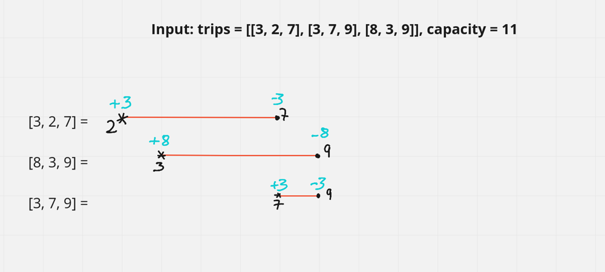
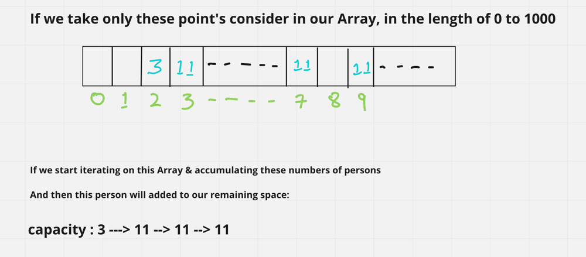
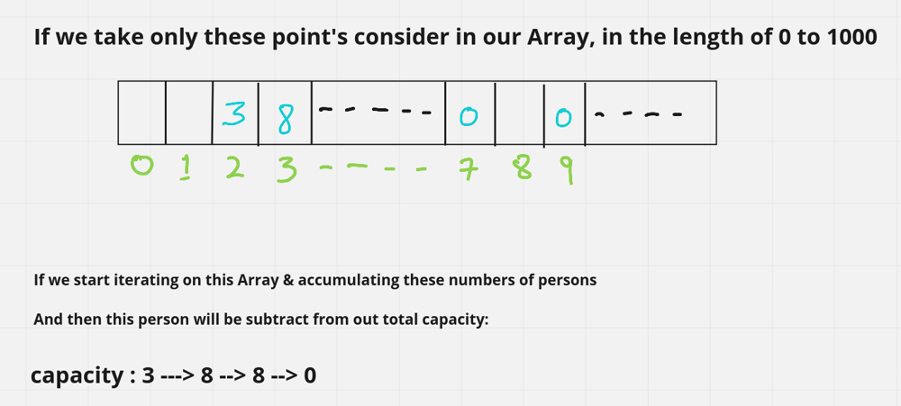

# ☕ Well Explained 2 Ways[Java/ C++/Python/JavaScript] || Easy for mind to Accept it

**Author:** hi-malik
**Votes:** 133
**Link:** [https://leetcode.com/problems/car-pooling/solutions/1669644/](https://leetcode.com/problems/car-pooling/solutions/1669644/)

---

**Intution :**
```
As we have 1000 stops.
So, we can just calculate how many passengers can get in and out at their location.
```
*`Car Pooling in simple word means, filling up with passengers! Like This:`*


**Approach :**
```
Process all trips, adding the passenger count to the start location and subtracting it from the end.\xA0

A positive value for a certain location after processing all trips indicates that we are getting more passengers;\xA0

And\xA0negative value indicates that we are getting more empty seats.

Finally, go over all of the stops to see if we've ever exceeded our vehicle's capacity
```





**JAVA**
```
class Solution {
    public boolean carPooling(int[][] trips, int capacity) {
        // Because from and to is between 0 and 1000. Idea is to store counts in an array of size 1001.
        int lengthOfTrip[] = new int[1001];
        for (int trip[] : trips){
            lengthOfTrip[trip[1]] += trip[0]; // Increment when passenger is on board
            lengthOfTrip[trip[2]] -= trip[0]; // decrement when they depart
        }
		// Count total passenger for each bus top
        int carLoad = 0;
        // we have the count array, we perform a line sweep from 0 to 1000 and track its total
        for (int i = 0; i < 1001; i++){
            carLoad += lengthOfTrip[i];
			// Reject when the car is overloaded somewhere
            if(carLoad > capacity) return false;
        }

        return true; // Accept only if all trip is safe
    }
}
```
**C++**
```
class Solution {
public:
    bool carPooling(vector<vector<int>>& trips, int capacity) {
        // Because from and to is between 0 and 1000. Idea is to store counts in an array of size 1001.
        vector<int> lengthOfTrip = vector<int>(1001);
        for (auto trip : trips){
            lengthOfTrip[trip[1]] += trip[0]; // Increment when passenger is on board
            lengthOfTrip[trip[2]] -= trip[0]; // decrement when they depart
        }
        // Count total passenger for each bus top
        int carLoad = 0;
        // we have the count array, we perform a line sweep from 0 to 1000 and track its total
        for (int i = 0; i < 1001 && carLoad <= capacity; i++){
            carLoad += lengthOfTrip[i];
            // Reject when the car is overloaded somewhere
            if(carLoad > capacity) return false;
        }

        return true; // Accept only if all trip is safe
  
```

**PYTHON**

```
class Solution:
    def carPooling(self, trips: List[List[int]], capacity: int) -> bool:
        # Because from and to is between 0 and 1000. Idea is to store counts in an array of size 1001.  
        lengthOfTrip = [ 0 for _ in range(1001)]
        
        # Update passenger change for each trip
        for trip, i, j in trips:
            lengthOfTrip[i] += trip # Increment when passenger is on board
            lengthOfTrip[j] -= trip # decrement when they depart
    
        carLoad = 0
        # Count total passenger for each bus top
        # we have the count array, we perform a line sweep from 0 to 1000 and track its total
        for i in range( len(lengthOfTrip) ):
            carLoad += lengthOfTrip[i] 
            if carLoad > capacity: # Reject when the car is overloaded somewhere
                return False                
        return True # Accept only if all trip is safe
```

*`Last Edit, Added JavaScript code`*

**JavaScript**

```
/**
 * @param {number[][]} trips
 * @param {number} capacity
 * @return {boolean}
 */
var carPooling = function(trips, capacity) {
	// Because from and to is between 0 and 1000. Idea is to store counts in an array of size 1001.
    let lengthOfTrip = Array(1001).fill( 0 );
      
	// Update passenger change for each trip
    for( const [trip, i, j] of trips){
        lengthOfTrip[i] += trip; // Increment when passenger is on board
        lengthOfTrip[j] -= trip; // decrement when they depart
    }
    
    let carLoad = 0; 
	// Count total passenger for each bus top
    // we have the count array, we perform a line sweep from 0 to 1000 and track its total
    for( let i = 0 ; i < lengthOfTrip.length ; i++ ){
        carLoad += lengthOfTrip[i];    
        if( carLoad > capacity ){ // Reject when the car is overloaded somewhere
            return false;
        } 
    }
    return true; // Accept only if all trip is safe
};
```

ANALYSIS :-
* **Time Complexity :-** BigO(n), where n is the number of trips.

* **Space Complexity :-** BigO(max(n, 1001))

**Similar Approach But in a Different Way :** 



**JAVA**
```
class Solution {
    public boolean carPooling(int[][] trips, int capacity) {
        int lengthOfTrip[] = new int[1001];
        
        for(int trip[] : trips){
            lengthOfTrip[trip[1]] += trip[0]; // Increment when passenger is on board
            lengthOfTrip[trip[2]] -= trip[0]; // decrement when they depart
        }
        
        for(int passenger : lengthOfTrip){
            capacity -= passenger;
            if(capacity < 0) return false;
        }
        return true;
    }
}
```

**C++**

```
class Solution {
public:
    bool carPooling(vector<vector<int>>& trips, int capacity) {
        vector<int> lengthOfTrip = vector<int>(1001);
        for (auto trip : trips){
            lengthOfTrip[trip[1]] += trip[0]; // Increment when passenger is on board
            lengthOfTrip[trip[2]] -= trip[0]; // decrement when they depart
        }
        for(auto passenger : lengthOfTrip){
            capacity -= passenger;
            if(capacity < 0) return false;
        }
        return true;
    }
};
```

**PYTHON**

```
class Solution:
    def carPooling(self, trips: List[List[int]], capacity: int) -> bool:
        lengthOfTrip = [ 0 for _ in range(1001)]
        
        for trip, i, j in trips:
            lengthOfTrip[i] += trip # Increment when passenger is on board
            lengthOfTrip[j] -= trip # decrement when they depart

        for passenger in lengthOfTrip:
            capacity -= passenger
            if capacity < 0:
                return False
        return True
```

*`Last Edit, Added JavaScript code`*

**JavaScript**

```
/**
 * @param {number[][]} trips
 * @param {number} capacity
 * @return {boolean}
 */
var carPooling = function(trips, capacity) {
	  
    let lengthOfTrip = Array(1001).fill( 0 );

    for( const [trip, i, j] of trips){
        
        lengthOfTrip[i] += trip; // Increment when passenger is on board
        lengthOfTrip[j] -= trip; // decrement when they depart
    }

    for( const passenger of lengthOfTrip){ 
        capacity -= passenger;  
        if( capacity < 0 ){ 
            return false;
        } 
    }
    return true; 
};
```

ANALYSIS :-
* **Time Complexity :-** BigO(n), where n is the number of trips.

* **Space Complexity :-** BigO(max(n, 1001))