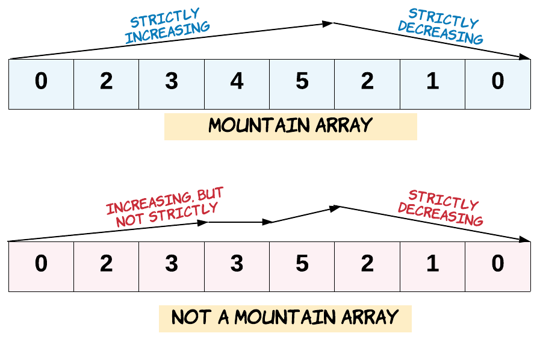

# 🚀 100% || Binary Search || Explained Intuition 🚀

**Author:** MohamedMamdouh20
**Votes:** 131
**Link:** [https://leetcode.com/problems/find-in-mountain-array/solutions/4159000/](https://leetcode.com/problems/find-in-mountain-array/solutions/4159000/)

---

# Porblem Description
The problem requires **finding** the **minimum** index in a `mountain array` where a given `target` is located. 

- A mountain array is defined as an array that satisfies the conditions:
    - The array has a length **greater** than or **equal** to `3`.
    - There exists an index `i` `(0 < i < arr.length - 1)` such that elements from index `0` up to `i` are in strictly **increasing** order, and elements from index `i` onwards are in strictly **decreasing** order.



The **task** is to return the **index** of the **target** element in the mountain array using the given `MountainArray` interface. If the target is not present, return `-1`. 
The solution should not make more than `100` calls to `MountainArray`.get.

- **Constraints:**
    - `3 <= mountain_arr.length() <= 10e4`
    - `0 <= target <= 10e9`
    - `0 <= mountain_arr.get(index) <= 10e9`
    - `Maximum No of calls to MountainArray <= 100`

---


# Intuition

Hi there, Friends. \uD83D\uDE03

Let's take a look at today's problem.\uD83D\uDC40
We have a mountain array and we must find the minimum index of element `target` in it or return `-1` or it doesn't exist.\uD83E\uDD14
As we know, that mountain array consists of two **parts**: **Increasing** part and **decreasing** part and the **shared** element between them is called the `peak`.

The **first** thing that can pop into mind \uD83C\uDF7F is why not to use **linear search**?\uD83E\uDD14
That's the first thing popped into my mind \uD83D\uDE05 since it was the easiest solution.
but **Unfotunately**, we are **limited** by number of calls we can make to the `MountainArray` API which is maximum `100` calls and the size of the array can reach $10^4$.
So, **linear search** is invalid solution.\uD83D\uDE14\uD83D\uDE14

Sadly, We are left only with **logarithmic operations**.\uD83E\uDD28
How can we use logarithmic operation to solve our problem?
I will pretend that I didn't say the solution in the title.\uD83D\uDE02

Let's look at some **features** of the mountain array:
```
EX1: [1, 4, 5, 10, 9, 7, 2]
```
```
EX2: [1, 4, 3, 2, 1]
```
```
EX3: [1, 2, 8, 10, 12, 14, 9]
```

What can we see?
We can see that the mountain array consists of two **smaller** array and each of them is **sorted** array.\uD83E\uDD2F
```
[1, 4, 5, 10, 9, 7, 2] = [1, 4, 5, 10] + [9, 7, 2]
```
```
[1, 2, 8, 10, 12, 14, 9] = [1, 2, 8, 10, 12, 14] + [9]
```
The **sorting** property is very **important**, how can we make use of it?\uD83E\uDD14
of course **Binary Search**, the hero of our day.\uD83E\uDDB8\u200D\u2642\uFE0F

**Binary Search** is a logarithmic algorithm in O(log(N)) operations.
How can we use **Binary Search**?
First, We need to know the boundaries of our two **sorted** array. By finding the peak element by using **Binary Search**. So we are sure that the elements before it are **sorted** and the elements after it are **sorted**.\uD83E\uDD2F

What next\u2753
Since, we are required to find the **minimum** index if the element exists so we will search the first part of the array using **Binary Search** then the second part also using **Binary Search**.
But the **Binary Search** for the second part is reversed **Binary Search** which means that we will move opposite of our regular directions.

But what if we didn't find our element after all?\uD83E\uDD14
Then simply, it doesn't exist in our array and we will return `-1`.

But we are limited with `100` calls to the API, can this work?
- Let's compute the **number** of calls:
    - **Finding** the `peak` in `log(N)`: $log(10^4)$ = `14`.
    - **Searching** the **first** part in `log(N)`: $log(10^4)$ = `14`.
    - **Searching** the **second** part in `log(N)`: $log(10^4)$ = `14`.

Our total calls to the API if we have an array of  size $10^4$ are `14 * 3 = 42` calls which are far less than `100` calls. so we are sure that our approach is a valid one.\u270C

And this is the solution for our today'S problem I hope that you understood it\uD83D\uDE80\uD83D\uDE80


---


# Approach
1. Using a **binary search** `findPeakIndex` to locate the peak index of the mountain array. 
2. Perform a **binary search** for the target in the increasing part of the mountain array `from index 0 to the peak index`. 
    - Use the `binarySearch` method with the `reversed` parameter set to `false`.
    - If the target is **found** in the **increasing** part, return the `index`.
3. If the target is **not found** in the **increasing** part, perform a **binary search** for the target in the **decreasing** part of the mountain array `from the peak index to the end`.
    - Use the `binarySearch` method with the `reversed` parameter set to `true`.
    - If the target is **found** in the **decreasing** part, return the **index**.
4. If the target is **not found** in **either** part of the array, return `-1` to indicate the **absence** of the target.


# Complexity
- **Time complexity:** $O(log(N))$
Since we are performing binary search three times: one time to find the peak, another time to find the target in increasing part and last time to find it in decreasing part.
This cost us `(3 * log(N))` which is `O(log(N))`.
where `N` is the size of Mountain Array. 
- **Space complexity:** $O(1)$
Since we are using only constant variables and not using anyother data structures.


---


# Code

```C++ []
class Solution {
public:
    int findInMountainArray(int target, MountainArray &mountainArr) {
        int length = mountainArr.length();

        // Find the index of the peak element in the mountain array.
        int peakIndex = findPeakIndex(1, length - 2, mountainArr);

        // Binary search for the target in the increasing part of the mountain array.
        int increasingIndex = binarySearch(0, peakIndex, target, mountainArr, false);
        if (mountainArr.get(increasingIndex) == target) 
            return increasingIndex; // Target found in the increasing part.

        // Binary search for the target in the decreasing part of the mountain array.
        int decreasingIndex = binarySearch(peakIndex + 1, length - 1, target, mountainArr, true);
        if (mountainArr.get(decreasingIndex) == target) 
            return decreasingIndex; // Target found in the decreasing part.

        return -1;  // Target not found in the mountain array.
    }

    int findPeakIndex(int low, int high, MountainArray &mountainArr) {
        while (low != high) {
            int mid = low + (high - low) / 2;
            if (mountainArr.get(mid) < mountainArr.get(mid + 1)) {
                low = mid + 1; // Move to the right side (increasing slope).
            } else {
                high = mid; // Move to the left side (decreasing slope).
            }
        }
        return low; // Return the index of the peak element.
    }

    int binarySearch(int low, int high, int target, MountainArray &mountainArr, bool reversed) {
        while (low != high) {
            int mid = low + (high - low) / 2;
            if (reversed) {
                if (mountainArr.get(mid) > target)
                    low = mid + 1; // Move to the right side for a decreasing slope.
                else
                    high = mid; // Move to the left side for an increasing slope.
            } else {
                if (mountainArr.get(mid) < target)
                    low = mid + 1; // Move to the right side for an increasing slope.
                else
                    high = mid; // Move to the left side for a decreasing slope.
            }
        }
        return low; // Return the index where the target should be or would be inserted.
    }
};
```
```Java []
class Solution {
    public int findInMountainArray(int target, MountainArray mountainArr) {
        int length = mountainArr.length();

        // Find the index of the peak element in the mountain array.
        int peakIndex = findPeakIndex(1, length - 2, mountainArr);

        // Binary search for the target in the increasing part of the mountain array.
        int increasingIndex = binarySearch(0, peakIndex, target, mountainArr, false);
        if (mountainArr.get(increasingIndex) == target) 
            return increasingIndex; // Target found in the increasing part.

        // Binary search for the target in the decreasing part of the mountain array.
        int decreasingIndex = binarySearch(peakIndex + 1, length - 1, target, mountainArr, true);
        if (mountainArr.get(decreasingIndex) == target) 
            return decreasingIndex; // Target found in the decreasing part.

        return -1;  // Target not found in the mountain array.
    }

    private int findPeakIndex(int low, int high, MountainArray mountainArr) {
        while (low != high) {
            int mid = low + (high - low) / 2;
            if (mountainArr.get(mid) < mountainArr.get(mid + 1)) {
                low = mid + 1; // Move to the right side (increasing slope).
            } else {
                high = mid; // Move to the left side (decreasing slope).
            }
        }
        return low; // Return the index of the peak element.
    }

    private int binarySearch(int low, int high, int target, MountainArray mountainArr, boolean reversed) {
        while (low != high) {
            int mid = low + (high - low) / 2;
            if (reversed) {
                if (mountainArr.get(mid) > target)
                    low = mid + 1; // Move to the right side for a decreasing slope.
                else
                    high = mid; // Move to the left side for an increasing slope.
            } else {
                if (mountainArr.get(mid) < target)
                    low = mid + 1; // Move to the right side for an increasing slope.
                else
                    high = mid; // Move to the left side for a decreasing slope.
            }
        }
        return low; // Return the index where the target should be or would be inserted.
    }
}
```
```Python []
class Solution:
    def findInMountainArray(self, target: int, mountain_arr: 'MountainArray') -> int:
        length = mountain_arr.length()

        # Find the index of the peak element in the mountain array.
        peak_index = self.find_peak_index(1, length - 2, mountain_arr)

        # Binary search for the target in the increasing part of the mountain array.
        increasing_index = self.binary_search(0, peak_index, target, mountain_arr, False)
        if mountain_arr.get(increasing_index) == target:
            return increasing_index  # Target found in the increasing part.

        # Binary search for the target in the decreasing part of the mountain array.
        decreasing_index = self.binary_search(peak_index + 1, length - 1, target, mountain_arr, True)
        if mountain_arr.get(decreasing_index) == target:
            return decreasing_index  # Target found in the decreasing part.

        return -1  # Target not found in the mountain array.

    def find_peak_index(self, low, high, mountainArr):
        while low != high:
            mid = low + (high - low) // 2
            if mountainArr.get(mid) < mountainArr.get(mid + 1):
                low = mid + 1  # Move to the right side (increasing slope).
            else:
                high = mid  # Move to the left side (decreasing slope).
        return low  # Return the index of the peak element.

    def binary_search(self, low, high, target, mountainArr, reversed):
        while low != high:
            mid = low + (high - low) // 2
            if reversed:
                if mountainArr.get(mid) > target:
                    low = mid + 1  # Move to the right side for a decreasing slope.
                else:
                    high = mid  # Move to the left side for an increasing slope.
            else:
                if mountainArr.get(mid) < target:
                    low = mid + 1  # Move to the right side for an increasing slope.
                else:
                    high = mid  # Move to the left side for a decreasing slope.
        return low  # Return the index where the target should be or would be inserted.
```


