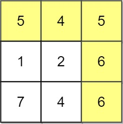
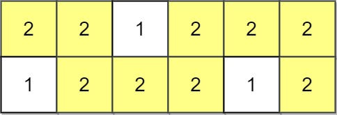
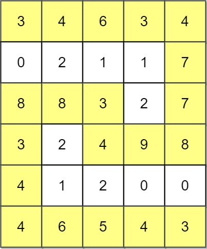

# [1102. Path With Maximum Minimum Value](https://leetcode.com/problems/path-with-maximum-minimum-value/)

| Category | Difficulty | Likes | Dislikes |
| :------: | :--------: | :---: | :------: |
| Algorithms | Medium | 1349 | 126 |

**Tags:** [`array`](https://leetcode.com/tag/array), [`binary-search`](https://leetcode.com/tag/binary-search), [`depth-first-search`](https://leetcode.com/tag/depth-first-search), [`breadth-first-search`](https://leetcode.com/tag/breadth-first-search), [`union-find`](https://leetcode.com/tag/union-find), [`heap-priority-queue`](https://leetcode.com/tag/heap-priority-queue), [`matrix`](https://leetcode.com/tag/matrix)

**Companies:** `google`, `amazon`

## Description

Given an `m x n` integer matrix `grid`, return *the maximum **score** of a path starting at *`(0, 0)`* and ending at *`(m - 1, n - 1)` moving in the 4 cardinal directions.

The **score** of a path is the minimum value in that path.

	- For example, the score of the path `8 &rarr; 4 &rarr; 5 &rarr; 9` is `4`.

 

**Example 1:**


```

Input: grid = [[5,4,5],[1,2,6],[7,4,6]]
Output: 4
Explanation: The path with the maximum score is highlighted in yellow. 

```

**Example 2:**


```

Input: grid = [[2,2,1,2,2,2],[1,2,2,2,1,2]]
Output: 2

```

**Example 3:**


```

Input: grid = [[3,4,6,3,4],[0,2,1,1,7],[8,8,3,2,7],[3,2,4,9,8],[4,1,2,0,0],[4,6,5,4,3]]
Output: 3

```

 

**Constraints:**

	- `m == grid.length`

	- `n == grid[i].length`

	- `1 <= m, n <= 100`

	- `0 <= grid[i][j] <= 10^9`

---

**Links:** [Submissions](https://leetcode.com/problems/path-with-maximum-minimum-value/) | [Solutions](https://leetcode.com/problems/path-with-maximum-minimum-value/)
