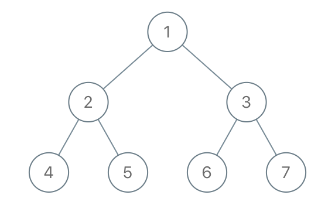

# [1110. Delete Nodes And Return Forest](https://leetcode.com/problems/delete-nodes-and-return-forest/)

| Category | Difficulty | Likes | Dislikes |
| :------: | :--------: | :---: | :------: |
| Algorithms | Medium | 4762 | 144 |

**Tags:** [`array`](https://leetcode.com/tag/array), [`hash-table`](https://leetcode.com/tag/hash-table), [`tree`](https://leetcode.com/tag/tree), [`depth-first-search`](https://leetcode.com/tag/depth-first-search), [`binary-tree`](https://leetcode.com/tag/binary-tree)

**Companies:** `google`, `pinterest`, `facebook`, `amazon`

## Description

Given the `root` of a binary tree, each node in the tree has a distinct value.

After deleting all nodes with a value in `to_delete`, we are left with a forest (a disjoint union of trees).

Return the roots of the trees in the remaining forest. You may return the result in any order.

 

**Example 1:**


```

Input: root = [1,2,3,4,5,6,7], to_delete = [3,5]
Output: [[1,2,null,4],[6],[7]]

```

**Example 2:**

```

Input: root = [1,2,4,null,3], to_delete = [3]
Output: [[1,2,4]]

```

 

**Constraints:**

	- The number of nodes in the given tree is at most `1000`.

	- Each node has a distinct value between `1` and `1000`.

	- `to_delete.length <= 1000`

	- `to_delete` contains distinct values between `1` and `1000`.

---

**Links:** [Submissions](https://leetcode.com/problems/delete-nodes-and-return-forest/) | [Solutions](https://leetcode.com/problems/delete-nodes-and-return-forest/)
